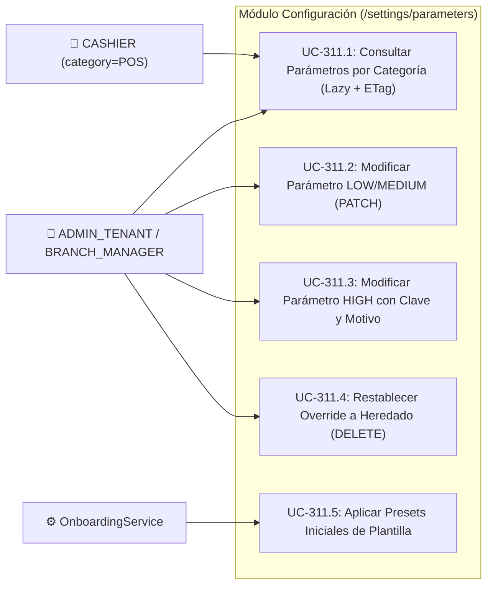

# ⚙️ Casos de Uso: Módulo de Configuración y Parametrización Multinivel

Este documento formaliza la especificación funcional y la matriz de permisos para el **Módulo de Configuración y Parámetros Dinámicos** (`modules.configuration`), alineado con [ADR-0008](../../../adr/0008_unified_multilevel_parameter_system.md), [ADR-0025](../../../adr/0025_parameter_console_humanization_json_catalog_and_contextual_help.md) y `parameters-catalog.json` (**20 parámetros operativos**).

---

## 👥 1. Actores y Matriz de Permisos RBAC

| Caso de Uso | Identificador | Actor Principal | Permiso / Regla Real (`ConfigurationController`) | Alcance Jerárquico |
| :--- | :--- | :--- | :--- | :--- |
| **Consultar Catálogo y Valores Efectivos** | `UC-311.1` | `ADMIN_TENANT`, `BRANCH_MANAGER`, Operador POS | `settings:read` *(o `pos:access` / `ROLE_CASHIER` si `category=POS`)* | `TENANT`, `BRANCH` |
| **Modificar Parámetro Operativo (`LOW`/`MEDIUM`)** | `UC-311.2` | `ADMIN_TENANT`, `BRANCH_MANAGER` | `settings:write` | `TENANT`, `BRANCH` |
| **Modificar Parámetro Crítico (`HIGH`)** | `UC-311.3` | `ADMIN_TENANT` / Usuario con `settings:write` | `settings:write` + `passwordConfirmation` + `auditReason` (`>= 10` caracteres) | `TENANT`, `BRANCH` |
| **Restablecer Parámetro al Valor Heredado** | `UC-311.4` | `ADMIN_TENANT`, `BRANCH_MANAGER` | `settings:write` | `TENANT` / `BRANCH` (elimina override) |
| **Aprovisionar Parámetros Semilla (Onboarding)** | `UC-311.5` | Dueño vía Onboarding / `SUPERADMIN` | Público (`/api/v1/auth/onboarding`) o creación Backoffice | `TENANT` |

> [!NOTE]
> Los parámetros globales exclusivos de infraestructura/plataforma SaaS (`storage.active_provider`, `storage.max_file_size_bytes`) no residen en `system_parameter_values`; se gestionan en `platform_settings` desde el Backoffice React ([ADR-0028](../../../adr/0028_agnostic_media_storage_and_platform_settings.md)).

---

## 🗺️ 2. Diagrama de Casos de Uso (Mermaid)

---

## 📋 3. Especificación Detallada de Casos de Uso

### UC-311.1: Consultar Parámetros con Carga Diferida por Categorías

- **Precondiciones:** Usuario autenticado con permiso `settings:read` (o `pos:access` / `ROLE_CASHIER` al solicitar `category=POS`).
- **Flujo Principal:**
  1. El cliente Angular (`/settings/parameters` o `/pos`) solicita `GET /api/v1/parameters?category={CAT}&branchId={BRANCH_ID}`.
  2. El backend lee las definiciones humanizadas desde `SystemParameterCatalog` (cargado desde `parameters-catalog.json`) y resuelve la cascada en memoria:
     `Branch Override -> Tenant Override -> Global Override -> Catalog Default`.
  3. Responde `200 OK` con lista de `SystemParameterDto` (incluyendo etiquetas humanizadas, opciones descriptivas, `effectiveValue`, `inheritedFrom`, `criticality`, ejemplos y palabras clave) o `304 Not Modified` si coincide `ETag`.

### UC-311.2: Modificar Parámetro Operativo (`LOW` o `MEDIUM`)

- **Precondiciones:** Usuario con `settings:write`. Parámetro con `criticality = LOW | MEDIUM`.
- **Flujo Principal:**
  1. El usuario ajusta el valor en `/settings/parameters` (selector traducido, switch booleano o input numérico).
  2. El cliente envía `PATCH /api/v1/parameters/{key}` con `UpdateParameterRequest(scope, branchId, value, passwordConfirmation, auditReason)`.
  3. `ConfigurationServiceImpl` valida tipo de dato/opciones permitidas, persiste en `system_parameter_values`, desaloja la caché en memoria (hot-reload en $O(1)$) y publica `ParameterUpdatedEvent`.
  4. Responde `200 OK` con el `SystemParameterDto` actualizado.

### UC-311.3: Modificar Parámetro Crítico (`HIGH`) con Confirmación de Contraseña y Auditoría

- **Precondiciones:** Usuario con permiso `settings:write`. Parámetro catalogado con `criticality = HIGH` (ej. `inventory.deduction_mode`, `catalog.scope_mode`, `finance.shift_concurrency_mode`).
- **Flujo Principal:**
  1. El frontend despliega un diálogo de confirmación reforzada advirtiendo el impacto financiero/operativo del cambio.
  2. El usuario ingresa su contraseña actual (`passwordConfirmation`) y una justificación obligatoria (`auditReason` con mínimo **10 caracteres**).
  3. El frontend envía `PATCH /api/v1/parameters/{key}`.
  4. `ConfigurationServiceImpl` verifica la contraseña mediante Argon2id/BCrypt contra el usuario autenticado y exige `auditReason.trim().length() >= 10`.
  5. Si es válido, actualiza `system_parameter_values` con `updatedBy` y `auditReason`, invalida la caché de forma atómica y publica `ParameterUpdatedEvent`.
- **Flujos Alternativos / Excepciones:**
  - **Contraseña inválida:** `401 Unauthorized` / error de credenciales sin mutar el parámetro.
  - **Motivo ausente o menor a 10 caracteres:** `400 Bad Request` (`RFC 7807`).

### UC-311.4: Restablecer Parámetro al Valor Heredado (`DELETE`)

- **Precondiciones:** Usuario con `settings:write` y existencia de un override en el alcance `scope` indicado.
- **Flujo Principal:**
  1. El usuario pulsa **"Restablecer valor heredado"** sobre un parámetro personalizado en `BRANCH` o `TENANT`.
  2. El frontend envía `DELETE /api/v1/parameters/{key}?scope={TENANT|BRANCH}&branchId={BRANCH_ID}`.
  3. El backend elimina la fila correspondiente en `system_parameter_values`, invalida la caché y el parámetro vuelve automáticamente al nivel superior o default de catálogo (*Sparse Storage*).

### UC-311.5: Aprovisionar Parámetros Semilla en Onboarding

- **Flujo Principal:**
  1. Al completar `POST /api/v1/auth/onboarding` (o crear tenant vía Backoffice), `OnboardingServiceImpl` escribe únicamente los overrides divergentes de la plantilla elegida (`FAST_FOOD`, `TRADITIONAL`, `CAFE`; `EMPTY` hereda 100% los defaults) sin poblar filas redundantes.

---

## 📦 4. Catálogo Completo de Parámetros Operativos (20 Entradas Reales en `parameters-catalog.json`)

| # | Clave Canónica (`key`) | Categoría | Ámbito Permitido | Tipo | Valor por Defecto | Criticidad |
| :---: | :--- | :--- | :--- | :--- | :--- | :--- |
| 1 | `inventory.deduction_mode` | `INVENTORY` | `TENANT` | `ENUM` (`AUTOMATIC_PERMISSIVE`, `AUTOMATIC_STRICT`, `MANUAL_ISOLATED`) | `AUTOMATIC_PERMISSIVE` | `HIGH` |
| 2 | `inventory.allow_negative_stock` | `INVENTORY` | `TENANT` | `BOOLEAN` | `false` | `HIGH` |
| 3 | `pos.display_dish_images` | `POS` | `BRANCH` | `BOOLEAN` | `true` | `LOW` |
| 4 | `pos.default_order_mode` | `POS` | `BRANCH` | `ENUM` (`DINE_IN`, `TAKEOUT`, `DELIVERY`, `SCHEDULED_PICKUP`) | `DINE_IN` | `LOW` |
| 5 | `pos.allow_scheduled_pickup` | `POS` | `BRANCH` | `BOOLEAN` | `true` | `LOW` |
| 6 | `pos.delivery_fee_enabled` | `POS` | `BRANCH` | `BOOLEAN` | `false` | `LOW` |
| 7 | `pos.delivery_fee_default` | `POS` | `BRANCH` | `DOUBLE` | `0.00` | `LOW` |
| 8 | `pos.cancellation_prepared_waste_policy` | `POS` | `BRANCH` | `ENUM` (`ALLOW_AUTO_BUFFER_REUSE`, `STRICT_WASTE`, `ALLOW_BUFFER_REUSE`) | `ALLOW_AUTO_BUFFER_REUSE` | `MEDIUM` |
| 9 | `finance.max_petty_cash_expense` | `FINANCE` | `BRANCH` | `DOUBLE` | `100.00` | `MEDIUM` |
| 10 | `finance.require_supervisor_pin_cancel` | `FINANCE` | `TENANT` | `BOOLEAN` | `true` | `HIGH` |
| 11 | `finance.shift_opening_policy` | `FINANCE` | `BRANCH` | `ENUM` (`ALL_AUTHORIZED`, `SUPERVISOR_ONLY`) | `ALL_AUTHORIZED` | `MEDIUM` |
| 12 | `finance.shift_concurrency_mode` | `FINANCE` | `BRANCH` | `ENUM` (`SINGLE_PER_BRANCH`, `INDIVIDUAL_PER_CASHIER`) | `SINGLE_PER_BRANCH` | `HIGH` |
| 13 | `finance.expense_allow_self_approval` | `FINANCE` | `BRANCH` | `BOOLEAN` | `false` | `MEDIUM` |
| 14 | `security.require_user_email` | `SECURITY` | `TENANT` | `BOOLEAN` | `true` | `HIGH` |
| 15 | `security.enforce_password_change_on_reset` | `SECURITY` | `TENANT` | `BOOLEAN` | `true` | `HIGH` |
| 16 | `security.session_inactivity_timeout_minutes` | `SECURITY` | `TENANT` | `INTEGER` | `15` | `MEDIUM` |
| 17 | `company.currency` | `GENERAL` | `BRANCH` | `STRING` | `BOB` | `MEDIUM` |
| 18 | `company.timezone` | `GENERAL` | `BRANCH` | `STRING` | `America/La_Paz` | `MEDIUM` |
| 19 | `catalog.scope_mode` | `POS` | `TENANT` | `ENUM` (`BRANCH_ISOLATED`, `GLOBAL_SHARED`) | `BRANCH_ISOLATED` | `HIGH` |
| 20 | `finance.auto_open_full_catalog_session` | `FINANCE` | `BRANCH` | `BOOLEAN` | `true` | `HIGH` |

---

## Documentos Relacionados
- [Mapa Macro de Casos de Uso](./use_cases_overview.md)
- [Casos de Uso de Empresa y Sucursales](./use_cases_company.md)
- [Casos de Uso de Onboarding](./use_cases_onboarding.md)
- [Casos de Uso de Catálogo](./use_cases_catalog.md)
- [Casos de Uso de Finanzas](./use_cases_finance.md)
- [Casos de Uso de RBAC y Perfil](./use_cases_rbac.md)
- [Casos de Uso de Sesiones y Seguridad](./use_cases_sessions.md)
- [Secuencia de Resolución de Parámetros y Hot-Reload](../04-behavior-and-flows/sequence_parameter_resolution_and_hot_reload.md)
- [Manual de Dueño, Finanzas, Personal y Reglas](../../../manuals/restaurante/06_dueno_finanzas_personal_y_reglas.md)
- [ADR-0002: Modelo Multi-Tenant Híbrido y Configuración Dinámica](../../../adr/0002_hybrid_tenancy_and_dynamic_settings.md)
- [ADR-0008: Sistema Unificado de Parámetros Multinivel](../../../adr/0008_unified_multilevel_parameter_system.md)
- [ADR-0025: Humanización de Parámetros y Catálogo JSON](../../../adr/0025_parameter_console_humanization_json_catalog_and_contextual_help.md)
- [ADR-0030: Aislamiento del Catálogo por Sucursal por Defecto](../../../adr/0030_catalog_branch_isolation_by_default.md)
- [ADR-0031: Sesiones de Servicio por Sucursal y Combos Dinámicos](../../../adr/0031_branch_service_sessions_and_dynamic_combos.md)
