# 💰 Casos de Uso - Módulo de Finanzas, Control de Caja y Autorizaciones

El módulo de **Finanzas** (`modules.finance`) gobierna los turnos de caja (único por sucursal o concurrente por cajero), los gastos menores de caja chica, la bandeja unificada de autorizaciones (incluyendo PIN rápido de supervisor), el control de caja operativo en `/cash-control` y la auditoría histórica gerencial con exportación CSV en `/finance`.

---

## 🗺️ 1. Diagrama General de Casos de Uso del Módulo Finanzas

```mermaid
flowchart TB
    Cashier["👤 CASHIER (/cash-control)"]
    Sup["👤 BRANCH_MANAGER / ADMIN_TENANT (/finance & PIN)"]
    Sys["⚙️ Sistema Reactivo (@ApplicationModuleListener)"]

    subgraph Mod_Fin["Módulo Finanzas (modules.finance)"]
        UC01["UC-FIN-01: Apertura de Turno (Single / Multi-Cajero)"]
        UC02["UC-FIN-02: Acumulación en Vivo (Ventas y Reembolsos)"]
        UC03["UC-FIN-03: Registro de Gasto (Tope y Autoaprobación)"]
        UC04["UC-FIN-04: Aprobación / Rechazo de Gasto"]
        UC05["UC-FIN-05: Cierre de Turno y Arqueo Ciego"]
        UC06["UC-FIN-06: Control de Caja en Vivo (/cash-control)"]
        UC07["UC-FIN-07: Histórico Multicriterio, Drill-Down y CSV (/finance)"]
        UC08["UC-FIN-08: Consolidación y Reapertura de Turnos"]
        UC09["UC-FIN-09: Bandeja de Autorizaciones (Gastos y Cancelaciones)"]
        UC10["UC-FIN-10: Validación Rápida por PIN de Supervisor"]
    end

    Cashier --> UC01
    Cashier --> UC03
    Cashier --> UC05
    Cashier --> UC06
    Cashier --> UC09
    Sup --> UC01
    Sup --> UC04
    Sup --> UC07
    Sup --> UC08
    Sup --> UC09
    Sup --> UC10
    Sys --> UC02
```

---

## 📝 2. Especificación Detallada de Casos de Uso

### UC-FIN-01: Apertura de Turno de Caja (Modo Único o Multi-Cajero)

| Atributo | Detalle |
| :--- | :--- |
| **Identificador** | `UC-FIN-01` |
| **Actor Principal** | `CASHIER` o `BRANCH_MANAGER` (`finance:shifts` o `finance:shifts_supervisor`) |
| **Precondiciones** | Permiso acorde a `finance.shift_opening_policy` (`ALL_AUTHORIZED` o `SUPERVISOR_ONLY`). |
| **Flujo Principal** | 1. El operador captura el fondo inicial (`initialCash >= 0`) en `/cash-control` o desde el modal directo en `/pos` y envía `POST /api/v1/finance/shifts/open` (`OpenShiftRequest(branchId, initialCash, menuTemplateId, customQuotas)`). 2. `CashShiftService` verifica `finance.shift_concurrency_mode`:    - `SINGLE_PER_BRANCH`: impide abrir si ya existe otro turno `OPEN` en la sucursal (`409 Conflict`).    - `INDIVIDUAL_PER_CASHIER`: permite varios turnos simultáneos de distintos usuarios, impidiendo solo que el mismo usuario abra dos turnos a la vez. 3. Vincula el turno a la `BranchServiceSession` activa de la sucursal (`cash_shifts.service_session_id`); si no existe sesión y `finance.auto_open_full_catalog_session = true`, crea automáticamente una sesión `FULL_CATALOG`. 4. Retorna `201 Created` con `CashShiftDto` y actualiza `activeShift` local en Dexie. |

---

### UC-FIN-02: Acumulación en Vivo de Ventas y Reembolsos por Cancelación

| Atributo | Detalle |
| :--- | :--- |
| **Identificador** | `UC-FIN-02` |
| **Actor Principal** | Sistema Reactivo (`OrderPaidEvent`, `OrderCancelledEvent`) |
| **Flujo Principal** | 1. Cada `OrderPaidEvent` incrementa el contador del turno correspondiente según método (`totalCashSales`, `totalCardSales`, `totalOtherSales` para QR/Transferencia). 2. Cada `OrderCancelledEvent` con `refundMethod = CASH` incrementa `totalCashRefunds` del turno para cuadrar el arqueo físico sin discrepancias artificiales. 3. La UI consulta el turno propio (`GET /api/v1/finance/shifts/current`) o todos los turnos concurrentes de la sucursal (`GET /api/v1/finance/shifts/active`). |

---

### UC-FIN-03: Registro de Gasto de Caja Chica (Evidencia, Tope y Autoaprobación)

| Atributo | Detalle |
| :--- | :--- |
| **Identificador** | `UC-FIN-03` |
| **Actor Principal** | Colaborador con `finance:expenses_create` |
| **Flujo Principal** | 1. Envía `POST /api/v1/finance/expenses` con `CreateExpenseRequest(branchId, cashShiftId, expenseType, description, amount, paidFromCashDrawer, evidenceUrl, expenseDate)` (`expenseType`: `DAILY_OPERATIONAL | MONTHLY_FIXED_PRORATED`; `expenseDate` es `LocalDate` puro `YYYY-MM-DD`). 2. Si `paidFromCashDrawer = true`, el backend valida que `amount <= finance.max_petty_cash_expense` (default `100.00`). 3. Evalúa autoaprobación: si el solicitante tiene rol `ADMIN_TENANT`/`SUPERADMIN`, o posee `finance:expenses_approve` con `finance.expense_allow_self_approval = true`, se aprueba automáticamente; en caso contrario nace en **`PENDING_APPROVAL`** y genera solicitud en `shift_authorizations`. |

---

### UC-FIN-04: Aprobación o Rechazo de Gasto por Supervisor

| Atributo | Detalle |
| :--- | :--- |
| **Identificador** | `UC-FIN-04` |
| **Actor Principal** | Supervisor / Administrador (`finance:expenses_approve`) |
| **Flujo Principal** | 1. El supervisor revisa descripción, fecha y comprobante (`evidenceUrl`) del gasto pendiente. 2. Envía `POST /api/v1/finance/expenses/{expenseId}/approve` con `ExpenseApprovalRequest(status, approvalNotes)` (`APPROVED | REJECTED`). 3. Si se aprueba y `paidFromCashDrawer = true`, suma al `totalCashExpenses` del turno para la fórmula de arqueo. |

---

### UC-FIN-05: Cierre de Turno y Conciliación de Arqueo Ciego

| Atributo | Detalle |
| :--- | :--- |
| **Identificador** | `UC-FIN-05` |
| **Actor Principal** | Cajero dueño del turno o Supervisor (`finance:shifts` / `finance:shifts_supervisor`) |
| **Flujo Principal** | 1. El operador cuenta el efectivo físico de gaveta y envía `POST /api/v1/finance/shifts/{shiftId}/close` con `CloseShiftRequest(actualCash, notes)`. 2. El backend calcula el efectivo teórico real bajo la fórmula canónica:    `expected_cash = initial_cash + total_cash_sales - total_cash_expenses_approved - total_cash_refunds` 3. Calcula `difference = actual_cash - expected_cash`, cambia el turno a estado `CLOSED` y registra `closedBy` / `closedAt`. *(Nota: también limpia los platos remanentes en `PreparedDishBuffer` cuando aplica cierre de inventario de vitrina).* |

---

### UC-FIN-06: Control Operativo de Caja en Vivo (`/cash-control`)

| Atributo | Detalle |
| :--- | :--- |
| **Identificador** | `UC-FIN-06` |
| **Actor Principal** | `CASHIER` (`finance:shifts` en `/cash-control`) |
| **Flujo Principal** | 1. En `/cash-control`, el cajero visualiza únicamente su jornada en curso (fondo inicial, desglose por método, gastos del turno, comandas cobradas y canceladas del turno) sin exposición de historiales gerenciales. 2. Gestiona sus solicitudes pendientes mediante `<app-authorization-queue>` en modo `CASHIER`, pudiendo invocar autorización presencial por PIN. |

---

### UC-FIN-07: Histórico Multicriterio, Auditoría Detallada y Exportación CSV (`/finance`)

| Atributo | Detalle |
| :--- | :--- |
| **Identificador** | `UC-FIN-07` |
| **Actor Principal** | `ADMIN_TENANT`, Supervisor (`finance:reports`, `finance:shifts_supervisor`, `finance:expenses_approve` o `reports:view`) |
| **Flujo Principal** | 1. En `/finance`, consulta `GET /api/v1/finance/shifts/history` enviando filtros multicriterio (`branchId`, `startDate`, `endDate` evaluados estrictamente en `branches.timezone`, `cashierId`, `status`, `discrepancyType`, `limit`) ejecutados con JPA `Specification` en PostgreSQL. 2. Para auditar un turno específico (*drill-down*), invoca `GET /api/v1/finance/shifts/{shiftId}/audit-detail` (`ShiftAuditDetailDto` en `<app-shift-detail-modal>`) o `GET /api/v1/finance/shifts/{shiftId}/summary` (`CashShiftSummaryDto`), inspeccionando ventas por método (`cashSales`, `cardSales`, `qrSales`, `transferSales`), órdenes, gastos y reembolsos. 3. Exporta la tabla filtrada desde el cliente usando `exportToCsv()` nativo con BOM UTF-8 (sin librerías externas). |

---

### UC-FIN-08: Consolidación y Reapertura de Turnos Cerrados

| Atributo | Detalle |
| :--- | :--- |
| **Identificador** | `UC-FIN-08` |
| **Actor Principal** | Supervisor / Administrador (`finance:shifts_supervisor`) |
| **Flujo Principal** | 1. Tras auditar un turno en estado `CLOSED`, el supervisor ejecuta `POST /api/v1/finance/shifts/{shiftId}/consolidate` registrando notas contables y pasando a estado `CONSOLIDATED`. 2. Ante corrección justificada, puede revertir a `CLOSED` mediante `POST /api/v1/finance/shifts/{shiftId}/reopen`. |

---

### UC-FIN-09: Gestión de Bandeja de Autorizaciones (`ShiftAuthorization`)

| Atributo | Detalle |
| :--- | :--- |
| **Identificador** | `UC-FIN-09` |
| **Actor Principal** | Cajero (solicitante) / Supervisor (`finance:shifts_supervisor` o `finance:expenses_approve`) |
| **Flujo Principal** | 1. Cajeros o POS crean solicitudes remotas (`POST /api/v1/finance/authorizations`, `CreateShiftAuthorizationRequest` para `EXPENSE` u `ORDER_CANCELLATION`). 2. Supervisores consultan `GET /api/v1/finance/authorizations` (vía `<app-authorization-queue>` en modo `SUPERVISOR` dentro de `/finance`) y resuelven con `PUT`/`POST /api/v1/finance/authorizations/{id}/approve` o `reject` (`DecideAuthorizationRequest(notes)`). |

---

### UC-FIN-10: Validación Rápida In-Situ por PIN de Supervisor

| Atributo | Detalle |
| :--- | :--- |
| **Identificador** | `UC-FIN-10` |
| **Actor Principal** | Cajero en mostrador + Supervisor presente físicamente |
| **Flujo Principal** | 1. Ante cancelación de orden o validación sensible (`finance.require_supervisor_pin_cancel = true`), el cajero despliega el teclado numérico táctil. 2. El supervisor introduce su PIN de 4–6 dígitos configurado en `/profile` (`UC-336.6`). 3. El frontend envía `POST /api/v1/finance/authorizations/validate-pin` (`ValidatePinRequest(branchId, pin)`) o adjunta `supervisorPin` directo en `CancelOrderRequest`. 4. El backend verifica el `pin_hash` del supervisor autorizado para esa sucursal y retorna `ValidatePinResponse(valid, supervisorId, supervisorName)` quedando auditado el canal `IN_SITU_PIN`. |

---

## Documentos Relacionados
- [Mapa Macro de Casos de Uso](./use_cases_overview.md)
- [Casos de Uso de POS](./use_cases_pos.md)
- [Casos de Uso de RBAC y Perfil](./use_cases_rbac.md)
- [Casos de Uso de Configuración](./use_cases_configuration.md)
- [Máquina de Estados de Turnos y Gastos](../04-behavior-and-flows/state_shift_and_expense_workflow.md)
- [Secuencia de Cancelación de Órdenes y Autorizaciones](../04-behavior-and-flows/sequence_pos_order_cancellation_and_authorizations.md)
- [Manual de Control de Caja, Gastos y Arqueo](../../../manuals/restaurante/04_control_de_caja_gastos_y_arqueo.md)
- [Manual de Dueño, Finanzas, Personal y Reglas](../../../manuals/restaurante/06_dueno_finanzas_personal_y_reglas.md)
- [ADR-0005: Workflow de Gastos de Caja Chica](../../../adr/0005_cash_shift_expense_workflow.md)
- [ADR-0006: Estándar de Fechas y Zonas Horarias](../../../adr/0006_datetime_and_timezone_handling.md)
- [ADR-0013: Invariante Transaccional de Turno en POS](../../../adr/0013_pos_shift_invariant_and_expense_authorizations.md)
- [ADR-0016: Separación Control de Caja y Multi-Cajero](../../../adr/0016_cash_control_separation_and_multi_cashier_shifts.md)
- [ADR-0019: Cancelaciones, Autorizaciones y PIN Rápido](../../../adr/0019_order_cancellation_workflow_authorizations_and_waste_treatment.md)
- [ADR-0023: Histórico Gerencial, Auditoría y Exportación CSV](../../../adr/0023_shift_history_multicriteria_audit_and_csv_export.md)
- [ADR-0031: Sesiones de Servicio por Sucursal](../../../adr/0031_branch_service_sessions_and_dynamic_combos.md)
