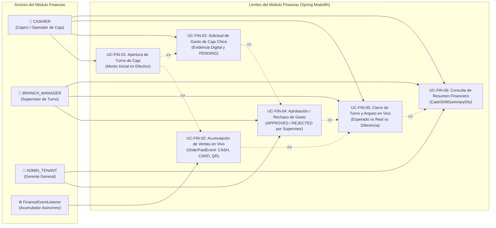

# 💰 Casos de Uso - Módulo de Finanzas y Control de Caja

El módulo de **Finanzas y Control de Caja** administra el flujo de tesorería del restaurante, gobernando el ciclo de vida de los turnos de caja (**Cash Shifts**), la acumulación en tiempo real de ventas por método de pago, el registro y fiscalización de gastos operativos menores (**Petty Cash / Expenses**) con soporte de comprobante digital, y el arqueo de caja con cálculo automatizado de faltantes y sobrantes.

---

## 🗺️ 1. Diagrama de Casos de Uso del Módulo Finanzas

---

## 📝 2. Especificación Detallada de Casos de Uso

---

### UC-FIN-01: Apertura de Turno de Caja con Monto Inicial en Efectivo

| Dimensión | Especificación Formal |
| :--- | :--- |
| **Identificador** | `UC-FIN-01` |
| **Nombre** | Apertura de Turno de Caja con Monto Inicial en Efectivo |
| **Actor Principal** | `CASHIER` |
| **Actores Secundarios** | `BRANCH_MANAGER` (Supervisión) |
| **Objetivo** | Iniciar formalmente un turno de caja para la sucursal, registrando el fondo de cambio o caja base inicial (`initialCash`), vinculando al cajero responsable y habilitando el cobro de comandas en el terminal POS. |
| **Precondiciones** | El usuario debe estar autenticado con rol `CASHIER` o `BRANCH_MANAGER`. No debe existir otro turno en estado `OPEN` en la misma sucursal. |
| **Flujo Principal** | 1. El cajero ingresa al módulo de Finanzas o abre el POS sin turno activo. 2. El sistema muestra el diálogo modal de "Apertura de Caja". 3. El cajero cuenta el dinero físico en gaveta e introduce el importe base (ej. `200.00` BOB). 4. El cliente envía `POST /api/v1/finance/shifts/open` con `OpenShiftRequest` (`branchId`, `initialCash`). 5. El backend valida que no exista un turno `OPEN` previo en la sucursal. 6. Inserta un nuevo registro en `cash_shifts` con:    - `tenantId`, `branchId`.    - `openedBy`: UUID del cajero extraído de `TenantContextHolder.getUserId()`.    - `openedAt`: Instante UTC actual (`Instant.now()`).    - `initialCash`: Importe inicial con redondeo a 2 decimales.    - Acumuladores de ventas y gastos inicializados en `0.00`.    - `status = 'OPEN'`. 7. Retorna `201 Created` con el `CashShiftDto`. 8. El frontend almacena el `shiftId` en Dexie (`activeShift`) y en memoria reactiva. |
| **Flujos Alternativos / Excepciones** | - **Turno ya abierto en la sucursal:** Si existe un turno con `status = 'OPEN'`, retorna `400 Bad Request` indicando "Ya existe un turno de caja abierto en esta sucursal". - **Monto inicial negativo:** La validación rechaza montos menores a cero (`400 Bad Request`). - **BranchId ausente:** Si la solicitud carece de sucursal válida, arroja `400 Bad Request`. |
| **Postcondiciones** | La sucursal queda habilitada para emitir tickets y procesar pagos en POS. |
| **Contrato de API** | - `POST /api/v1/finance/shifts/open` → `201 Created` (`OpenShiftRequest` → `CashShiftDto`) - `GET /api/v1/finance/shifts/current?branchId={branchId}` → `200 OK` / `204 No Content` |
| **Entidades Afectadas** | `cash_shifts` (nuevo registro con `status = 'OPEN'`), Dexie: `activeShift` |

---

### UC-FIN-02: Acumulación de Ventas en Vivo ante `OrderPaidEvent`

| Dimensión | Especificación Formal |
| :--- | :--- |
| **Identificador** | `UC-FIN-02` |
| **Nombre** | Acumulación de Ventas en Vivo ante `OrderPaidEvent` (`CASH`, `CARD`, `QR`, `TRANSFER`) |
| **Actor Principal** | Sistema Asíncrono (`FinanceEventListener`) |
| **Actores Secundarios** | `CashShiftService` |
| **Objetivo** | Incrementar en tiempo real los contadores de ingresos acumulados en el turno de caja abierto según el método de pago utilizado en la venta, sin introducir bloqueos en el hilo transaccional del cajero. |
| **Precondiciones** | Se ha completado con éxito el cobro de una comanda en POS, publicando `OrderPaidEvent`. |
| **Flujo Principal** | 1. `FinanceEventListener.on(OrderPaidEvent)` intercepta el evento publicado por el módulo POS. 2. Si el evento contiene `cashShiftId`, busca el turno correspondiente; si es nulo, localiza el turno activo `OPEN` de la sucursal. 3. Discrimina el método de pago (`event.paymentMethod()`):    - **`CASH`:** Suma el importe a `totalCashSales`.    - **`CARD`:** Suma el importe a `totalCardSales`.    - **`QR` / `TRANSFER` / Otros:** Suma el importe a `totalOtherSales`. 4. Ejecuta la actualización atómica en base de datos. 5. Los balances acumulados quedan actualizados para cualquier consulta del arqueo en vivo. |
| **Flujos Alternativos / Excepciones** | - **Venta sin turno activo asociado:** Si por contingencia no hay turno abierto al procesar el evento (ej. ventas offline muy demoradas), el listener registra una advertencia en log y no aborta el flujo. |
| **Postcondiciones** | Los saldos acumulados de ventas del turno reflejan con exactitud el total cobrado. |
| **Contrato Técnico** | - Evento: `OrderPaidEvent` - Listener: `com.restaurant.app.modules.finance.internal.FinanceEventListener` - Método: `CashShiftService.updateRunningSales(...)` |
| **Entidades Afectadas** | `cash_shifts` (`total_cash_sales`, `total_card_sales`, `total_other_sales`) |

---

### UC-FIN-03: Solicitud y Registro de Gasto de Caja Chica con Evidencia Digital

| Dimensión | Especificación Formal |
| :--- | :--- |
| **Identificador** | `UC-FIN-03` |
| **Nombre** | Solicitud y Registro de Gasto de Caja Chica con Evidencia Digital (`expenses`) |
| **Actor Principal** | `CASHIER`, `BRANCH_MANAGER`, `ADMIN_TENANT` |
| **Actores Secundarios** | Ninguno |
| **Objetivo** | Registrar una salida de dinero menor de la gaveta de caja (ej. compra de verduras de urgencia, hielo, insumos de limpieza) o pago operativo extraordinario, adjuntando número de comprobante y fotografía del recibo/factura. |
| **Precondiciones** | Debe existir un turno de caja activo si el egreso se realiza en efectivo desde la gaveta (`paidFromCashDrawer = true`). |
| **Flujo Principal** | 1. El usuario pulsa "Registrar Gasto de Caja Chica". 2. Completa el formulario con los siguientes campos obligatorios y opcionales:    - `amount`: Importe exacto del gasto (`NUMERIC(12, 2)`).    - `description`: Motivo justificado del egreso.    - `expenseType`: `DAILY_OPERATIONAL` o `MONTHLY_FIXED_PRORATED`.    - `paidFromCashDrawer`: Booleano (indica si se extrajo dinero físico de la gaveta de caja).    - `receiptNumber`: Folio o número físico del comprobante/factura.    - `receiptImageUrl`: URL o fotografía digital de respaldo. 3. El cliente emite `POST /api/v1/finance/expenses` con `CreateExpenseRequest`. 4. **Determinación del Estado de Aprobación según Rol (RBAC):**    - **Si el actor es `CASHIER` y `paidFromCashDrawer == true`:** El gasto se registra en estado `PENDING_APPROVAL` (requiere visto bueno del encargado antes de descontar del arqueo).    - **Si el actor es `BRANCH_MANAGER` o `ADMIN_TENANT`:** El gasto pasa directamente a estado `APPROVED` con `approvedBy = userId`.    - **Si `paidFromCashDrawer == false`:** No afecta el arqueo físico y se aprueba de inmediato (`APPROVED`). 5. Se persiste la entidad `Expense` y se responde `201 Created` con `ExpenseDto`. |
| **Flujos Alternativos / Excepciones** | - **Monto inválido:** Montos menores o iguales a cero retornan `400 Bad Request`. - **Descripción vacía:** Rechazado con `400 Bad Request`. - **Tipo de gasto no admitido:** Retorna `400 Bad Request` indicando tipos válidos. |
| **Postcondiciones** | El gasto queda asentado en la base de datos para auditoría y en espera de aprobación si fue solicitado por un cajero. |
| **Contrato de API** | - `POST /api/v1/finance/expenses` → `201 Created` (`CreateExpenseRequest` → `ExpenseDto`) |
| **Entidades Afectadas** | `expenses` (`id`, `tenant_id`, `branch_id`, `cash_shift_id`, `amount`, `expense_type`, `description`, `receipt_number`, `receipt_image_url`, `paid_from_cash_drawer`, `approval_status`, `registered_by`, `approved_by`) |

---

### UC-FIN-04: Aprobación / Rechazo de Gasto por Supervisor

| Dimensión | Especificación Formal |
| :--- | :--- |
| **Identificador** | `UC-FIN-04` |
| **Nombre** | Aprobación / Rechazo de Gasto por Supervisor (`APPROVED` / `REJECTED`) |
| **Actor Principal** | `BRANCH_MANAGER`, `ADMIN_TENANT` |
| **Actores Secundarios** | `CASHIER` (Solicitante notificado) |
| **Objetivo** | Auditar la validez y evidencia digital de los gastos de caja chica solicitados por el cajero, aprobándolos para que se descuenten del arqueo esperado de efectivo o rechazándolos con justificación. |
| **Precondiciones** | El gasto debe existir y encontrarse en estado `PENDING_APPROVAL`. El usuario debe poseer rol `BRANCH_MANAGER` o `ADMIN_TENANT`. |
| **Flujo Principal** | 1. El supervisor ingresa a la bandeja de "Gastos por Aprobar" (`GET /api/v1/finance/expenses?approvalStatus=PENDING_APPROVAL`). 2. Revisa la descripción, monto y fotografía del recibo adjunto. 3. Elige la acción:    - **Aprobar:** Envía `status = 'APPROVED'`. El gasto se computará formalmente en el arqueo del turno.    - **Rechazar:** Envía `status = 'REJECTED'` e ingresa un motivo obligatorio (`rejectionReason`). El dinero extraído no se reconoce como gasto válido de la empresa y se imputará como faltante al cajero. 4. El cliente ejecuta `POST /api/v1/finance/expenses/{expenseId}/approve` con `ExpenseApprovalRequest`. 5. El backend actualiza `approval_status`, `approved_by = currentUserId` y `rejection_reason`. 6. Responde `200 OK` con el `ExpenseDto` actualizado. |
| **Flujos Alternativos / Excepciones** | - **Cajero intentando auto-aprobar:** Si el token no tiene rol directivo, el endpoint arroja `403 Forbidden`. - **Gasto ya resuelto:** Si el gasto ya estaba `APPROVED` o `REJECTED`, arroja `400 Bad Request`. |
| **Postcondiciones** | El estado del gasto queda fijado y actualizado en los cálculos dinámicos de tesorería del turno. |
| **Contrato de API** | - `POST /api/v1/finance/expenses/{expenseId}/approve` → `200 OK` (`ExpenseApprovalRequest` → `ExpenseDto`) |
| **Entidades Afectadas** | `expenses` (`approval_status`, `approved_by`, `rejection_reason`, `version`) |

---

### UC-FIN-05: Cierre de Turno y Conciliación de Arqueo en Vivo

| Dimensión | Especificación Formal |
| :--- | :--- |
| **Identificador** | `UC-FIN-05` |
| **Nombre** | Cierre de Turno y Conciliación de Arqueo en Vivo (Efectivo Esperado vs Real vs Diferencia) |
| **Actor Principal** | `CASHIER`, `BRANCH_MANAGER` |
| **Actores Secundarios** | `ADMIN_TENANT` (Auditoría) |
| **Objetivo** | Finalizar la jornada operativa de caja, ejecutando el arqueo que confronta matemáticamente el dinero que debería haber físicamente en la gaveta contra el dinero real recontado por el cajero, registrando sobrantes o faltantes. |
| **Precondiciones** | El turno debe estar en estado `OPEN`. |
| **Flujo Principal** | 1. El cajero realiza el recuento físico de los billetes y monedas en la gaveta. 2. Ingresa a "Cerrar Turno de Caja" e introduce el importe físico contado (`actualCash`) y observaciones opcionales. 3. El cliente invoca `POST /api/v1/finance/shifts/{shiftId}/close` con `CloseShiftRequest`. 4. **Cálculo Matemático del Arqueo en el Backend (ADR / SDD):**    a. Obtiene ventas consolidadas por método de pago (`PosPublicApi.getShiftSalesSummary`).    b. Suma todos los gastos aprobados con salida de efectivo de la gaveta: `totalCashExpenses = SUM(expenses WHERE paidFromCashDrawer = true AND approvalStatus = 'APPROVED')`.    c. Calcula el **Efectivo Esperado en Gaveta**:       $$\text{expectedCash} = \text{initialCash} + \text{totalCashSales} - \text{totalCashExpenses}$$    d. Calcula la **Diferencia de Arqueo**:       $$\text{difference} = \text{actualCash} - \text{expectedCash}$$       - $\text{difference} == 0$: Cuadre perfecto.       - $\text{difference} > 0$: Sobrante de caja.       - $\text{difference} < 0$: Faltante de caja. 5. Actualiza la entidad `CashShift` fijando todos los acumuladores, `actualCash`, `expectedCash`, `difference`, `closedBy = userId`, `closedAt = Instant.now()` y `status = 'CLOSED'`. 6. Responde `200 OK` con el `CashShiftDto` cerrado y consolidado. |
| **Flujos Alternativos / Excepciones** | - **Turno ya cerrado previamente:** Si `status != 'OPEN'`, arroja `400 Bad Request` indicando "El turno de caja ya se encuentra cerrado". - **Gastos pendientes de aprobación:** Si existen gastos en `PENDING_APPROVAL`, el sistema emite una advertencia visual recomendando al supervisor resolverlos antes de fijar el arqueo definitivo. |
| **Postcondiciones** | El turno queda cerrado de forma inmutable. Se inhibe el ingreso de nuevas comandas o gastos asignados a este turno. |
| **Contrato de API** | - `POST /api/v1/finance/shifts/{shiftId}/close` → `200 OK` (`CloseShiftRequest` → `CashShiftDto`) |
| **Entidades Afectadas** | `cash_shifts` (`status = 'CLOSED'`, `closed_at`, `closed_by`, `expected_cash`, `actual_cash`, `difference`) |

---

### UC-FIN-06: Consulta de Resumen Financiero de Turno

| Dimensión | Especificación Formal |
| :--- | :--- |
| **Identificador** | `UC-FIN-06` |
| **Nombre** | Consulta de Resumen Financiero de Turno (`CashShiftSummaryDto`) |
| **Actor Principal** | `BRANCH_MANAGER`, `ADMIN_TENANT`, `CASHIER` |
| **Actores Secundarios** | Contabilidad General |
| **Objetivo** | Visualizar el reporte consolidado de un turno de caja (tanto activo en vivo como histórico cerrado), agrupando total de comandas atendidas, desglose de ventas por método de pago, gastos pagados y conteo de aprobaciones pendientes. |
| **Precondiciones** | El turno de caja debe existir. El usuario debe tener acceso a la sucursal del turno. |
| **Flujo Principal** | 1. El usuario selecciona un turno desde el historial o visualiza el turno en curso. 2. El cliente ejecuta `GET /api/v1/finance/shifts/{shiftId}/summary`. 3. El backend obtiene el DTO del turno (enriquecido con ventas en vivo si aún está `OPEN`). 4. Consulta a `PosPublicApi.getShiftSalesSummary` para obtener la cantidad total de pedidos atendidos (`totalOrders`). 5. Cuenta la cantidad de gastos aprobados (`approvedExpensesCount`) y pendientes (`pendingExpensesCount`). 6. Empaqueta la información en `CashShiftSummaryDto` y retorna `200 OK`. 7. La UI renderiza tarjetas con indicadores clave (KPIs), gráficas de pastel por método de pago y opción de impresión del comprobante de arqueo. |
| **Flujos Alternativos / Excepciones** | - **Turno inexistente:** Retorna `404 Not Found`. |
| **Postcondiciones** | Acceso a métricas ejecutivas transparentes para control de gestión y liquidación de cajeros. |
| **Contrato de API** | - `GET /api/v1/finance/shifts/{shiftId}/summary` → `200 OK` (`CashShiftSummaryDto`) - `GET /api/v1/finance/shifts` → `200 OK` (`List<CashShiftDto>`) |
| **Entidades Consultadas** | `cash_shifts`, `orders`, `expenses` |

---

## 🔗 3. Relación con Otros Subsistemas

- **Punto de Venta (POS):** Recibe las ventas cobradas vía `OrderPaidEvent` desde [use_cases_pos.md](./use_cases_pos.md).
- **Inventario:** Provee soporte para valorización de costos de materias primas en [use_cases_inventory.md](./use_cases_inventory.md).
- **Mapa Macro:** [use_cases_overview.md](./use_cases_overview.md).
- **Índice General:** [README](../README.md).
