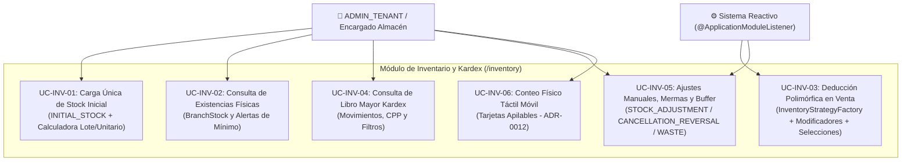

# 📦 Casos de Uso - Módulo de Inventario y Kardex

El módulo de **Inventario y Kardex** (`modules.inventory` / ruta `/inventory`) gobierna el control de existencias físicas por sucursal, la trazabilidad de movimientos bajo **Costo Promedio Ponderado (CPP)** y la deducción o reversión reactiva de insumos y platos mediante `InventoryStrategyFactory` ante eventos de venta (`OrderPaidEvent`) y cancelación (`OrderCancelledEvent`).

> [!NOTE]
> **Compras a Proveedores (`purchases` / `PB-021`):** Aunque existe el permiso catalogado `inventory:purchase` y la tabla base SQL en `V1`, el flujo completo de registro de compras a proveedores **aún no cuenta con API REST ni UI activa** en el corte Sprint 6.

---

## 🗺️ 1. Diagrama de Casos de Uso del Módulo Inventario

---

## 📝 2. Especificación Detallada de Casos de Uso

### UC-INV-01: Registro Único de Stock Inicial por Sucursal (`INITIAL_STOCK` / `TASK-635`)

| Atributo | Detalle |
| :--- | :--- |
| **Identificador** | `UC-INV-01` |
| **Actor Principal** | `ADMIN_TENANT` o Encargado con permiso `inventory:stock_initial` |
| **Precondiciones** | El insumo debe estar creado en el catálogo (`UC-CAT-02`). El insumo **no** debe tener movimientos previos registrados en la sucursal seleccionada. |
| **Flujo Principal** | 1. El operador selecciona una sucursal y un insumo sin movimientos iniciales en `/inventory`. 2. Ingresa la cantidad física inicial (`quantity > 0`) y utiliza el asistente dual de costos (`TASK-635`): puede capturar el **costo total del lote** para que la interfaz calcule `unitCost = totalCost / quantity` automáticamente (o editar el `unitCost` directo). 3. El frontend envía `POST /api/v1/inventory/stock/initial` con `InitialStockRequest(ingredientId, quantity, unitCost)`. 4. `KardexService.registerInitialStock` verifica que no existan movimientos previos del insumo en esa sucursal. 5. Crea/actualiza el saldo en `branch_stock` fijando `averageCost = unitCost` y registra un asiento de entrada **`INITIAL_STOCK`** en `kardex_movements`. 6. Responde `201 Created` (o `200 OK` vacío según endpoint) actualizando saldos en UI. |
| **Flujos Alternativos / Excepciones** | - **Carga inicial ya realizada:** Si el insumo ya posee movimientos en esa sucursal, el backend bloquea con **`409 Conflict` (`ResourceConflictException`)** para obligar a usar `UC-INV-05` (ajuste auditado) y proteger la trazabilidad CPP. - **Cantidad `<= 0` o costo negativo:** Rechazado por validación (`400 Bad Request`). |

---

### UC-INV-02: Consulta de Existencias Físicas y Alertas de Stock Mínimo

| Atributo | Detalle |
| :--- | :--- |
| **Identificador** | `UC-INV-02` |
| **Actor Principal** | `ADMIN_TENANT` / Encargado (`inventory:read`) |
| **Flujo Principal** | 1. El cliente invoca `GET /api/v1/inventory/stock?branchId={id}`. 2. El backend consulta `branch_stock` enriqueciendo los saldos con nombre del insumo/plato, unidad de medida, `minStockAlert` y bandera `isLowStock` cuando `currentQuantity <= minStockAlert`. 3. Retorna `200 OK` con lista de `StockBalanceDto`. |

---

### UC-INV-03: Deducción Polimórfica en Ventas (`OrderPaidEvent`)

| Atributo | Detalle |
| :--- | :--- |
| **Identificador** | `UC-INV-03` |
| **Actor Principal** | Sistema Reactivo (`InventoryEventListener` + `KardexService` + `InventoryStrategyFactory`) |
| **Precondiciones** | Emisión de `OrderPaidEvent` por una venta POS confirmada (`UC-POS-07` / `UC-POS-08`). |
| **Flujo Principal** | 1. El listener de inventario recibe `OrderPaidEvent` de manera atómica dentro de Spring Modulith. 2. Para cada ítem vendido (plato simple, plato dentro de combo/selecciones o componente de menú), `InventoryStrategyFactory` resuelve la estrategia del plato:    - **`RECIPE_BOM_STRICT`:** Si existe stock disponible en `PreparedDishBuffer` (vitrina de cancelación reutilizable), consume primero de vitrina sin volver a descontar materia prima; de lo contrario, deduce cada insumo de su receta en `branch_stock` generando `SALE_OUT`.    - **`DISH_AS_INVENTORY_UNIT`:** Deduce unidades del propio plato terminado en `branch_stock` (`SALE_OUT`).    - **`COMMERCIAL_NO_INVENTORY`:** No genera movimientos en Kardex. 3. **Consumo por modificadores/extras:** Para cada modificador seleccionado con `ingredientId` y `quantityConsumed > 0`, deduce del inventario de insumos con tipo **`SALE_CONSUMPTION`**. 4. **Validación de stock negativo y modo de deducción:** `KardexService` respeta `inventory.allow_negative_stock` (vía `ConfigurationPublicApi`, considerando override del plato) e `inventory.deduction_mode` (*nota técnica vigente:* `KardexService` continúa leyendo `INVENTORY_DEDUCTION_MODE` vía `TenantConfigService` como deuda heredada de [ADR-0002](../../../adr/0002_hybrid_tenancy_and_dynamic_settings.md) pendiente en `TASK-640`). En modo estricto sin stock negativo, `OrderServiceImpl` pre-verifica stock antes de confirmar ventas online (en sync offline deja advertencia). |

---

### UC-INV-04: Consulta de Libro Mayor de Kardex y Costo Promedio (CPP)

| Atributo | Detalle |
| :--- | :--- |
| **Identificador** | `UC-INV-04` |
| **Actor Principal** | `ADMIN_TENANT` / Auditor (`inventory:read`) |
| **Flujo Principal** | 1. El usuario consulta `GET /api/v1/inventory/kardex?branchId={id}&ingredientId={opt}&movementType={opt}`. 2. El backend devuelve la lista ordenada cronológicamente de `KardexMovementDto` con saldo anterior, delta de cantidad, costo unitario/total y referencia origen (`INITIAL_STOCK`, `SALE_OUT`, `SALE_CONSUMPTION`, `CANCELLATION_REVERSAL`, `WASTE_ADJUSTMENT`, ajustes manuales). |

---

### UC-INV-05: Ajustes Manuales de Stock, Reversiones de Cancelación y Mermas

| Atributo | Detalle |
| :--- | :--- |
| **Identificador** | `UC-INV-05` |
| **Actor Principal** | `ADMIN_TENANT` / Encargado (`inventory:adjust`) o Sistema (`OrderCancelledEvent`) |
| **Flujo Principal (Ajuste Manual)** | 1. En `/inventory`, el operador selecciona un insumo y registra un nuevo conteo físico o merma. 2. Envía `POST /api/v1/inventory/stock/adjust` con `StockAdjustmentRequest(ingredientId, newQuantity, unitCost, reason)`. 3. `KardexService` calcula la diferencia respecto al saldo actual, actualiza `branch_stock` (y recalcula/asienta costo cuando aplica) y registra el asiento auditado en `kardex_movements`. |
| **Flujo Reactivo (Cancelación de Orden)** | Ante `OrderCancelledEvent` ([ADR-0019](../../../adr/0019_order_cancellation_workflow_authorizations_and_waste_treatment.md)): - Si `wasPrepared = false`, revierte los insumos consumidos con movimiento **`CANCELLATION_REVERSAL`**. - Si `wasPrepared = true`, según `pos.cancellation_prepared_waste_policy`, registra merma **`WASTE_ADJUSTMENT`** o deposita los platos aptos en **`PreparedDishBuffer` (`prepared_dish_buffer`)** para reventa en vitrina. |

---

### UC-INV-06: Conteo Físico Táctil en Smartphone (`ADR-0012`)

| Atributo | Detalle |
| :--- | :--- |
| **Identificador** | `UC-INV-06` |
| **Actor Principal** | Encargado de Almacén (`inventory:read`, `inventory:adjust`) |
| **Flujo Principal** | 1. En dispositivos móviles (`< 768px`), `/inventory` oculta las tablas anchas de escritorio y despliega tarjetas apilables de alto contraste. 2. El operador toca una tarjeta para expandir controles numéricos de ajuste físico y confirmar en `UC-INV-05` con una sola mano dentro de la bodega. |

---

## Documentos Relacionados
- [Mapa Macro de Casos de Uso](./use_cases_overview.md)
- [Casos de Uso de Catálogo](./use_cases_catalog.md)
- [Casos de Uso de POS](./use_cases_pos.md)
- [Actividad de Estrategia de Deducción de Inventario](../04-behavior-and-flows/activity_inventory_deduction_strategy.md)
- [Manual de Insumos, Recetas y Kardex](../../../manuals/restaurante/05_insumos_recetas_y_kardex.md)
- [Secuencia de Venta en POS y Deducción de Inventario](../04-behavior-and-flows/sequence_pos_order_deduction.md)
- [Secuencia de Cancelación de Órdenes y Autorizaciones](../04-behavior-and-flows/sequence_pos_order_cancellation_and_authorizations.md)
- [Estado de UX Móvil en POS e Inventario](../04-behavior-and-flows/state_mobile_pos_and_inventory_ux.md)
- [ADR-0012: Adaptabilidad Móvil y Experiencia Táctil](../../../adr/0012_mobile_responsiveness_and_touch_ux.md)
- [ADR-0015: Estrategias Flexibles de Inventario](../../../adr/0015_daily_menus_and_flexible_dish_inventory.md)
- [ADR-0018: Suite de Modificadores, Extras y Deducción Kardex](../../../adr/0018_pos_modifiers_extras_and_kitchen_notes_suite.md)
- [ADR-0019: Cancelaciones, Buffer de Vitrina y Mermas](../../../adr/0019_order_cancellation_workflow_authorizations_and_waste_treatment.md)
