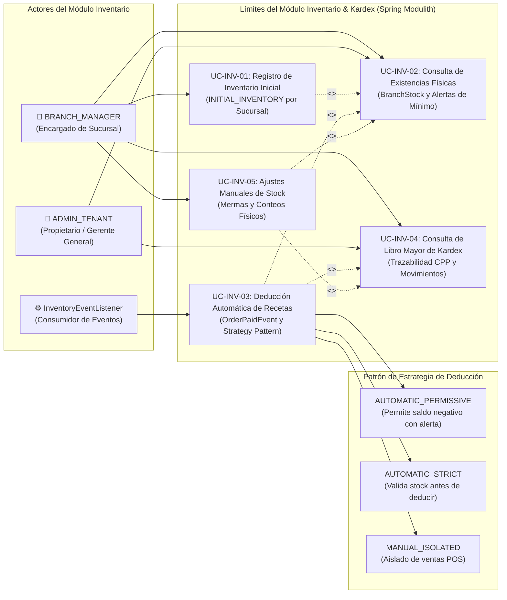

# 📦 Casos de Uso - Módulo de Inventario y Kardex

El módulo de **Inventario y Kardex** gobierna el control de existencias físicas por sucursal, la trazabilidad granular de movimientos de almacén bajo el método de **Costo Promedio Ponderado (CPP)** y el descuento automatizado de materias primas mediante recetas técnicas (BOM) ante eventos de venta.

---

## 🗺️ 1. Diagrama de Casos de Uso del Módulo Inventario

---

## 📝 2. Especificación Detallada de Casos de Uso

---

### UC-INV-01: Registro de Inventario Inicial por Sucursal

| Dimensión | Especificación Formal |
| :--- | :--- |
| **Identificador** | `UC-INV-01` |
| **Nombre** | Registro de Inventario Inicial por Sucursal (`INITIAL_INVENTORY`) |
| **Actor Principal** | `BRANCH_MANAGER`, `ADMIN_TENANT` |
| **Actores Secundarios** | Ninguno |
| **Objetivo** | Establecer el saldo inicial de apertura y el costo unitario de partida para cada insumo en una sucursal específica, sentando la base para el cálculo del Costo Promedio Ponderado. |
| **Precondiciones** | El insumo debe estar registrado en el Catálogo Maestro (`UC-CAT-02`). La sucursal debe existir y pertenecer al tenant. |
| **Flujo Principal** | 1. El encargado de sucursal accede a la pantalla de inventario en la sección "Carga Inicial". 2. Selecciona el insumo (`ingredientId`), e ingresa la cantidad física disponible (`quantity`) y su costo unitario de adquisición (`unitCost`). 3. El cliente emite `POST /api/v1/inventory/stock/initial?branchId={branchId}` con `InitialStockRequest`. 4. El backend busca o instancia la entidad `BranchStock` para la terna `(tenantId, branchId, ingredientId)`. 5. Actualiza `currentQuantity = request.quantity` y `averageUnitCost = request.unitCost`. 6. Inserta un asiento formal en `kardex_movements` con `movementType = 'INITIAL_INVENTORY'`, `quantity`, `unitCost`, `totalCost = quantity * unitCost` y `balanceQuantity = quantity`. 7. El sistema responde con código HTTP `201 Created`. |
| **Flujos Alternativos / Excepciones** | - **Cantidad o costo negativo:** Rechazado por validación `@Positive` (`400 Bad Request`). - **Insumo inexistente:** Retorna `404 Not Found`. - **Sin contexto de sucursal:** Si no se especifica `branchId` en URL ni en JWT, retorna `400 Bad Request`. |
| **Postcondiciones** | La sucursal dispone de existencias iniciales valorizadas en `branch_stocks` y el primer registro de auditoría en `kardex_movements`. |
| **Contrato de API** | - `POST /api/v1/inventory/stock/initial?branchId={branchId}` → `201 Created` (`InitialStockRequest`) |
| **Entidades Afectadas** | `branch_stocks`, `kardex_movements` (`movement_type = 'INITIAL_INVENTORY'`) |

---

### UC-INV-02: Consulta de Existencias Físicas y Valorización de Stock

| Dimensión | Especificación Formal |
| :--- | :--- |
| **Identificador** | `UC-INV-02` |
| **Nombre** | Consulta de Existencias Físicas y Valorización de Stock (`BranchStock`) |
| **Actor Principal** | `BRANCH_MANAGER`, `ADMIN_TENANT` |
| **Actores Secundarios** | Ninguno |
| **Objetivo** | Monitorear el inventario disponible de materias primas por sucursal, identificando insumos críticos por debajo del umbral de alerta (`isLowStockAlert`) y obteniendo la valorización monetaria total del almacén. |
| **Precondiciones** | Usuario autenticado con rol gerencial o administrativo. |
| **Flujo Principal** | 1. El usuario solicita la consulta de existencias en el panel de inventario. 2. El frontend ejecuta `GET /api/v1/inventory/stock?branchId={branchId}`. 3. El backend obtiene todos los insumos activos del tenant (`CatalogPublicApi.getAllIngredients`). 4. Cruza los insumos con las existencias registradas en `branch_stocks` para esa sucursal. 5. Para cada insumo calcula:    - `currentStock`: Cantidad actual disponible (default 0).    - `averageUnitCost`: Costo unitario promedio ponderado actual.    - `totalValue`: `currentStock * averageUnitCost` redondeado a 2 decimales.    - `minStockAlert`: Umbral configurado en catálogo.    - `isLowStockAlert`: Booleano `(currentStock <= minStockAlert)`. 6. Retorna `200 OK` con `List<StockBalanceDto>`. 7. La interfaz resalta en color ámbar/rojo los insumos que requieren orden de reposición inmediata. |
| **Flujos Alternativos / Excepciones** | - **Sucursal sin stock previo:** Los insumos sin movimientos se reportan con cantidad 0 y bandera de alerta activada si el umbral mínimo es mayor a cero. |
| **Postcondiciones** | Los encargados disponen de una fotografía exacta del almacén para toma de decisiones y compras. |
| **Contrato de API** | - `GET /api/v1/inventory/stock?branchId={branchId}` → `200 OK` (`List<StockBalanceDto>`) |
| **Entidades Consultadas** | `branch_stocks`, `ingredients` |

---

### UC-INV-03: Deducción Automática de Recetas ante `OrderPaidEvent`

| Dimensión | Especificación Formal |
| :--- | :--- |
| **Identificador** | `UC-INV-03` |
| **Nombre** | Deducción Automática de Recetas ante `OrderPaidEvent` (Strategy Pattern) |
| **Actor Principal** | Sistema Asíncrono (`InventoryEventListener`) |
| **Actores Secundarios** | Spring Modulith Event Bus |
| **Objetivo** | Descargar automáticamente del inventario de la sucursal las cantidades exactas de materias primas consumidas en cada plato vendido, de acuerdo a su ficha técnica (BOM), ejecutando la estrategia configurada por el tenant. |
| **Precondiciones** | La venta ha sido cobrada y confirmada en POS, emitiendo `OrderPaidEvent`. |
| **Flujo Principal** | 1. `InventoryEventListener.on(OrderPaidEvent)` recibe el evento desacoplado vía `@ApplicationModuleListener`. 2. Para cada plato en `event.items()`, consulta su receta en `CatalogPublicApi.getRecipeForDish`. 3. Consolida las cantidades totales requeridas por ingrediente: $\sum (\text{item.quantity} \times \text{recipe.ingredientQuantity})$. 4. Lee la configuración del tenant `INVENTORY_DEDUCTION_MODE` (`AUTOMATIC_PERMISSIVE`, `AUTOMATIC_STRICT`, `MANUAL_ISOLATED`). 5. **Ejecución de la Estrategia:**    - **`AUTOMATIC_PERMISSIVE` (Default):** Resta la cantidad al saldo de `branch_stocks`. Si el saldo resultante es negativo, lo permite y registra en bitácora `STOCK_DEFICIT_WARNING`. Inserta movimiento `SALE_OUT` en `kardex_movements`.    - **`AUTOMATIC_STRICT`:** Valida previamente que todos los ingredientes tengan stock suficiente. Si alguno no alcanza, aborta o escala notificación de quiebre de stock.    - **`MANUAL_ISOLATED`:** Omite la deducción automática en tiempo real, delegando el cuadre a partes manuales de producción en cocina. 6. Se guarda el nuevo saldo y se cierra la transacción modular. |
| **Flujos Alternativos / Excepciones** | - **Platos sin receta BOM:** Se omiten pacíficamente registrando un log informativo. - **Concurrencia en actualización de saldo:** Controlado por el motor transaccional de Spring. |
| **Postcondiciones** | Las existencias físicas reflejan el consumo de la venta y queda registrada la trazabilidad completa en Kardex con referencia al `orderId`. |
| **Contrato Técnico** | - Evento: `OrderPaidEvent` (`orderId`, `ticketNumber`, `items`, `branchId`, `tenantId`) - Listener: `InventoryEventListener` - Modos: `InventoryDeductionMode` |
| **Entidades Afectadas** | `branch_stocks`, `kardex_movements` (`movement_type = 'SALE_OUT'`) |

---

### UC-INV-04: Consulta de Libro Mayor de Kardex y Costo Promedio (CPP)

| Dimensión | Especificación Formal |
| :--- | :--- |
| **Identificador** | `UC-INV-04` |
| **Nombre** | Consulta de Libro Mayor de Kardex (Trazabilidad y Costo Promedio Ponderado) |
| **Actor Principal** | `BRANCH_MANAGER`, `ADMIN_TENANT` |
| **Actores Secundarios** | Auditores Contables |
| **Objetivo** | Auditar cronológicamente cada ingreso, egreso o ajuste que ha afectado a un insumo, visualizando la cantidad movida, el costo unitario aplicado, el costo total y el saldo resultante para garantizar transparencia fiscal y contable. |
| **Precondiciones** | Usuario autenticado con privilegios de consulta. |
| **Flujo Principal** | 1. El usuario ingresa a la vista "Movimientos de Kardex". 2. Opcionalmente filtra por insumo (`ingredientId`) o rango de fechas. 3. El cliente invoca `GET /api/v1/inventory/kardex?branchId={branchId}&ingredientId={ingredientId}`. 4. El backend recupera los movimientos ordenados por `movementDate` descendente desde `kardex_movements`. 5. Enriquece cada movimiento con el nombre y unidad de medida oficial del catálogo. 6. Retorna `200 OK` con `List<KardexMovementDto>` conteniendo:    - `movementType`: `INITIAL_INVENTORY`, `SALE_OUT`, `PHYSICAL_COUNT_ADJUSTMENT`, etc.    - `quantity`: Cantidad ingresada o deducida.    - `unitCost`: Costo unitario registrado en el momento de la transacción.    - `totalCost`: Valor total monetario del movimiento.    - `balanceQuantity`: Saldo final en almacén tras dicho movimiento.    - `referenceId`: UUID de la orden o ajuste de origen.    - `movementDate`: Timestamp UTC. 7. La tabla de auditoría se despliega en pantalla con opción de exportación. |
| **Flujos Alternativos / Excepciones** | - **Insumo sin movimientos:** Retorna lista vacía `[]` con código `200 OK`. |
| **Postcondiciones** | Los administradores disponen de trazabilidad inmutable de todas las mutaciones de stock. |
| **Contrato de API** | - `GET /api/v1/inventory/kardex?branchId={branchId}&ingredientId={ingredientId}` → `200 OK` (`List<KardexMovementDto>`) |
| **Entidades Consultadas** | `kardex_movements`, `ingredients` |

---

### UC-INV-05: Ajustes Manuales de Stock (Mermas / Conteos Físicos)

| Dimensión | Especificación Formal |
| :--- | :--- |
| **Identificador** | `UC-INV-05` |
| **Nombre** | Ajustes Manuales de Stock (Mermas / Conteos Físicos) |
| **Actor Principal** | `BRANCH_MANAGER`, `ADMIN_TENANT` |
| **Actores Secundarios** | Ninguno |
| **Objetivo** | Cuadrar las existencias teóricas del sistema con el recuento físico real realizado en almacén, asentando diferencias por mermas, caducidad, roturas o desvíos operativos. |
| **Precondiciones** | El insumo debe pertenecer a la sucursal y el usuario debe tener rol `BRANCH_MANAGER` o `ADMIN_TENANT`. |
| **Flujo Principal** | 1. El encargado realiza un recuento físico en bodega y detecta una discrepancia. 2. Abre el diálogo "Ajuste de Stock", selecciona el insumo e ingresa el nuevo stock físico real contado (`newQuantity`) y opcionalmente un costo unitario actualizado (`unitCost`). 3. El cliente envía `POST /api/v1/inventory/stock/adjust?branchId={branchId}` con `StockAdjustmentRequest`. 4. El backend calcula la diferencia neta: $\Delta = \text{newQuantity} - \text{previousQuantity}$. 5. Actualiza `currentQuantity` en `branch_stocks`. 6. Inserta un asiento en `kardex_movements` con:    - `movementType = 'PHYSICAL_COUNT_ADJUSTMENT'`.    - `quantity = diff` (positiva si hubo sobrante, negativa si hubo merma/faltante).    - `totalCost = |diff| * unitCost`.    - `balanceQuantity = newQuantity`.    - `createdBy = userId` (trazabilidad del usuario responsable del ajuste). 7. Retorna `200 OK` con el `StockBalanceDto` actualizado. |
| **Flujos Alternativos / Excepciones** | - **Nueva cantidad negativa:** La validación rechaza existencias negativas en conteo físico manual (`400 Bad Request`). - **Usuario no autorizado:** Cajeros intentando invocar este endpoint reciben `403 Forbidden`. |
| **Postcondiciones** | El inventario teórico queda perfectamente sincronizado con el conteo físico y el ajuste queda firmado por el usuario responsable en el libro de Kardex. |
| **Contrato de API** | - `POST /api/v1/inventory/stock/adjust?branchId={branchId}` → `200 OK` (`StockAdjustmentRequest` → `StockBalanceDto`) |
| **Entidades Afectadas** | `branch_stocks`, `kardex_movements` (`movement_type = 'PHYSICAL_COUNT_ADJUSTMENT'`) |

---

## 🔗 3. Relación con Otros Subsistemas

- **Punto de Venta (POS):** Recibe el evento `OrderPaidEvent` originado en [use_cases_pos.md](./use_cases_pos.md).
- **Catálogo:** Consume las recetas BOM y los insumos estructurados en [use_cases_catalog.md](./use_cases_catalog.md).
- **Finanzas:** Los costos valorizados alimentan los balances de costos en [use_cases_finance.md](./use_cases_finance.md).
- **Índice General:** [README](../README.md)
