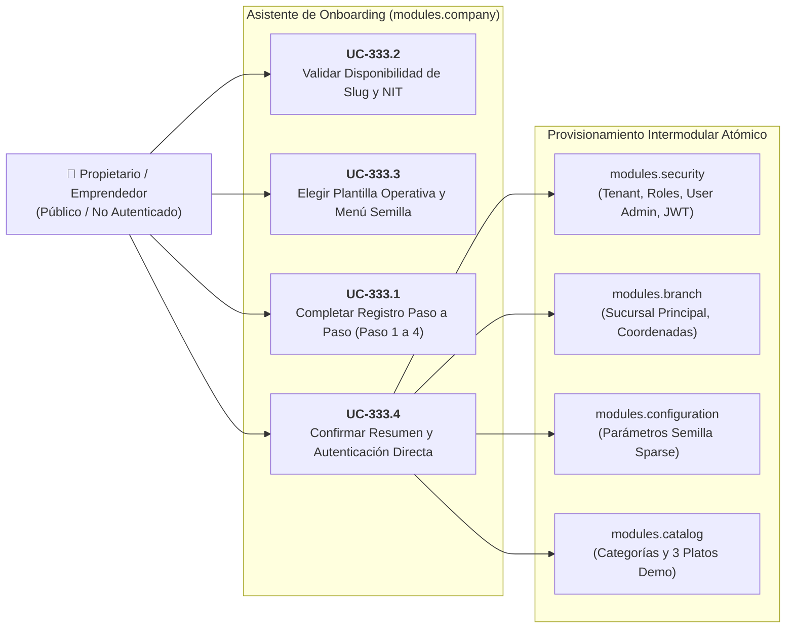

# 🚀 Casos de Uso: Asistente de Onboarding y Alta de Empresa

Este documento formaliza la especificación funcional y la matriz de interacciones para el **Asistente de Onboarding y Alta Rápida de Empresa** (`modules.company`), estructurado según el estándar de **Specification-Driven Development (SDD)** ([ADR-0007](../../../adr/0007_sdd_software_development_lifecycle.md), [ADR-0009](../../../adr/0009_tenant_onboarding_and_operational_presets.md) / `TASK-333` / `PB-001`).

---

## 👥 1. Actores y Permisos

| Caso de Uso | Identificador | Actor Principal | Permiso Requerido | Tipo de Acceso |
| :--- | :--- | :--- | :--- | :--- |
| **Alta Rápida de Empresa y Asistente Guiado** | `UC-333.1` | Dueño / Emprendedor Gastronómico | Público (`ANONYMOUS`) | Asistente Web Progresivo |
| **Comprobación Asíncrona de Slug y NIT** | `UC-333.2` | Navegador Web (Debounce) | Público (`ANONYMOUS`) | Endpoint Reactivo Liviano |
| **Selección de Plantilla y Catálogo Semilla** | `UC-333.3` | Dueño / Emprendedor Gastronómico | Público (`ANONYMOUS`) | Selector Interactivo |
| **Confirmación de Resumen y Acceso Inmediato** | `UC-333.4` | Dueño / Emprendedor Gastronómico | Público (`ANONYMOUS`) | Modal de Síntesis y Redirección |

---

## 🗺️ 2. Diagrama de Casos de Uso (Mermaid)

---

## 📋 3. Especificación Detallada de Casos de Uso

### UC-333.1: Registro Asistido y Alta Rápida de Empresa
- **Actor:** Dueño / Emprendedor gastronómico no registrado.
- **Precondiciones:** Dispositivo con navegador moderno (móvil o de escritorio), conexión a Internet.
- **Flujo Principal:**
  1. El usuario ingresa a la ruta `/onboarding`.
  2. **Paso 1 (Datos del Negocio):**
     - Introduce el nombre comercial de su negocio (ej. *"Pizzería Bella Napoli"*).
     - El frontend infiere en tiempo real el slug (`bella-napoli`) con un botón de ayuda contextual `(?)` que explica: *"Este identificador se utilizará en tu enlace de acceso y para iniciar sesión sin NIT"*.
     - El usuario puede editar el slug si lo desea.
     - Introduce el NIT o número de identificación tributaria (opcional). El tooltip aclara: *"Si tu negocio no cuenta con NIT aún, puedes dejar este campo vacío e iniciar sesión con tu slug"*.
     - Opcionalmente sube el logotipo; si no lo hace, se genera un avatar con las iniciales y un color contrastante.
  3. **Paso 2 (Sucursal Principal):**
     - El nombre de la sucursal viene prellenado como *"Sucursal Principal"*.
     - Indica la dirección de referencia.
     - Selecciona interactivamente su ubicación en un mapa OpenStreetMap/Leaflet integrado (gratuito, sin claves complejas de API).
     - Opcionalmente añade un teléfono de contacto.
     - La moneda por defecto se asigna a Boliviano (`BOB`) y la zona horaria a `'America/La_Paz'` de forma automática e inadvertida (sin sobrecargar de preguntas al usuario).
  4. **Paso 3 (Plantilla y Menú Semilla):**
     - Invoca `UC-333.3` para seleccionar el giro de negocio y los platos de demostración.
  5. **Paso 4 (Cuenta del Administrador):**
     - Introduce su nombre completo (`full_name`), nombre de usuario (`username`), correo electrónico (opcional) y contraseña segura.
  6. Avanza a `UC-333.4` para la confirmación.

---

### UC-333.2: Validación Asíncrona de Disponibilidad de Slug y NIT
- **Actor:** Interfaz de usuario (Angular Zoneless) en segundo plano.
- **Precondiciones:** El usuario ha escrito al menos 3 caracteres en el slug o en el NIT.
- **Flujo Principal:**
  1. Al escribir el nombre o editar el slug, la interfaz aplica un `debounceTime(350ms)`.
  2. Despacha una consulta liviana: `GET /api/v1/auth/onboarding/check-availability?slug=bella-napoli`.
  3. El backend verifica la existencia en la tabla `tenants` mediante un `EXISTS(...)` indexado.
  4. Si está disponible, la interfaz muestra un check verde sutil y habilita el avance. Si está en uso, sugiere alternativas agregando sufijos numéricos (ej. `bella-napoli-bo`, `bella-napoli-1`).
  5. Para el NIT (cuando no está en blanco), valida del mismo modo garantizando la unicidad estricta (`uq_tenant_nit`).

---

### UC-333.3: Selección de Plantilla Operativa y Catálogo Semilla
- **Actor:** Dueño / Emprendedor gastronómico.
- **Precondiciones:** Paso 3 del asistente activo.
- **Flujo Principal:**
  1. El usuario visualiza 4 tarjetas visuales de giros de negocio:
     - 🍕 **Comida Rápida / Pizzería:** Flujo ágil en mostrador, comanda directa.
     - 🍽️ **Restaurante Tradicional / A la Carta:** Atención a mesas con control de mozos y pre-cuentas.
     - ☕ **Cafetería / Bar:** Cuentas rápidas de barra, ventas al paso.
     - ⚙️ **Personalizado / En Blanco:** Para negocios que prefieren configurar su menú desde cero.
  2. Al pulsar una plantilla, se despliega una vista previa colapsable de **3 productos de ejemplo con recetas básicas**.
  3. Una nota destacada informa: *"Estos productos son de muestra para que puedas probar el sistema de inmediato. Podrás editarlos, eliminarlos o cargar tu menú completo por Excel más adelante"*.
  4. El usuario puede desmarcar la casilla *"Incluir productos de demostración"* si prefiere arrancar con el catálogo vacío.

---

### UC-333.4: Resumen Previo de Confirmación y Acceso Inmediato
- **Actor:** Dueño / Emprendedor gastronómico.
- **Precondiciones:** Todos los pasos completados válidamente en el formulario reactivo.
- **Flujo Principal:**
  1. El usuario presiona *"Finalizar y Crear Restaurante"*.
  2. Se abre un modal de síntesis interactivo con el resumen visual de su configuración:
     - Empresa: Nombre, Slug, NIT (o *"Sin NIT"*).
     - Sucursal: Nombre, Dirección y Coordenadas en mapa miniatura.
     - Plantilla: Modo operativo y cantidad de productos semilla.
     - Administrador: Usuario asignado.
     - Mensaje motivador: *"Todo esto es solo para comenzar; podrás modificar cualquier ajuste cuando lo necesites"*.
  3. Al confirmar, el frontend envía: `POST /api/v1/auth/onboarding` con el payload unificado.
  4. El backend ejecuta la transacción atómica intermodular en $\le 500$ ms.
  5. La respuesta retorna los tokens de acceso JWT (`accessToken` y `refreshToken`) junto con la información de la empresa y sucursal creada.
  6. El frontend guarda la sesión en memoria/almacenamiento local, inicializa la base de datos Dexie.js para la sucursal y redirige al usuario directamente al Punto de Venta (`/pos`) o Dashboard con un mensaje de bienvenida.
