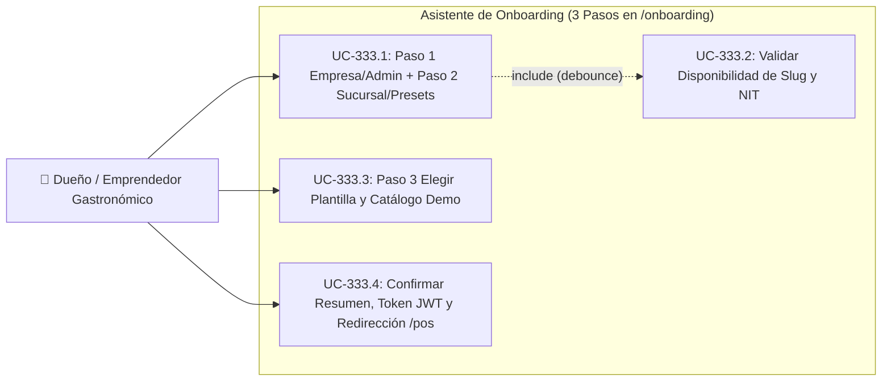

# 🚀 Casos de Uso: Asistente de Onboarding y Alta de Empresa

Este documento formaliza la especificación funcional del **Asistente de Onboarding y Alta Rápida de Empresa** (`modules.company` y `OnboardingComponent` en `/onboarding`), alineado con [ADR-0009](../../../adr/0009_tenant_onboarding_and_operational_presets.md) (`PB-001` / `TASK-333`) y verificado contra el código real.

---

## 👥 1. Actores y Permisos

| Caso de Uso | Identificador | Actor Principal | Acceso / Permiso | Mecanismo |
| :--- | :--- | :--- | :--- | :--- |
| **Registro Asistido en 3 Pasos** | `UC-333.1` | Emprendedor / Propietario | Público (`guestGuard` en `/onboarding`) | Asistente Angular (`ReactiveFormsModule` + Signals) |
| **Comprobación Asíncrona de Slug y NIT** | `UC-333.2` | Navegador Web (Debounce) | Público (`ANONYMOUS`) | `GET /api/v1/auth/onboarding/check-availability` |
| **Selección de Plantilla y Menú Semilla** | `UC-333.3` | Emprendedor / Propietario | Público (`ANONYMOUS`) | `FAST_FOOD`, `TRADITIONAL`, `CAFE`, `EMPTY` |
| **Confirmación de Resumen y Entrada a POS** | `UC-333.4` | Emprendedor / Propietario | Público (`ANONYMOUS`) -> JWT `ADMIN_TENANT` | Modal de síntesis + `POST /api/v1/auth/onboarding` |

---

## 🗺️ 2. Diagrama de Casos de Uso (Mermaid)

---

## 📋 3. Especificación Detallada de Casos de Uso

### UC-333.1: Registro Asistido de Empresa, Administrador y Sucursal Matriz (Pasos 1 y 2)

- **Actor Principal:** Propietario o Emprendedor Gastronómico sin sesión activa.
- **Flujo Principal:**
  1. El usuario accede a `/onboarding` (`OnboardingComponent`).
  2. **Paso 1 — Empresa y Administrador:**
     - Captura razón social (`legalName`), identificador único `slug` (autogenerado vía `slugify`, editable) y NIT opcional (`nitOrTaxId`).
     - Registra al usuario propietario inicial: nombre completo (`fullName`), `username`, `email` **opcional**, contraseña (`password`) y confirmación (`confirmPassword` validada por `passwordsMatchValidator`).
     - *(Nota real: el asistente no solicita carga de logotipo en el alta inicial para acelerar la entrada).*
  3. **Paso 2 — Sucursal Matriz y Ubicación:**
     - Define nombre de la sede (prellenado `"Sucursal Principal"`), dirección referencial y teléfono opcional.
     - Fija moneda (`BOB` por defecto) y zona horaria IANA (`America/La_Paz` por defecto, [ADR-0006](../../../adr/0006_datetime_and_timezone_handling.md)).
     - Selecciona la ubicación entre **6 presets de ciudades bolivianas** (`La Paz`, `Santa Cruz`, `Cochabamba`, `El Alto`, `Tarija`, `Sucre`) que asignan automáticamente `latitude` y `longitude` sin cargar mapas interactivos externos (Leaflet / OpenStreetMap).
  4. Avanza al Paso 3 (`UC-333.3`).

---

### UC-333.2: Validación Asíncrona de Disponibilidad de Slug y NIT

- **Precondiciones:** Campo `slug` (o `nitOrTaxId` no vacío) modificado en el Paso 1.
- **Flujo Principal:**
  1. Con un *debounce* reactivo, el cliente consulta `GET /api/v1/auth/onboarding/check-availability?slug={slug}` (o incluyendo `nit={nit}`; el backend también expone `GET /api/v1/auth/check-slug?slug={slug}`).
  2. `OnboardingServiceImpl` verifica disponibilidad global sin exponer datos de otros restaurantes y retorna `CheckAvailabilityResultDto(available, suggestedAlternative, suggestedSlug, slugAvailable, nitAvailable)`.
  3. Si existe colisión, la UI sugiere alternativas en vivo antes de enviar el formulario final.

---

### UC-333.3: Selección de Plantilla Operativa y Catálogo Semilla (Paso 3)

- **Flujo Principal:**
  1. En el Paso 3, el usuario elige una de las 4 plantillas de negocio:
     - `FAST_FOOD` (Comida Rápida / Pizzería)
     - `TRADITIONAL` (Restaurante Tradicional / A la Carta)
     - `CAFE` (Cafetería / Bar)
     - `EMPTY` (Plantilla Vacía / Personalizada)
  2. Controla la casilla `includeDemoCatalog`: cuando selecciona `EMPTY`, la generación de catálogo demo permanece desactivada; en las plantillas sectoriales puede activar o desactivar la carga de categorías, insumos y platos semilla.
  3. Pulsa **"Finalizar y Revisar"** para abrir el modal de confirmación (`UC-333.4`).

---

### UC-333.4: Confirmación de Resumen, Provisión Transaccional y Entrada a `/pos`

- **Flujo Principal:**
  1. El modal de síntesis muestra la empresa, sucursal matriz, administrador y plantilla elegida.
  2. Al confirmar, el cliente envía `POST /api/v1/auth/onboarding` (`OnboardingRequest`).
  3. En una transacción atómica `@Transactional`, el backend:
     - Crea el `Tenant` (NIT nullable con índice único parcial) y la `Branch` matriz.
     - Ejecuta `RolePublicApi.seedDefaultRolesForTenant` y crea el usuario propietario (`ADMIN_TENANT`, Argon2id).
     - Aplica los presets iniciales en `system_parameter_values` (*Sparse Storage*, [ADR-0008](../../../adr/0008_unified_multilevel_parameter_system.md)).
     - Si `includeDemoCatalog = true`, invoca `CatalogPublicApi.seedDemoCatalog` e inicializa existencias demo cuando aplica.
     - Emite tokens de sesión (`accessToken`, `refreshToken` y `UserDto`).
  4. El cliente guarda la sesión en `AuthService`, inicializa el tour guiado (`OnboardingTourService`) y redirige automáticamente a **`/pos`** (listo para operar).
- **Flujos Alternativos / Excepciones:**
  - **NIT o Slug ya ocupado en concurrencia:** Retorna `409 Conflict` (`RFC 7807`) y conserva los datos del asistente para corrección.

---

## Documentos Relacionados
- [Mapa Macro de Casos de Uso](./use_cases_overview.md)
- [Casos de Uso de Empresa y Sucursales](./use_cases_company.md)
- [Casos de Uso de Configuración](./use_cases_configuration.md)
- [Casos de Uso de Sesiones](./use_cases_sessions.md)
- [Secuencia de Onboarding de Tenant](../04-behavior-and-flows/sequence_tenant_onboarding.md)
- [Estado del Ciclo de Vida del Tenant](../04-behavior-and-flows/state_tenant_lifecycle.md)
- [ADR-0006: Manejo Estricto de Fechas y Zonas Horarias](../../../adr/0006_datetime_and_timezone_handling.md)
- [ADR-0008: Sistema Unificado de Parámetros Multinivel](../../../adr/0008_unified_multilevel_parameter_system.md)
- [ADR-0009: Onboarding Guiado de Empresa y Presets Operativos](../../../adr/0009_tenant_onboarding_and_operational_presets.md)
- [Manual de Bootstrap y Operación Inicial](../../../manuals/plataforma/bootstrap_y_operacion_inicial.md)
- [Guía de Inicio Rápido Restaurante](../../../manuals/restaurante/00_guia_inicio_rapido_restaurante.md)
