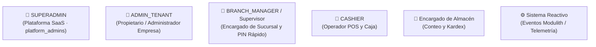
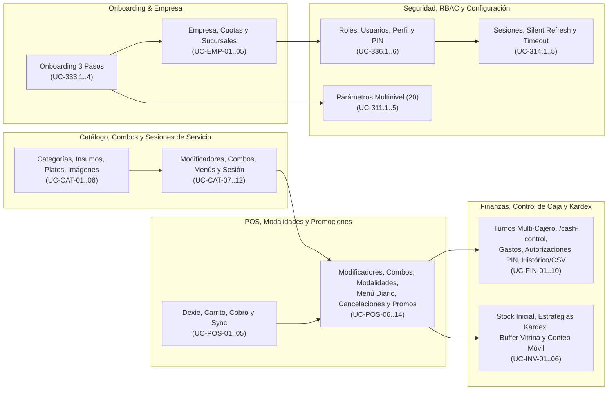

# 🌐 Mapa Macro de Actores y Casos de Uso del Sistema

Este documento presenta la cartografía consolidada del ecosistema completo de **Restaurante POS + ERP** (`frontend/` + `backend/`) y su vínculo con el **Backoffice SaaS** (`backoffice-frontend/`), reflejando fielmente los módulos, permisos reales (`SystemPermissions`) y capacidades activas verificadas al cierre del Sprint 6.

---

## 👥 1. Taxonomía de Actores del Ecosistema

### Responsabilidades y Límites Operativos

| Actor | Alcance | Capacidades Clave en el Sistema Real | Alcance Futuro / Fuera de Corte Actual |
| :--- | :--- | :--- | :--- |
| **`SUPERADMIN`** | Plataforma SaaS Global | Identidad separada (`platform_admins`). Opera el Backoffice React (`/api/v1/backoffice/**`) para planes, suscripciones, cuotas, bloqueos, `platform_settings` y observabilidad. | No mezcla su sesión con `app_users`; ver [Casos de Uso de Backoffice](../../../backoffice/architecture/use_cases_backoffice.md). |
| **`ADMIN_TENANT`** | Empresa Completa (`tenant_id`) | Onboarding, gestión de perfil de empresa y sucursales, roles RBAC y personal, parametrización multinivel (20 parámetros), catálogo maestro, combos, promociones, auditoría financiera y exportaciones CSV. | Recibe automáticamente todas las constantes de `SystemPermissions.ALL_PERMISSIONS` + comodín `"*"`. |
| **`BRANCH_MANAGER`** | Sucursales Asignadas (`user_branches`) | Apertura/cierre/consolidación de turnos, aprobación de gastos y cancelaciones (vía bandeja o PIN rápido de 4–6 dígitos), gestión de menú del día y jornada de servicio (`BranchServiceSession`), ajuste de cupos y stock. | Limitado a las sucursales presentes en su claim JWT `branch_ids`. |
| **`CASHIER`** | Terminal POS y Gaveta de Sucursal | Carga catálogo en Dexie, abre turno (según `finance.shift_opening_policy`), cobra órdenes con modificadores, combos dinámicos, promociones automáticas y modalidades de servicio, opera `/cash-control` y solicita autorizaciones/gastos. | No accede a costos de insumos, fórmulas de recetas ni histórico gerencial `/finance`. |
| **`Encargado de Almacén`** | Bodega de Sucursal (`inventory:*`) | Carga stock inicial (`INITIAL_STOCK` único por insumo/sucursal), ejecuta ajustes y mermas manuales (incluido modo táctil móvil), inspecciona Kardex y alertas de mínimo. | Módulo de Compras a Proveedores (`inventory:purchase` / tabla `purchases`) aún sin API/UI activa. |
| **`Sistema Reactivo`** | Coreografía Interna Modulith | Escucha `OrderPaidEvent` y `OrderCancelledEvent` para deducir/revertir Kardex (`InventoryStrategyFactory`), acumular totales en caja y proyectar telemetría diaria (`tenant_daily_telemetry`). | Monitor interactivo de cocina KDS (`pos:kds` / `PB-010`) catalogado para iteración futura. |

---

## 🗺️ 2. Mapa Macro de Casos de Uso por Subsistema

---

## 📊 3. Matriz de Trazabilidad por Dominio y Permisos Reales

| Dominio | Especificación | Casos de Uso Clave | Permisos RBAC Reales (`SystemPermissions`) |
| :--- | :--- | :--- | :--- |
| **Onboarding** | [use_cases_onboarding.md](./use_cases_onboarding.md) | `UC-333.1..4` (Wizard 3 pasos, presets ciudades, plantillas + `EMPTY`, redirect `/pos`) | Público (`ANONYMOUS`) |
| **Empresa y Sucursales** | [use_cases_company.md](./use_cases_company.md) | `UC-EMP-01..05` (Perfil legal, entitlements, sucursales y cuota `BRANCHES`) | `company:read`, `company:write`, `branches:read`, `branches:write` |
| **Configuración** | [use_cases_configuration.md](./use_cases_configuration.md) | `UC-311.1..5` (20 parámetros multinivel `TENANT`/`BRANCH`, confirmación en `HIGH`, hot-reload) | `settings:read`, `settings:write` (`pos:access` para lectura `POS`) |
| **Seguridad, RBAC y Perfil** | [use_cases_rbac.md](./use_cases_rbac.md) | `UC-336.1..6` (Roles `/users/roles`, usuarios `/users`, multi-sucursal, reset -> `/profile`, PIN supervisor) | `users:read`, `users:write`, `roles:manage` |
| **Sesiones y Refresh** | [use_cases_sessions.md](./use_cases_sessions.md) | `UC-314.1..5` (Access 15m + Refresh rotación SHA-256, `GET/DELETE /auth/sessions`, inactividad) | Token JWT / Sesión Autenticada |
| **Catálogo y Menús** | [use_cases_catalog.md](./use_cases_catalog.md) | `UC-CAT-01..12` (Categorías con emoji/prefix, insumos `KG..UNIT`, platos/recetas/imágenes, overrides, clonación, modificadores, combos, menús diarios `V24` y `BranchServiceSession`) | `catalog:read`, `catalog:write` |
| **Punto de Venta (POS)** | [use_cases_pos.md](./use_cases_pos.md) | `UC-POS-01..14` (Dexie `appDb` 4 tablas, carrito Signals, idempotencia, `409 SHIFT_REQUIRED_ERROR`, modificadores, combos con selecciones, modalidades, menú diario, cancelaciones con PIN, promociones) | `pos:access`, `pos:order_create`, `pos:discount_apply`, `pos:void_item` |
| **Finanzas y Caja** | [use_cases_finance.md](./use_cases_finance.md) | `UC-FIN-01..10` (Turnos single/multi-cajero, `/cash-control`, gastos/autoaprobación, fórmula `- totalCashRefunds`, histórico `/finance`, drill-down, CSV nativo, consolidación/reapertura, autorizaciones y PIN) | `finance:shifts`, `finance:shifts_supervisor`, `finance:expenses_create`, `finance:expenses_approve`, `finance:reports`, `reports:view` |
| **Inventario y Kardex** | [use_cases_inventory.md](./use_cases_inventory.md) | `UC-INV-01..06` (`INITIAL_STOCK` único con calculadora lote/unitario, `InventoryStrategyFactory`, consumo modificadores `SALE_CONSUMPTION`, `PreparedDishBuffer`, conteo táctil móvil) | `inventory:read`, `inventory:stock_initial`, `inventory:adjust` |
| **Backoffice SaaS** | [use_cases_backoffice.md](../../../backoffice/architecture/use_cases_backoffice.md) | Gestión de plataforma (`platform_admins`), suscripciones, planes, cuotas, storage S3/Local y Actuator | `ROLE_SUPERADMIN` |

> [!NOTE]
> **Capacidades en Backlog Futuro (No Activas en Runtime Actual):**
> - **KDS de Cocina (`PB-010`):** El permiso `pos:kds` está reservado en `SystemPermissions`, sin interfaz ni endpoints de tablero KDS implementados aún.
> - **Compras a Proveedores (`PB-021`):** El permiso `inventory:purchase` y las tablas SQL base existen, pero no hay controlador, servicio ni UI de compras activa.
> - **Pendientes de Cierre (`TASK-637`, `TASK-638`, `TASK-640`):** Migración de slots `CourseType` a categorías (`TASK-637`), unificación plato/combo/complemento (`TASK-638`), caché offline de combos/menús diarios/promociones en Dexie, cableado dinámico de `IdleTimerService` al parámetro `15` min y endpoint `PATCH /dishes/{id}/inventory-strategy` (`TASK-640`).

---

## Documentos Relacionados
- **Especificaciones de Casos de Uso del ERP:**
  - [Onboarding](./use_cases_onboarding.md) · [Empresa y Sucursales](./use_cases_company.md) · [Configuración](./use_cases_configuration.md) · [RBAC y Perfil](./use_cases_rbac.md) · [Sesiones](./use_cases_sessions.md)
  - [Catálogo y Menús](./use_cases_catalog.md) · [Punto de Venta (POS)](./use_cases_pos.md) · [Finanzas y Caja](./use_cases_finance.md) · [Inventario y Kardex](./use_cases_inventory.md)
- **Backoffice SaaS:** [Casos de Uso de Backoffice](../../../backoffice/architecture/use_cases_backoffice.md)
- **Flujos y Comportamiento Consolidados:**
  - [Secuencia de Venta en POS y Deducción](../04-behavior-and-flows/sequence_pos_order_deduction.md)
  - [Secuencia de Sincronización Offline POS](../04-behavior-and-flows/sequence_pos_offline_sync.md)
  - [Secuencia de Cancelación de Órdenes y Autorizaciones](../04-behavior-and-flows/sequence_pos_order_cancellation_and_authorizations.md)
  - [Secuencia de Evaluación de Promociones](../04-behavior-and-flows/sequence_pos_promotions_evaluation.md)
  - [Secuencia de Menú Diario y Cupos](../04-behavior-and-flows/sequence_daily_menu_shift_assignment_and_quota_enforcement.md)
  - [Máquina de Estados de Turnos y Gastos](../04-behavior-and-flows/state_shift_and_expense_workflow.md)
- **Manuales y Gobierno:**
  - [Guía de Inicio Rápido Restaurante](../../../manuals/restaurante/00_guia_inicio_rapido_restaurante.md) · [Manuales Operativos del Restaurante](../../../manuals/restaurante/README.md) · [Bootstrap y Operación Inicial](../../../manuals/plataforma/bootstrap_y_operacion_inicial.md)
  - [ADR-0001: Monolito Modular con Spring Modulith](../../../adr/0001_spring_modulith_monolith.md) · [ADR-0007: SDD-SDLC](../../../adr/0007_sdd_software_development_lifecycle.md) · [ADR-0017: Gobernanza de Testing](../../../adr/0017_multilevel_testing_governance_and_automation_standard.md)
