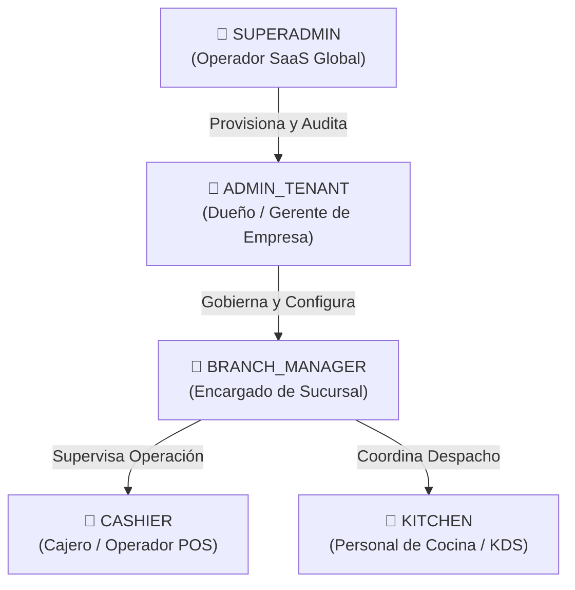

# 🌐 Mapa Macro de Actores y Casos de Uso del Sistema

Este documento establece la arquitectura funcional global del **Sistema Integral de Gestión para Restaurantes**, modelando la interacción entre los diferentes perfiles de usuario (**Actores**) y los subsistemas de negocio (**Paquetes / Módulos Modulith**) bajo el estándar de **Specification-Driven Development (SDD)**.

---

## 👥 1. Taxonomía de Actores del Ecosistema

El sistema implementa un modelo de autorización basado en roles (**Role-Based Access Control - RBAC**) y particionamiento multi-tenant estricto por `tenant_id` y `branch_id`. Se definen 5 actores con límites de responsabilidad claramente segregados:

### Descripción de Responsabilidades y Límites

| Actor | Alcance Operativo | Responsabilidades Principales | Restricciones Inviolables de Seguridad |
| :--- | :--- | :--- | :--- |
| **`SUPERADMIN`** | Nivel SaaS Supra-Tenant (Plataforma Global). | Alta de nuevas empresas (Tenants), asignación de suscripciones y límites de sucursales, auditoría técnica y gobernanza global. | **Prohibido:** No opera restaurantes, no puede abrir turnos de caja, alterar recetas ni registrar ventas en nombre de un tenant. |
| **`ADMIN_TENANT`** | Empresa Completa (Tenant y todas sus sucursales). | Creación de sucursales, gestión de usuarios, definición del Catálogo Maestro corporativo (Platos, Insumos, Fichas Técnicas BOM), configuración de modos de deducción de stock y consulta de finanzas consolidadas. | **Prohibido:** No tiene acceso a datos ni transacciones de otros tenants (`tenant_id` inmutable en JWT). |
| **`BRANCH_MANAGER`** | Sucursal Asignada (`branch_id`). | Ajustes de inventario local (mermas, conteos físicos), registro de stock inicial, sobreescritura de precios locales (`branch_dishes`), aprobación/rechazo de gastos de caja chica (`expenses`) y auditoría de arqueos. | **Prohibido:** No puede crear nuevos platos maestros corporativos ni acceder a datos operativos de sucursales hermanas sin autorización. |
| **`CASHIER`** | Estación POS de Sucursal en Turno Activo. | Apertura de turno con fondo inicial, armado reactivo de comandas, cobro multiformato (Efectivo, Tarjeta, QR, Transferencia), emisión de tickets locales offline y solicitud de egresos de caja chica. | **Prohibido:** Prohibido ver costos de compra de insumos, fórmulas de recetas (BOM), márgenes de ganancia o reportes financieros globales. |
| **`KITCHEN`** | Monitor de Cocina (KDS) de Sucursal. | Visualización de comandas en cola (`WAITING`, `IN_PREPARATION`), actualización de estado de preparación y despacho de platos (`READY`, `DELIVERED`). | **Prohibido:** Prohibido acceder a montos dinerarios, cobros, cierres de turno, costos de insumos o gestión administrativa. |

---

## 🗺️ 2. Mapa Macro de Casos de Uso por Subsistema

El siguiente diagrama detalla la relación funcional entre los 5 actores y los límites modulares del backend Spring Modulith y frontend Angular Dexie:

```mermaid
flowchart LR
    %% Declaración de Actores
    subgraph Actores["Perfiles y Actores del Sistema"]
        direction TB
        Act_SA["SUPERADMIN<br/>(Árbitro SaaS)"]
        Act_AT["ADMIN_TENANT<br/>(Propietario / Gerente)"]
        Act_BM["BRANCH_MANAGER<br/>(Gerente de Sucursal)"]
        Act_CS["CASHIER<br/>(Cajero POS)"]
        Act_KT["KITCHEN<br/>(Personal Cocina)"]
    end

    %% Módulo Core: Autenticación y Tenancy
    subgraph Mod_Core["Core: Autenticación y Tenancy"]
        UC_COR_01["UC-COR-01: Login y Emisión de JWT"]
        UC_COR_02["UC-COR-02: Gestión de Tenants y Licencias"]
        UC_COR_03["UC-COR-03: Administración de Sucursales y Zonas IANA"]
        UC_COR_04["UC-COR-04: Administración de Colaboradores y Roles"]
    end

    %% Módulo Catálogo
    subgraph Mod_Catalog["Módulo Catálogo & Recetas (BOM)"]
        UC_CAT_01["UC-CAT-01: Administrar Categorías"]
        UC_CAT_02["UC-CAT-02: Gestionar Insumos Base"]
        UC_CAT_03["UC-CAT-03: Crear/Editar Platos con Receta BOM"]
        UC_CAT_04["UC-CAT-04: Sobrescribir Precios por Sucursal"]
        UC_CAT_05["UC-CAT-05: Clonar Plato con Receta Diferenciada"]
        UC_CAT_06["UC-CAT-06: Consultar Menú Efectivo para POS"]
    end

    %% Módulo POS
    subgraph Mod_POS["Módulo Punto de Venta (POS & Ventas)"]
        UC_POS_01["UC-POS-01: Cargar y Cachear Catálogo en Dexie.js"]
        UC_POS_02["UC-POS-02: Armar Carrito de Ventas Reactivo"]
        UC_POS_03["UC-POS-03: Checkout y Cobro Idempotente"]
        UC_POS_04["UC-POS-04: Transmitir Orden con X-Client-Tx-Id"]
        UC_POS_05["UC-POS-05: Sincronización Batch Offline-to-Online"]
        UC_POS_06["UC-POS-06: Publicar OrderPaidEvent"]
    end

    %% Módulo Inventario
    subgraph Mod_Inv["Módulo Inventario & Kardex"]
        UC_INV_01["UC-INV-01: Registro de Inventario Inicial"]
        UC_INV_02["UC-INV-02: Consulta de Existencias Físicas"]
        UC_INV_03["UC-INV-03: Deducción Automática por Receta"]
        UC_INV_04["UC-INV-04: Consulta de Libro Mayor Kardex y CPP"]
        UC_INV_05["UC-INV-05: Ajustes Manuales de Merma / Conteo"]
    end

    %% Módulo Finanzas
    subgraph Mod_Fin["Módulo Finanzas & Control de Caja"]
        UC_FIN_01["UC-FIN-01: Apertura de Turno de Caja"]
        UC_FIN_02["UC-FIN-02: Acumulación de Ventas en Vivo"]
        UC_FIN_03["UC-FIN-03: Solicitud de Gasto de Caja Chica"]
        UC_FIN_04["UC-FIN-04: Aprobación/Rechazo de Gasto"]
        UC_FIN_05["UC-FIN-05: Cierre de Turno y Conciliación de Arqueo"]
        UC_FIN_06["UC-FIN-06: Consulta de Resumen Financiero"]
    end

    %% Conexiones SUPERADMIN
    Act_SA --> UC_COR_02

    %% Conexiones ADMIN_TENANT
    Act_AT --> UC_COR_03
    Act_AT --> UC_COR_04
    Act_AT --> UC_CAT_01
    Act_AT --> UC_CAT_02
    Act_AT --> UC_CAT_03
    Act_AT --> UC_CAT_04
    Act_AT --> UC_CAT_05
    Act_AT --> UC_INV_02
    Act_AT --> UC_INV_04
    Act_AT --> UC_FIN_06

    %% Conexiones BRANCH_MANAGER
    Act_BM --> UC_CAT_04
    Act_BM --> UC_INV_01
    Act_BM --> UC_INV_02
    Act_BM --> UC_INV_04
    Act_BM --> UC_INV_05
    Act_BM --> UC_FIN_04
    Act_BM --> UC_FIN_05
    Act_BM --> UC_FIN_06

    %% Conexiones CASHIER
    Act_CS --> UC_COR_01
    Act_CS --> UC_CAT_06
    Act_CS --> UC_POS_01
    Act_CS --> UC_POS_02
    Act_CS --> UC_POS_03
    Act_CS --> UC_POS_04
    Act_CS --> UC_POS_05
    Act_CS --> UC_FIN_01
    Act_CS --> UC_FIN_03
    Act_CS --> UC_FIN_05

    %% Conexiones KITCHEN
    Act_KT --> UC_COR_01
    Act_KT --> UC_POS_06

    %% Eventos Asíncronos entre Subsistemas
    UC_POS_06 -.->|"OrderPaidEvent (Asíncrono)"| UC_INV_03
    UC_POS_06 -.->|"OrderPaidEvent (Asíncrono)"| UC_FIN_02
```

---

## 📊 3. Matriz de Trazabilidad: Casos de Uso vs. Actores (RBAC)

La siguiente tabla resume los privilegios efectivos de acceso y ejecución:
- **`CRUD`**: Capacidad total de Crear, Leer, Actualizar y Eliminar / Desactivar.
- **`R`**: Consulta y Lectura únicamente (sin privilegios de mutación).
- **`X`**: Ejecución de acción operativa o flujo transaccional.
- **`A`**: Aprobación / Auditoría sobre registros de terceros.
- **`-`**: Acceso estrictamente denegado (403 Forbidden o inaccesible por UI).

| Código UC | Caso de Uso del Sistema | Subsistema | `SUPERADMIN` | `ADMIN_TENANT` | `BRANCH_MANAGER` | `CASHIER` | `KITCHEN` |
| :--- | :--- | :--- | :---: | :---: | :---: | :---: | :---: |
| **UC-COR-01** | Login y Autenticación con JWT | Core / Security | **X** | **X** | **X** | **X** | **X** |
| **UC-COR-02** | Provisionamiento de Tenants y Licencias | Core / Common | **CRUD** | **-** | **-** | **-** | **-** |
| **UC-COR-03** | Administración de Sucursales y Husos IANA | Core / Common | **R** | **CRUD** | **R** | **-** | **-** |
| **UC-COR-04** | Gestión de Usuarios y Asignación de Sede | Core / Security | **R** | **CRUD** | **R** | **-** | **-** |
| **UC-CAT-01** | Administrar Categorías de Menú | Catálogo | **-** | **CRUD** | **R** | **R** | **-** |
| **UC-CAT-02** | Gestionar Insumos Base y Stock Mínimo | Catálogo | **-** | **CRUD** | **R** | **-** | **-** |
| **UC-CAT-03** | Crear y Editar Platos con Ficha Técnica (BOM) | Catálogo | **-** | **CRUD** | **R** | **-** | **-** |
| **UC-CAT-04** | Sobrescribir Precios y Disponibilidad por Sucursal | Catálogo | **-** | **CRUD** | **CRUD** | **-** | **-** |
| **UC-CAT-05** | Clonar Plato Maestro con Receta Diferenciada | Catálogo | **-** | **CRUD** | **-** | **-** | **-** |
| **UC-CAT-06** | Consultar Catálogo Efectivo de Sucursal para POS | Catálogo | **-** | **R** | **R** | **R** | **-** |
| **UC-POS-01** | Cargar y Cachear Catálogo en Dexie.js | POS | **-** | **-** | **-** | **X** | **-** |
| **UC-POS-02** | Armar Carrito de Ventas Reactivo | POS | **-** | **-** | **-** | **X** | **-** |
| **UC-POS-03** | Checkout y Cobro Idempotente de Comanda | POS | **-** | **-** | **-** | **X** | **-** |
| **UC-POS-04** | Transmisión Online de Comanda (`X-Client-Tx-Id`) | POS | **-** | **-** | **-** | **X** | **-** |
| **UC-POS-05** | Reconciliación Asíncrona Offline-to-Online Batch | POS | **-** | **-** | **-** | **X** | **-** |
| **UC-POS-06** | Emisión del Evento del Dominio `OrderPaidEvent` | POS | **-** | **-** | **-** | **Sistema** | **R** |
| **UC-INV-01** | Registro de Inventario Inicial por Sucursal | Inventario | **-** | **CRUD** | **CRUD** | **-** | **-** |
| **UC-INV-02** | Consulta de Existencias Físicas y Balance | Inventario | **-** | **R** | **R** | **-** | **-** |
| **UC-INV-03** | Deducción Automática por Receta ante `OrderPaidEvent` | Inventario | **-** | **-** | **-** | **-** | **Sistema** |
| **UC-INV-04** | Consulta de Libro Mayor Kardex y Costo Promedio | Inventario | **-** | **R** | **R** | **-** | **-** |
| **UC-INV-05** | Ajustes Manuales de Stock (Mermas / Conteos) | Inventario | **-** | **CRUD** | **CRUD** | **-** | **-** |
| **UC-FIN-01** | Apertura de Turno de Caja con Monto Inicial | Finanzas | **-** | **-** | **R** | **X** | **-** |
| **UC-FIN-02** | Acumulación de Ventas en Vivo ante `OrderPaidEvent` | Finanzas | **-** | **-** | **-** | **-** | **Sistema** |
| **UC-FIN-03** | Solicitud y Registro de Gasto de Caja Chica | Finanzas | **-** | **CRUD** | **CRUD** | **X** | **-** |
| **UC-FIN-04** | Aprobación / Rechazo de Gastos por Supervisor | Finanzas | **-** | **A** | **A** | **-** | **-** |
| **UC-FIN-05** | Cierre de Turno y Conciliación de Arqueo en Vivo | Finanzas | **-** | **R** | **R / A** | **X** | **-** |
| **UC-FIN-06** | Consulta de Resumen Financiero de Turno | Finanzas | **-** | **R** | **R** | **R** | **-** |

---

## 🔒 4. Principios y Patrones Arquitectónicos Clave

1. **Aislamiento Multi-Tenant Hermético:**
   - Todo request autenticado propaga `tenant_id` y `branch_id` en el contexto del hilo vía `TenantContextHolder`.
   - Ninguna consulta SQL o índice omite `tenant_id`. Las mutaciones sin contexto arrojan `IllegalStateException`.
2. **Resiliencia Offline-First en POS:**
   - La caja no se detiene ante cortes de conectividad. Las ventas se graban en Dexie.js con `syncStatus = 'PENDING'` y se emite ticket local.
   - La sincronización online es idempotente garantizada por `client_transaction_id` (UUIDv4) y la cabecera `X-Client-Transaction-Id`.
3. **Coreografía Basada en Eventos de Dominio:**
   - La finalización de cobro en POS publica `OrderPaidEvent`.
   - Los módulos de **Inventario** (`InventoryEventListener`) y **Finanzas** (`FinanceEventListener`) consumen el evento de manera asíncrona y atómica mediante `@ApplicationModuleListener` de Spring Modulith.
4. **Gobernanza de Fechas y Husos Horarios (ADR-0006):**
   - Base de datos: `DATE` para fechas de calendario puro, `TIMESTAMPTZ` para instantes transaccionales en UTC.
   - Presentación: Conversión estricta a la zona horaria configurada en la sucursal (`branches.timezone`, default `'America/La_Paz'`).

---

## 🔗 5. Navegación por Especificaciones Detalladas

Para profundizar en la especificación técnica, precondiciones, flujos de eventos y endpoints REST de cada módulo, consulte los documentos complementarios:

- 📋 **Catálogo y Recetas (BOM):** [use_cases_catalog.md](./use_cases_catalog.md)
- 🛒 **Punto de Venta (POS & Ventas):** [use_cases_pos.md](./use_cases_pos.md)
- 📦 **Inventario y Kardex (CPP):** [use_cases_inventory.md](./use_cases_inventory.md)
- 💰 **Finanzas y Turnos de Caja:** [use_cases_finance.md](./use_cases_finance.md)
- 🏛️ **Índice General de Arquitectura:** [README](../README.md)
