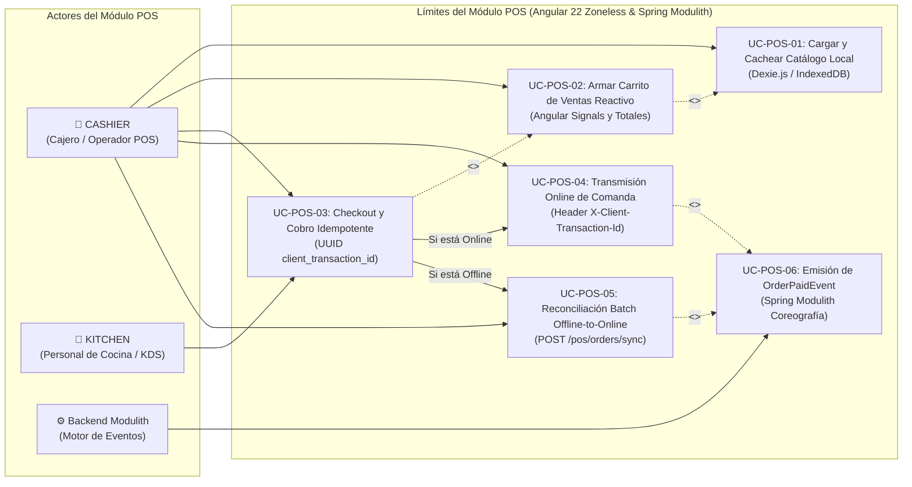

# 🛒 Casos de Uso - Módulo Punto de Venta (POS & Ventas)

El módulo de **Punto de Venta (POS & Ventas)** es el núcleo de captura transaccional del restaurante. Diseñado bajo el paradigma **Offline-First**, permite la venta ininterrumpida frente a pérdidas de conectividad mediante persistencia local en **Dexie.js (IndexedDB)** y garantiza la consistencia del servidor con transacciones idempotentes (`client_transaction_id`).

---

## 🗺️ 1. Diagrama de Casos de Uso del Módulo POS

---

## 📝 2. Especificación Detallada de Casos de Uso

---

### UC-POS-01: Cargar y Cachear Catálogo en Memoria Local (Dexie.js)

| Dimensión | Especificación Formal |
| :--- | :--- |
| **Identificador** | `UC-POS-01` |
| **Nombre** | Cargar y Cachear Catálogo en Memoria Local (Dexie.js) |
| **Actor Principal** | `CASHIER` |
| **Actores Secundarios** | Sistema Local (Dexie.js / IndexedDB) |
| **Objetivo** | Descargar el catálogo de categorías y productos activos de la sucursal y persistirlos en la base de datos local del navegador para permitir búsquedas instantáneas y operación 100% offline. |
| **Precondiciones** | El usuario debe haber iniciado sesión y tener una sucursal asignada (`branchId`). |
| **Flujo Principal** | 1. El cajero abre la pantalla de ventas `/pos`. 2. El servicio `PosService.loadCatalog(branchId)` comprueba la conectividad mediante `isOnline()`. 3. **Estrategia Online (Cache-Refresh):**    a. Solicita en paralelo `GET /api/v1/catalog/categories` y `GET /api/v1/catalog/dishes?branchId={branchId}`.    b. Limpia las tablas locales `cachedCategories` y `cachedProducts`.    c. Inserta en bloque los registros descargados (`bulkPut`).    d. Actualiza los signals de interfaz `categories` y `products`. 4. **Estrategia Offline (Fallback):**    a. Si la red no responde o `isOnline() == false`, consulta directamente `appDb.cachedCategories.toArray()` y `appDb.cachedProducts.toArray()`.    b. Carga los productos en los signals sin bloquear la pantalla. 5. La interfaz del catálogo queda lista para interacción inmediata. |
| **Flujos Alternativos / Excepciones** | - **Primer inicio sin internet y sin caché previa:** Si Dexie está vacío y no hay conexión, se muestra una alerta informativa solicitando conectarse al menos una vez para la descarga inicial de datos. - **Error en IndexedDB:** Si el navegador restringe el almacenamiento local (modo incógnito estricto), los datos se mantienen en memoria volátil de Angular Signals. |
| **Postcondiciones** | El menú completo de la sucursal está disponible en memoria local del navegador sin latencia de red. |
| **Contrato Técnico** | - Backend: `GET /api/v1/catalog/categories`, `GET /api/v1/catalog/dishes?branchId={branchId}` - Local DB: `cachedCategories: 'id, name, sortOrder'`, `cachedProducts: 'id, categoryId, code, name, salePrice, isAvailable'` |
| **Entidades Afectadas** | Dexie.js: `cachedCategories`, `cachedProducts` |

---

### UC-POS-02: Armar Carrito de Ventas Reactivo (Angular Signals)

| Dimensión | Especificación Formal |
| :--- | :--- |
| **Identificador** | `UC-POS-02` |
| **Nombre** | Armar Carrito de Ventas Reactivo |
| **Actor Principal** | `CASHIER` |
| **Actores Secundarios** | Ninguno |
| **Objetivo** | Permitir la selección ágil de platos, modificación de cantidades, adición de notas especiales de comanda (ej. "sin cebolla") y cálculo reactivo en tiempo real de subtotales y total a pagar sin disparar re-renderizados innecesarios (Zoneless). |
| **Precondiciones** | El catálogo local debe estar cargado en Dexie (`UC-POS-01`). |
| **Flujo Principal** | 1. El cajero pulsa una tarjeta de producto o escanea/busca su código. 2. Se invoca `PosService.addToCart(dish, quantity, notes)`:    - Si el ítem ya está en el carrito (`dishId`), se incrementa `quantity` y se recalcula `subtotal = Number((quantity * unitPrice).toFixed(2))`.    - Si es nuevo, se crea un nuevo objeto `CartItem` y se inserta en el signal `cartItems`. 3. Los signals computados (`computed`) recalculan automáticamente en microtareas:    - `totalAmount`: Suma de todos los subtotales con redondeo a 2 decimales.    - `totalItemsCount`: Suma total de unidades. 4. El cajero puede incrementar/decrementar cantidades (`updateQuantity`), eliminar ítems (`removeFromCart`) o vaciar el pedido (`clearCart`). |
| **Flujos Alternativos / Excepciones** | - **Disminución a cero:** Si el usuario presiona "-" cuando la cantidad es 1, el ítem se elimina automáticamente del carrito. - **Producto no disponible:** Si `isAvailable == false`, el botón de la UI se bloquea impidiendo la adición al carrito. |
| **Postcondiciones** | El signal `cartItems` contiene los ítems listos para el cobro y `totalAmount` refleja el monto exacto a cobrar. |
| **Contrato Técnico** | Estado reactivo frontend en `PosService`: `cartItems = signal<CartItem[]>([])`, `totalAmount = computed(...)`. |
| **Entidades Afectadas** | Memoria volátil del cliente Angular 22 (Zoneless). |

---

### UC-POS-03: Checkout y Cobro de Comanda con Idempotencia

| Dimensión | Especificación Formal |
| :--- | :--- |
| **Identificador** | `UC-POS-03` |
| **Nombre** | Checkout y Cobro de Comanda con Idempotencia (`client_transaction_id`) |
| **Actor Principal** | `CASHIER` |
| **Actores Secundarios** | `KITCHEN` (Recibe comanda local o impresa) |
| **Objetivo** | Finalizar la venta registrando el método de pago (`CASH`, `CARD`, `QR`, `TRANSFER`), asociando la orden al turno de caja abierto (`cash_shifts`), garantizando idempotencia mediante un UUID único originado en el cliente y persistiendo inmediatamente en Dexie.js antes de cualquier intento de red. |
| **Precondiciones** | El carrito debe tener al menos un ítem (`cartItems.length > 0`). Debe existir un turno de caja abierto (`cashShiftId`). |
| **Flujo Principal** | 1. El cajero pulsa "Cobrar" y selecciona el método de pago (`CASH`, `CARD`, `QR`, `TRANSFER`). 2. El sistema genera un identificador de transacción único universal (`client_transaction_id = crypto.randomUUID()`). 3. Se genera un número de comprobante provisional `ticketNumber = LOCAL-{clientTxId[:8]}`. 4. **Persistencia Local Inmediata (Offline-Safe):**    - Se crea una entidad `PendingOrderEntity` con `syncStatus = 'PENDING'` y se guarda en `appDb.pendingOrders`.    - Se incrementa el contador `pendingCount`.    - Se limpia el carrito de venta (`clearCart`). 5. **Derivación de Envío:**    - Si `isOnline() == true`, ejecuta de inmediato `UC-POS-04` (Transmisión Online).    - Si `isOnline() == false`, finaliza el flujo local emitiendo el comprobante offline. |
| **Flujos Alternativos / Excepciones** | - **Carrito vacío:** Arroja excepción "El carrito de venta está vacío" bloqueando el botón. - **Sin turno abierto:** Se alerta al usuario de que debe abrir caja antes de proceder con el cobro. |
| **Postcondiciones** | La venta queda registrada de forma persistente e indestructible en el navegador. Si hay conexión, se envía al servidor; de lo contrario, queda encolada para sincronización batch posterior. |
| **Contrato Técnico** | - Local: `appDb.pendingOrders.add(pendingEntity)` - Modelo: `PendingOrderEntity` (`localId`, `clientTransactionId`, `syncStatus`, `createdAt`, `orderData`, `ticketNumber`, `totalAmount`) |
| **Entidades Afectadas** | Dexie.js: `pendingOrders` |

---

### UC-POS-04: Transmisión Online de Comanda con Cabecera `X-Client-Transaction-Id`

| Dimensión | Especificación Formal |
| :--- | :--- |
| **Identificador** | `UC-POS-04` |
| **Nombre** | Transmisión Online de Comanda con cabecera `X-Client-Transaction-Id` |
| **Actor Principal** | `CASHIER` (Desencadenado por `UC-POS-03`) |
| **Actores Secundarios** | Backend Spring Modulith (`OrderController`) |
| **Objetivo** | Enviar la comanda cobrada al backend mediante petición HTTP POST segura, adjuntando la cabecera de idempotencia para evitar cobros duplicados ante reintentos de red. |
| **Precondiciones** | `isOnline() == true` y token JWT presente en cabeceras (`Authorization: Bearer ...`). |
| **Flujo Principal** | 1. El frontend envía `POST /api/v1/pos/orders` con:    - Cabecera: `X-Client-Transaction-Id: {clientTransactionId}`.    - Cuerpo: `CreateOrderRequest` (`clientTransactionId`, `branchId`, `cashShiftId`, `paymentMethod`, `notes`, `items`). 2. El backend intercepta la solicitud y verifica si ya existe una orden con ese `client_transaction_id` en el tenant:    - **Si ya existe (Reintento de Red):** Recupera la orden previa sin duplicar cobro ni eventos y retorna `200 OK`.    - **Si es nueva:**      a. Persiste `Order` con estado `PAID` y sus `order_items` en PostgreSQL.      b. Genera el número secuencial de ticket oficial (ej. "TKT-001042").      c. Ejecuta `UC-POS-06` (Publicación de `OrderPaidEvent`).      d. Retorna `201 Created` con el `OrderDto` consolidado. 3. Al recibir `200` o `201`, el frontend actualiza el registro en Dexie `pendingOrders` marcándolo como `syncStatus = 'SYNCED'`. 4. Se decrementa `pendingCount`. |
| **Flujos Alternativos / Excepciones** | - **Caída de conexión durante el envío (Timeout o Network Error):** La orden permanece en Dexie como `syncStatus = 'PENDING'`. No se pierde la venta y será sincronizada por `UC-POS-05`. - **Turno de caja cerrado en servidor:** Retorna `400 Bad Request` informando que el turno fue cerrado remotamente. |
| **Postcondiciones** | La orden queda grabada en PostgreSQL y se disparan los procesos en segundo plano de inventario y caja. |
| **Contrato de API** | - `POST /api/v1/pos/orders` - Headers: `X-Client-Transaction-Id: UUID` - Response: `201 Created` / `200 OK` (`OrderDto`) |
| **Entidades Afectadas** | PostgreSQL: `orders`, `order_items`. Dexie.js: `pendingOrders` (actualización a `SYNCED`) |

---

### UC-POS-05: Reconciliación Asíncrona Offline-to-Online (Batch `/sync`)

| Dimensión | Especificación Formal |
| :--- | :--- |
| **Identificador** | `UC-POS-05` |
| **Nombre** | Reconciliación Asíncrona Offline-to-Online (Batch `/sync` de pendingOrders) |
| **Actor Principal** | Sistema Frontend / `CASHIER` |
| **Actores Secundarios** | Backend Spring Modulith (`OrderController`) |
| **Objetivo** | Sincronizar en bloque todas las ventas acumuladas localmente mientras la terminal estuvo fuera de línea tan pronto se detecta la restauración de la conexión a internet. |
| **Precondiciones** | Existen registros en Dexie con `syncStatus = 'PENDING'` y el navegador emite el evento global `window.addEventListener('online')` o el cajero pulsa manualmente "Sincronizar". |
| **Flujo Principal** | 1. `PosService` detecta la reconexión y activa el signal `isSyncing.set(true)`. 2. Consulta en Dexie: `appDb.pendingOrders.where('syncStatus').equals('PENDING').toArray()`. 3. Si hay órdenes pendientes, arma el payload `SyncOrdersRequest` con la lista de `CreateOrderRequest`. 4. Emite `POST /api/v1/pos/orders/sync`. 5. El backend procesa el lote de manera atómica:    - Para cada orden, verifica idempotencia por `client_transaction_id`.    - Inserta órdenes nuevas, publica los correspondientes `OrderPaidEvent` e ignora duplicados.    - Retorna `SyncOrdersResponse` con conteos: `processed`, `synced`, `duplicates`, `failed` y detalles de error si aplican. 6. El cliente actualiza en Dexie todos los registros procesados a `syncStatus = 'SYNCED'`. 7. Se actualiza el signal `pendingCount` a 0 y `isSyncing.set(false)`. |
| **Flujos Alternativos / Excepciones** | - **Fallo parcial en lote:** Si alguna orden puntual contiene un `dishId` eliminado, el backend reporta el fallo en `SyncOrdersResponse.errors` sin abortar el resto del lote. - **Desconexión en plena sincronización:** La sincronización se suspende y se reintentará en el siguiente ciclo `online` sin duplicar transacciones gracias a la idempotencia. |
| **Postcondiciones** | Todas las comandas acumuladas offline se encuentran conciliadas en PostgreSQL sin diferencias monetarias ni pérdidas de stock. |
| **Contrato de API** | - `POST /api/v1/pos/orders/sync` → `200 OK` (`SyncOrdersRequest` → `SyncOrdersResponse`) |
| **Entidades Afectadas** | PostgreSQL: `orders`, `order_items`. Dexie.js: `pendingOrders` |

---

### UC-POS-06: Emisión del Evento del Dominio `OrderPaidEvent`

| Dimensión | Especificación Formal |
| :--- | :--- |
| **Identificador** | `UC-POS-06` |
| **Nombre** | Emisión del Evento del Dominio `OrderPaidEvent` |
| **Actor Principal** | Sistema Backend (`OrderServiceImpl`) |
| **Actores Secundarios** | `InventoryEventListener`, `FinanceEventListener` |
| **Objetivo** | Publicar de forma atómica y desacoplada el evento de dominio que notifica a toda la arquitectura modular que una comanda ha sido pagada y debe repercutir en inventario y caja. |
| **Precondiciones** | La orden debe haber sido persistida con éxito en PostgreSQL con estado `PAID` (`UC-POS-04` o `UC-POS-05`). |
| **Flujo Principal** | 1. El servicio `OrderServiceImpl` construye el record inmutable `OrderPaidEvent` con:    - `eventId`: UUID único de evento.    - `tenantId`, `branchId`, `orderId`, `clientTransactionId`.    - `ticketNumber`: Código de ticket secuencial.    - `items`: Lista de `OrderItemSummary` (`dishId`, `quantity`, `unitPrice`).    - `totalAmount`, `paymentMethod`, `paidAt`, `cashShiftId`. 2. Publica el evento en el bus de eventos de Spring Modulith mediante `ApplicationEventPublisher.publishEvent(...)`. 3. Spring Modulith intercepta el evento e inserta un registro en la tabla de outbox `event_publication` para garantizar persistencia y reintentos automáticos. 4. Los listeners modulares (`InventoryEventListener` y `FinanceEventListener`) reciben el evento en hilos virtuales dedicados. |
| **Flujos Alternativos / Excepciones** | - **Fallo en Listener Asíncrono:** Si el listener de inventario falla por concurrencia, Spring Modulith mantiene el evento marcado como pendiente en `event_publication` para reintento automático sin comprometer la respuesta HTTP de la venta al cajero. |
| **Postcondiciones** | El evento queda despachado. Se inician de inmediato la deducción de recetas en Kardex ([use_cases_inventory.md](./use_cases_inventory.md)) y la acumulación de ventas en el turno de caja ([use_cases_finance.md](./use_cases_finance.md)). |
| **Contrato Técnico** | - Record: `com.restaurant.app.modules.pos.api.OrderPaidEvent` - Bus: `org.springframework.context.ApplicationEventPublisher` - Outbox: tabla `event_publication` de Spring Modulith |
| **Entidades Afectadas** | `event_publication` |

---

## 🔗 3. Relación con Otros Subsistemas

- **Catálogo:** Obtiene los platos y categorías cacheados localmente mediante [use_cases_catalog.md](./use_cases_catalog.md).
- **Inventario:** Desencadena la deducción por receta y cálculo del Costo Promedio Ponderado en [use_cases_inventory.md](./use_cases_inventory.md).
- **Finanzas:** Alimenta el arqueo en tiempo real del turno de caja en [use_cases_finance.md](./use_cases_finance.md).
- **Índice General:** [README](../README.md)
