# 🛒 Casos de Uso - Módulo Punto de Venta (POS & Ventas)

El módulo **POS** (`modules.pos` y ruta `/pos`) opera como terminal de mostrador de alta velocidad con arquitectura Offline-First parcial en Angular 22 + Dexie.js, invariante estricto de turno abierto ([ADR-0013](../../../adr/0013_pos_shift_invariant_and_expense_authorizations.md)), personalización de platos/combos, modalidades de despacho, promociones y cancelaciones auditadas.

> [!IMPORTANT]
> **Alcance Real Offline vs Online (Sprint 6):**
> - Actualmente `appDb` (Dexie.js) mantiene exactamente **4 tablas reales**: `cachedCategories`, `cachedProducts`, `pendingOrders` y `activeShift`.
> - Los **combos dinámicos**, la jornada **`BranchServiceSession`** con cupos de menú diario y las **promociones vigentes** consultan el backend en línea (`TASK-640` cubre la ampliación futura de caché offline en `appDb`).
> - La vista interactiva de cocina (**KDS / `PB-010`**, permiso reservado `pos:kds`) pertenece al backlog futuro y no está activa en este corte.

---

## 🗺️ 1. Diagrama General de Casos de Uso del Módulo POS

```mermaid
flowchart TB
    Cashier["👤 CASHIER (/pos)"]
    Sup["👤 Supervisor (PIN / Autorización)"]
    Net["🌐 Backend Spring Modulith"]

    subgraph Mod_POS["Módulo Punto de Venta (modules.pos)"]
        UC01["UC-POS-01: Caché Dexie + Selector Vista Triple"]
        UC02["UC-POS-02: Carrito Reactivo Signals"]
        UC03["UC-POS-03: Modificadores y Notas por Ítem"]
        UC04["UC-POS-04: Combos con order_item_selections"]
        UC05["UC-POS-05: Modalidades de Servicio y Delivery"]
        UC06["UC-POS-06: Checkout Idempotente Local (pendingOrders)"]
        UC07["UC-POS-07: Transmisión Online y 409 Shift/Quota"]
        UC08["UC-POS-08: Reconciliación Batch (/orders/sync)"]
        UC09["UC-POS-09: Atención Móvil y Bottom Sheet"]
        UC10["UC-POS-10: Operar BranchServiceSession Activa"]
        UC11["UC-POS-11: Menú Diario y Cupos (@Version / isUnlimited)"]
        UC12["UC-POS-12: Ajustar Cupos en Vivo (adjust-quota)"]
        UC13["UC-POS-13: Promociones Vigentes (/pos/promotions)"]
        UC14["UC-POS-14: Cancelación con PIN / Autorización"]
    end

    Cashier --> UC01
    Cashier --> UC02
    Cashier --> UC03
    Cashier --> UC04
    Cashier --> UC05
    Cashier --> UC06
    Cashier --> UC09
    Cashier --> UC10
    Cashier --> UC11
    Cashier --> UC13
    Cashier --> UC14
    Sup --> UC12
    Sup --> UC14
    UC07 --> Net
    UC08 --> Net
```

---

## 📝 2. Especificación Detallada de Casos de Uso

### UC-POS-01: Cargar Catálogo Local (Dexie.js) y Selector Triple de Vista

- **Identificador:** `UC-POS-01` · **Actor:** `CASHIER` (`pos:access`)
- **Flujo Principal:**
  1. Al entrar a `/pos`, `PosService` descarga categorías, platos efectivos de la sucursal (`UC-CAT-06`) y turno activo, almacenándolos en `appDb` (`cachedCategories`, `cachedProducts`, `activeShift`). Si no hay red, lee desde Dexie.js.
  2. La cabecera del POS lee `pos.display_dish_images` como preferencia inicial y ofrece el **Selector Triple de Vista** (`COMPLETO`, `COMPACTO`, `LISTA`), persistido por sucursal en `localStorage`.

---

### UC-POS-02: Armar Carrito de Ventas Reactivo (Angular Signals)

- **Identificador:** `UC-POS-02` · **Actor:** `CASHIER` (`pos:order_create`)
- **Flujo Principal:**
  1. El cajero agrega productos, incrementa/disminuye cantidades y visualiza en tiempo real subtotales, descuentos promocionales aplicables (`effectivePromotion()`) y total neto con Signals sin Zone.js.

---

### UC-POS-03: Personalizar Plato con Modificadores, Extras y Notas (`PB-020`)

- **Identificador:** `UC-POS-03` · **Actor:** `CASHIER` (`pos:order_create`)
- **Flujo Principal:**
  1. Si el plato posee grupos de modificadores asignados (`UC-CAT-08`), el POS abre el selector de modificadores respetando `minSelectable`, `maxSelectable` e `isRequired`, más nota abierta de cocina (`notes`).
  2. Cada opción elegida viaja en `SelectedModifierRequest(modifierId, name, unitPrice, ingredientId, quantityConsumed)` dentro de `CreateOrderItemRequest`, sumando `additionalPrice` al precio unitario y alimentando la deducción `SALE_CONSUMPTION` en Kardex.

---

### UC-POS-04: Armar Combo Dinámico con `order_item_selections` (`V23`, `TASK-634`)

- **Identificador:** `UC-POS-04` · **Actor:** `CASHIER` (`pos:order_create`)
- **Flujo Principal:**
  1. Al seleccionar un combo configurado en catálogo (`ComboDto`), el POS guía paso a paso por sus bloques (`FIXED`, `SPECIFIC_OPTIONS`, `MENU_COURSE`).
  2. El ítem se construye con `dishId = null` (`order_items.dish_id` nullable en `V23`), `comboId`, opcionalmente `dailyMenuId` y la lista `selections` (`OrderItemSelectionRequest(slotLabel, selectedDishId, quantity, priceAdjustment)`).
  3. El backend persiste `order_item_selections`, descuenta cupos de cada plato seleccionado cuando aplica menú del día y deduce ingredientes por componente en Kardex.

---

### UC-POS-05: Seleccionar Modalidad de Servicio y Delivery (`PB-032`)

- **Identificador:** `UC-POS-05` · **Actor:** `CASHIER` (`pos:order_create`)
- **Flujo Principal:**
  1. El POS preselecciona la modalidad según `pos.default_order_mode` (default `DINE_IN`) y ofrece cambio rápido tanto en la barra superior como en el checkout entre `DINE_IN`, `TAKEOUT`, `SCHEDULED_PICKUP` (cuando `pos.allow_scheduled_pickup = true`) y `DELIVERY`.
  2. Si es `DELIVERY`, solicita `customerName`, `customerPhone`, `deliveryAddress`, `deliveryNotes` y calcula `deliveryFee` según `pos.delivery_fee_enabled` / `pos.delivery_fee_default`, enviándolos en `CreateOrderRequest`.

---

### UC-POS-06: Checkout Idempotente Local (`pendingOrders`)

- **Identificador:** `UC-POS-06` · **Actor:** `CASHIER` (`pos:order_create`)
- **Precondiciones:** Turno de caja activo (`activeShift`) y carrito no vacío.
- **Flujo Principal:**
  1. El cajero selecciona método de pago (`CASH`, `CARD`, `QR`, `TRANSFER`).
  2. El cliente genera `clientTransactionId = crypto.randomUUID()` y ticket provisional local.
  3. Persiste `PendingOrderEntity` con `syncStatus = 'PENDING'` en `appDb.pendingOrders`, limpia el carrito y deriva a `UC-POS-07` si hay conectividad (si no hay red, emite ticket local offline y conserva la barra discreta de pendientes).

---

### UC-POS-07: Transmisión Online de Comanda (`409 Conflict` en Turno / Cupos)

- **Identificador:** `UC-POS-07` · **Actor:** `CASHIER` / Sistema
- **Flujo Principal:**
  1. Envía `POST /api/v1/pos/orders` con cabecera `X-Client-Transaction-Id: {clientTransactionId}` y `CreateOrderRequest`.
  2. `OrderServiceImpl` verifica idempotencia por `client_transaction_id`; si ya existe, retorna `200 OK` sin duplicar cobro ni eventos.
  3. Si es nueva: valida existencia de turno abierto para el cajero/sucursal (`FinancePublicApi`), valida cuotas/cupos del menú diario si aplica, calcula/verifica promociones y delivery, persiste `Order` (`PAID`) con ticket secuencial, publica `OrderPaidEvent` (que dispara actualización financiera y deducción de Kardex) y retorna `201 Created` (`OrderDto`).
  4. El cliente marca el registro en `pendingOrders` como `SYNCED`.
- **Excepciones Reales (`RFC 7807`):**
  - **Sin turno de caja abierto en servidor:** Retorna **`409 Conflict` (`SHIFT_REQUIRED_ERROR`, `ShiftRequiredException`)** — nunca `400 Bad Request` — mostrando en POS un botón directo para abrir turno.
  - **Cupo agotado en menú del día:** Retorna **`409 Conflict` (`ITEM_SOLD_OUT`, `ItemSoldOutException`)**.
  - **Stock insuficiente en modo estricto:** Retorna `409 Conflict` (`INSUFFICIENT_STOCK_ERROR`).

---

### UC-POS-08: Reconciliación Batch Offline-to-Online (`/sync`)

- **Identificador:** `UC-POS-08` · **Actor:** `SyncManagerService`
- **Flujo Principal:**
  1. Al recuperar conectividad (`online` event), lee las órdenes `PENDING` de `appDb.pendingOrders` y envía `POST /api/v1/pos/orders/sync` (`SyncOrdersRequest`).
  2. El backend procesa cada orden idempotente retornando `SyncOrdersResponse(syncedOrders, totalReceived, totalProcessed)` y limpiando los pendientes en Dexie.

---

### UC-POS-09: Atención Móvil y Comanda Deslizable en Bottom Sheet (`ADR-0012`)

- **Identificador:** `UC-POS-09` · **Actor:** `CASHIER`
- **Flujo Principal:**
  1. En resoluciones `< 768px`, la barra de modalidad se compacta a iconos en cabecera, el catálogo ocupa el área principal y el resumen del carrito se ancla como píldora flotante que expande un Bottom Sheet táctil con botones de pago en fila única horizontal ([ADR-0012](../../../adr/0012_mobile_responsiveness_and_touch_ux.md)).

---

### UC-POS-10: Operar Sesión de Servicio Compartida (`BranchServiceSession`)

- **Identificador:** `UC-POS-10` · **Actor:** `CASHIER` / Sistema
- **Flujo Principal:**
  1. Al abrir el POS, consulta `GET /api/v1/catalog/service-sessions/current?branchId=...`.
  2. Si `menuMode = FULL_CATALOG`, expone el catálogo completo de la sucursal.
  3. Si `menuMode = DAILY_MENU`, despliega pestañas de menú del día y combos vinculados (`daily_menu_combos`), ocultando como producto suelto los platos con `allowIndividualSale = false` (disponibles solo al armar combos).

---

### UC-POS-11: Venta de Menú Diario con Control Atómico de Cupos

- **Identificador:** `UC-POS-11` · **Actor:** `CASHIER` / Sistema
- **Flujo Principal:**
  1. Cuando se venden ítems con límite de raciones (`isUnlimited = false`), `DailyMenuServiceImpl` decrementa atómicamente `shift_menu_items` mediante *Optimistic Locking* (`@Version`) y cláusula condicional `WHERE current_quota >= :qty`.
  2. Si `isUnlimited = true`, permite vender sin tope de cupo diario registrando igualmente `soldCount`.

---

### UC-POS-12: Ajuste Supervisado de Cupos en Vivo

- **Identificador:** `UC-POS-12` · **Actor:** Supervisor (`catalog:write` o `finance:shifts_supervisor`)
- **Flujo Principal:**
  1. Ante ampliación de raciones en cocina o merma operativa, el supervisor invoca `POST /api/v1/catalog/shifts/{shiftId}/menu-items/{itemId}/adjust-quota` (`AdjustQuotaRequest(quantityDelta, reason)`), reflejándose de inmediato los nuevos cupos en todos los terminales POS de la sucursal.

---

### UC-POS-13: Evaluación y Aplicación de Promociones Vigentes (`ADR-0032`)

- **Identificador:** `UC-POS-13` · **Actor:** `CASHIER` / `PromotionEngine`
- **Flujo Principal:**
  1. Al cargar el POS, consulta `GET /api/v1/pos/promotions/active?branchId={id}&evalTime={opt}`.
  2. `PromotionEngine` evalúa vigencia estrictamente en `branches.timezone` (fechas `startDate`/`endDate`, `daysOfWeek`, franja `startTime`/`endTime`, sucursal en `PromotionBranch` y `minOrderAmount`).
  3. En el corte actual, la interfaz POS muestra y aplica automáticamente en carrito/checkout (`effectivePromotion()`) las promociones activas de modo **`AUTOMATIC`**, enviando `appliedPromotionId` en `CreateOrderRequest`.
- **Estado de Alcance:** El backend ya expone `GET/POST /api/v1/pos/promotions` (`CreatePromotionRequest`) y soporta `applicationMode = MANUAL`; la vista administrativa CRUD de campañas promocionales, la selección manual explícita en POS y la caché offline de promociones permanecen como extensiones futuras (`TASK-640`).

---

### UC-POS-14: Cancelación de Orden Pagada con PIN / Autorización y Reembolso (`PB-031`)

- **Identificador:** `UC-POS-14` · **Actor:** `CASHIER` + Supervisor (`pos:void_item`)
- **Flujo Principal:**
  1. Desde comandas del turno (en `/cash-control` o historial reciente), el cajero solicita anular una orden en estado `PAID` indicando `cancellationReason` (`CUSTOMER_RETRACTED | TYPING_ERROR | KITCHEN_ISSUE | QUALITY_COMPLAINT | DUPLICATE_ORDER`), `cancellationNotes`, `refundMethod` (`CASH | DIGITAL`), si fue preparada en cocina (`wasPrepared`) y autorización (`supervisorPin` in-situ cuando `finance.require_supervisor_pin_cancel = true`, o `authorizationRequestId` aprobada remotamente en `/finance`).
  2. Envía `POST /api/v1/pos/orders/{orderId}/cancel` (`CancelOrderRequest`).
  3. El backend transiciona la orden de `PAID -> CANCELLED`, publica `OrderCancelledEvent` (desencadenando `totalCashRefunds` en caja si `refundMethod = CASH` y `CANCELLATION_REVERSAL` / `WASTE_ADJUSTMENT` / `PreparedDishBuffer` en Kardex según `pos.cancellation_prepared_waste_policy`) y retorna `200 OK` con `OrderDto`.

---

## Documentos Relacionados
- [Mapa Macro de Casos de Uso](./use_cases_overview.md)
- [Casos de Uso de Catálogo](./use_cases_catalog.md)
- [Casos de Uso de Finanzas](./use_cases_finance.md)
- [Casos de Uso de Inventario](./use_cases_inventory.md)
- [Casos de Uso de RBAC y Perfil](./use_cases_rbac.md)
- [Manual del Cajero POS](../../../manuals/restaurante/03_manual_cajero_pos.md)
- [Manual de Menús del Día y Jornada de Sucursal](../../../manuals/restaurante/02_menus_del_dia_y_jornada_sucursal.md)
- [Secuencia de Venta en POS y Deducción](../04-behavior-and-flows/sequence_pos_order_deduction.md)
- [Secuencia de Sincronización Offline POS](../04-behavior-and-flows/sequence_pos_offline_sync.md)
- [Secuencia de Cancelación de Órdenes y Autorizaciones](../04-behavior-and-flows/sequence_pos_order_cancellation_and_authorizations.md)
- [Secuencia de Evaluación de Promociones en POS](../04-behavior-and-flows/sequence_pos_promotions_evaluation.md)
- [Estado del Ciclo de Vida de la Orden](../04-behavior-and-flows/state_order_lifecycle.md)
- [Estado de UX Móvil en POS e Inventario](../04-behavior-and-flows/state_mobile_pos_and_inventory_ux.md)
- [ADR-0003: Estrategia Offline-First con Dexie.js](../../../adr/0003_offline_first_dexie_sync.md)
- [ADR-0006: Estándar de Fechas y Zonas Horarias](../../../adr/0006_datetime_and_timezone_handling.md)
- [ADR-0012: Adaptabilidad Móvil y Experiencia Táctil](../../../adr/0012_mobile_responsiveness_and_touch_ux.md)
- [ADR-0013: Invariante Transaccional de Turno en POS](../../../adr/0013_pos_shift_invariant_and_expense_authorizations.md)
- [ADR-0018: Modificadores, Extras y Deducción Kardex](../../../adr/0018_pos_modifiers_extras_and_kitchen_notes_suite.md)
- [ADR-0019: Cancelaciones, Autorizaciones PIN y Mermas](../../../adr/0019_order_cancellation_workflow_authorizations_and_waste_treatment.md)
- [ADR-0020: Modalidades de Servicio, Delivery y Tickets](../../../adr/0020_service_modalities_takeout_delivery_and_ticket_badges.md)
- [ADR-0021: Catálogo Visual, Recorte WebP y Modos de Vista](../../../adr/0021_visual_dish_catalog_image_cropping_and_pos_view_modes.md)
- [ADR-0031: Sesiones de Servicio por Sucursal y Combos Dinámicos](../../../adr/0031_branch_service_sessions_and_dynamic_combos.md)
- [ADR-0032: Motor de Promociones en POS por Zona Horaria](../../../adr/0032_pos_promotions_engine.md)
