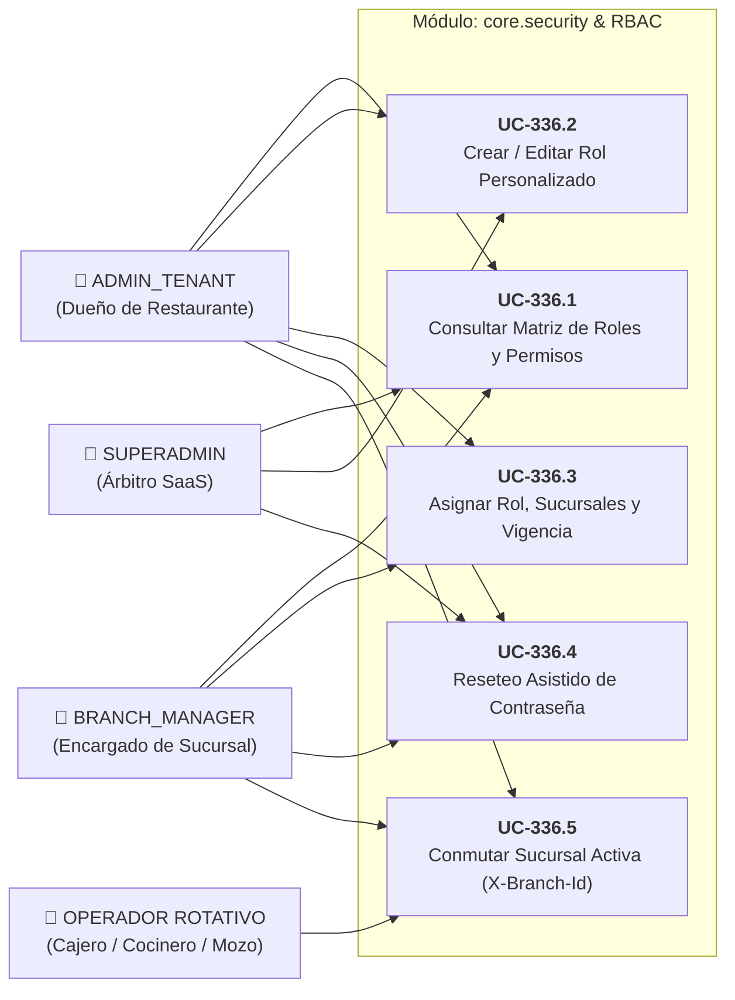

# 🛡️ Casos de Uso: Gestión Dinámica de Roles, Multi-Sucursal y RBAC

Este documento formaliza la especificación funcional y la matriz de permisos para el **Módulo de Seguridad, Roles Dinámicos y RBAC** (`core.security`), estructurado según el estándar de **Specification-Driven Development (SDD)** ([ADR-0007](../../../adr/0007_sdd_software_development_lifecycle.md), [ADR-0010](../../../adr/0010_granular_rbac_roles_and_privileges.md) / `TASK-336` / `PB-039`).

---

## 👥 1. Actores y Matriz de Permisos

| Caso de Uso | Identificador | Actor Principal | Permiso Requerido | Ámbito Permitido (*Scope*) |
| :--- | :--- | :--- | :--- | :--- |
| **Consultar Matriz de Roles y Catálogo** | `UC-336.1` | `ADMIN_TENANT`, `BRANCH_MANAGER`, `SUPERADMIN` | `roles:read` o `users:read` | `TENANT` |
| **Crear / Modificar Rol Personalizado** | `UC-336.2` | `ADMIN_TENANT`, `SUPERADMIN` | `roles:manage` | `TENANT` |
| **Asignar Rol, Multi-Sucursal y Vigencia** | `UC-336.3` | `ADMIN_TENANT`, `BRANCH_MANAGER` | `users:write` | `TENANT` (Manager limitado a sus sucursales) |
| **Reseteo Asistido de Contraseña** | `UC-336.4` | `ADMIN_TENANT`, `BRANCH_MANAGER`, `SUPERADMIN` | `users:password_reset` | Jerárquico (Manager solo a su personal) |
| **Conmutar Sucursal Activa con Rotación** | `UC-336.5` | Cualquier Colaborador Autenticado | Token JWT Válido | Sucursales en `branch_ids` autorizadas |

---

## 🗺️ 2. Diagrama de Casos de Uso (Mermaid)

---

## 📋 3. Especificación Detallada de Casos de Uso

### UC-336.1: Consultar Matriz de Roles y Catálogo de Permisos
- **Actor:** `ADMIN_TENANT` o `BRANCH_MANAGER`.
- **Precondiciones:** Usuario autenticado con permiso `roles:read` o `users:read`.
- **Flujo Principal:**
  1. El usuario accede a la vista `/settings/roles` en TailwindAdmin.
  2. El frontend despacha en paralelo:
     - `GET /api/v1/roles`: Lista de roles del tenant (con código, nombre, descripción, flag `isSystem` y conteo de usuarios asignados).
     - `GET /api/v1/roles/permissions-catalog`: Catálogo de permisos agrupados por módulos funcionales (Punto de Venta, Caja, Cocina, Inventario, Catálogo, Personal, Configuración).
  3. La interfaz renderiza el panel maestro-detalle: a la izquierda la lista de roles, a la derecha la cuadrícula de switches del rol seleccionado.
  4. Si el rol seleccionado es `ADMIN_TENANT`, los switches se muestran activados y bloqueados, con un tooltip informativo indicando su inmutabilidad.

---

### UC-336.2: Crear o Modificar Rol Personalizado
- **Actor:** `ADMIN_TENANT`.
- **Precondiciones:** Permiso `roles:manage`.
- **Flujo Principal:**
  1. El administrador presiona *"Nuevo Rol"* o selecciona un rol personalizado existente.
  2. Define el nombre del rol (ej. *"Jefe de Barra"*), código autogenerado en minúsculas/guiones (`jefe-barra`) y descripción operativa.
  3. Activa o desactiva los switches según las responsabilidades del puesto (ej. activa `pos:access`, `pos:order_create`, `catalog:read` y desactiva acceso a finanzas e inventario general).
  4. Al presionar *"Guardar Rol"*, el frontend despacha `POST /api/v1/roles` (o `PUT /api/v1/roles/{id}`).
  5. El backend valida:
     - Que el código sea único dentro del tenant (`uq_role_tenant_code`).
     - Que no se esté intentando editar o eliminar un rol de sistema (`is_system == true`).
  6. En una transacción atómica `@Transactional`, persiste el registro en `roles` y la lista de permisos en `role_permissions`.
  7. Retorna `HTTP 201 Created` / `HTTP 200 OK` con el DTO enriquecido.

---

### UC-336.3: Asignar Rol, Multi-Sucursal y Vigencia Temporal a Colaborador
- **Actor:** `ADMIN_TENANT` o `BRANCH_MANAGER` con permiso `users:write`.
- **Precondiciones:** Colaborador registrado o en formulario de alta en `/users`.
- **Flujo Principal:**
  1. El administrador selecciona un colaborador y abre el modal de edición.
  2. Selecciona el **Rol** a asignar (nativo o personalizado).
  3. Opcionalmente activa la casilla *"Rol Temporal por Temporada / Suplencia"* y selecciona una fecha límite en el selector de fecha (`role_valid_until`). Si no se activa, el rol queda como permanente (`NULL`).
  4. Configura la **Asignación de Sucursales:**
     - Marca las sucursales donde el empleado está facultado para trabajar (1 a $N$ sucursales de la empresa).
     - Selecciona cuál de ellas será su *"Sucursal Predeterminada"* (`default_branch_id`).
     - Si el actor es `BRANCH_MANAGER`, solo puede asignar sucursales dentro de las cuales él mismo está autorizado.
  5. Al guardar, el backend valida y persiste atómicamente en `app_users` y en la tabla asociativa `user_branches`.

---

### UC-336.4: Reseteo Asistido de Contraseña (Sin Correo Obligatorio)
- **Actor:** `SUPERADMIN`, `ADMIN_TENANT` o `BRANCH_MANAGER`.
- **Precondiciones:** Permiso `users:password_reset`. El empleado no recuerda su clave o es su primer día de trabajo.
- **Flujo Principal:**
  1. El administrador abre el menú de opciones del usuario en `/users` y selecciona *"Resetear Contraseña"*.
  2. El sistema genera una clave temporal legible (ej. `Rest*2026`) o permite al administrador ingresar una clave temporal manual.
  3. El frontend despacha `POST /api/v1/users/{id}/reset-password` con `{ "temporaryPassword": "..." }`.
  4. El backend valida la jerarquía de reseteo:
     - `BRANCH_MANAGER` solo puede resetear claves de usuarios asignados a sus mismas sucursales y con rol operativo (`CASHIER`, `KITCHEN`, o roles custom de nivel operativo). No puede resetear a otros managers ni a `ADMIN_TENANT`.
     - `ADMIN_TENANT` puede resetear a cualquier usuario de su empresa.
  5. El backend cifra la nueva clave con Argon2id, actualiza `app_users.must_change_password = TRUE` y retorna confirmación.
  6. El administrador comunica verbalmente la clave temporal al empleado en el restaurante.
  7. Cuando el empleado inicia sesión con la clave temporal, el sistema detecta `must_change_password == true`, bloquea la navegación e intercepta con el modal `ChangePasswordModalComponent`, obligándolo a introducir su nueva clave privada para continuar.

---

### UC-336.5: Conmutar Sucursal Activa con Rotación
- **Actor:** Colaborador rotativo (ej. cajero que trabaja en Sucursal 1 y Sucursal 2).
- **Precondiciones:** Usuario autenticado con token JWT conteniendo múltiples sucursales en el claim `branch_ids`.
- **Flujo Principal:**
  1. El usuario pulsa el selector contextual de sucursal en el Topbar.
  2. El menú desplegable muestra únicamente las sucursales donde tiene asignación activa (`user_branches`).
  3. Al seleccionar otra sucursal, el frontend actualiza el Signal en `BranchContextService`.
  4. Las siguientes peticiones HTTP inyectan automáticamente el encabezado `X-Branch-Id: <id_seleccionado>`.
  5. `JwtAuthenticationFilter` en backend verifica que el UUID de la cabecera pertenezca al claim `branch_ids` del token, actualiza el `TenantContext` en memoria y autoriza la transacción sin necesidad de reloguearse.
