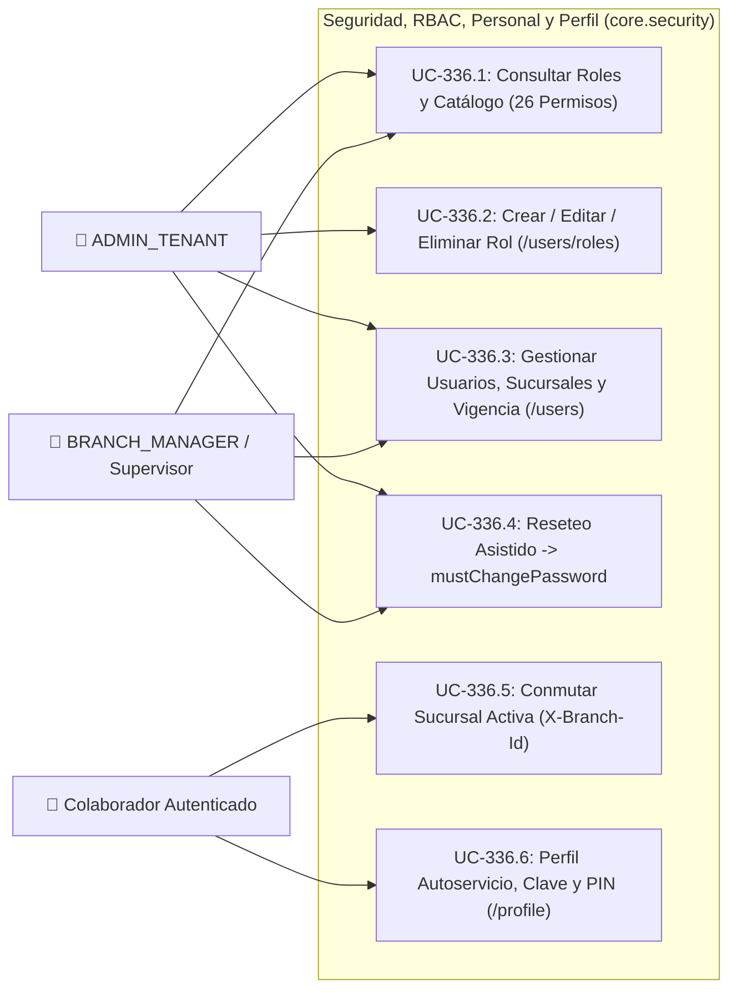

# 🛡️ Casos de Uso: Gestión Dinámica de Roles, Personal Multi-Sucursal y Perfil Autoservicio

Este documento formaliza la especificación funcional y la matriz de permisos para el **Módulo de Seguridad, RBAC Dinámico, Personal y Perfil Autoservicio** (`core.security`), alineado con [ADR-0010](../../../adr/0010_granular_rbac_roles_and_privileges.md) (`PB-039` / `TASK-336`), [ADR-0024](../../../adr/0024_self_service_user_profile_pin_and_humanization.md) (`PB-045` / `TASK-509`) y `TASK-628`.

---

## 👥 1. Actores y Matriz de Permisos Reales

| Caso de Uso | Identificador | Actor Principal | Permiso / Autorización Real | Ruta UI / Endpoint |
| :--- | :--- | :--- | :--- | :--- |
| **Consultar Roles y Catálogo de Permisos** | `UC-336.1` | `ADMIN_TENANT`, Supervisor | `roles:manage` o `users:read` | `/users/roles` · `GET /api/v1/roles`, `/roles/permissions-catalog` |
| **Crear / Modificar / Eliminar Rol** | `UC-336.2` | `ADMIN_TENANT` / Autorizado | `roles:manage` | `/users/roles` · `POST`, `PUT`, `DELETE /api/v1/roles` |
| **Gestionar Personal, Multi-Sucursal y Vigencia** | `UC-336.3` | `ADMIN_TENANT` / Supervisor | `users:read`, `users:write` (+ `security.require_user_email`) | `/users` · `POST/PUT /api/v1/users`, `POST/PUT /users/{id}/branches`, `PATCH /users/{id}/status` |
| **Reseteo Asistido de Contraseña** | `UC-336.4` | `ADMIN_TENANT`, `BRANCH_MANAGER` | `users:write` (o `ROLE_ADMIN_TENANT` / `ROLE_BRANCH_MANAGER`) | `/users` · `POST /api/v1/users/{id}/reset-password` |
| **Conmutar Sucursal Activa (`X-Branch-Id`)** | `UC-336.5` | Colaborador Autenticado | Token JWT válido (`branch_ids`) | Topbar (`BranchContextService`) |
| **Perfil Autoservicio, Clave Forzada y PIN** | `UC-336.6` | Cualquier Colaborador Autenticado | Sesión autenticada (`authGuard`) | `/profile` · `GET/PUT /api/v1/profile`, `/password`, `/pin` |

---

## 🗺️ 2. Diagrama de Casos de Uso (Mermaid)

---

## 📋 3. Especificación Detallada de Casos de Uso

### UC-336.1: Consultar Matriz de Roles y Catálogo de Permisos

- **Precondiciones:** Usuario autenticado con permiso `roles:manage` o `users:read` (`RoleController`).
- **Flujo Principal:**
  1. En `/users/roles` (o el alias compatible `/settings/roles`), el frontend consulta `GET /api/v1/roles` y `GET /api/v1/roles/permissions-catalog` (también expuesto en `/api/v1/permissions/catalog`).
  2. El backend devuelve las definiciones de `RoleDto(id, tenantId, code, name, description, isSystem, permissions)` del tenant y las 26 constantes agrupadas de `SystemPermissions.ALL_PERMISSIONS` (`PermissionCatalogItemDto(code, name, description, module)`).
  3. Para `ADMIN_TENANT` y `SUPERADMIN`, `AuthService` entrega en sesión la totalidad de `SystemPermissions.ALL_PERMISSIONS` más el comodín `"*"` en `permissions`.

---

### UC-336.2: Crear, Modificar o Eliminar Rol Personalizado (`/users/roles`)

- **Precondiciones:** Permiso `roles:manage`.
- **Flujo Principal:**
  1. El administrador define código, nombre, descripción y conjunto de permisos granulares (`CreateRoleRequest` / `UpdateRoleRequest`).
  2. El frontend envía `POST /api/v1/roles`, `PUT /api/v1/roles/{id}` o `DELETE /api/v1/roles/{id}`.
  3. El backend protege de forma inmutable al rol nativo `ADMIN_TENANT` (`isSystem = true`), impidiendo alterarlo o eliminarlo.
  4. Al modificar permisos de un rol existente, los tokens/sesiones pueden ser revocados para propagar privilegios de inmediato.

---

### UC-336.3: Gestionar Personal, Asignación Multi-Sucursal y Vigencia Temporal (`/users`)

- **Precondiciones:** Permiso `users:read` (listado/detalle en `/users`) y `users:write` (alta/edición/estado).
- **Flujo Principal:**
  1. El administrador gestiona usuarios en `/users` mediante `CreateUserRequest` / `UpdateUserRequest` con nombre de usuario (`username`), nombre completo humanizado (`fullName`), teléfono (`phoneNumber`), correo (`email`), contraseña inicial, rol (`role`), sucursal principal (`branchId`), conjunto de sucursales autorizadas (`authorizedBranchIds`), fecha de expiración opcional (`roleValidUntil`) y bandera `mustChangePassword`.
  2. **Política de correo (`security.require_user_email`):** Si el parámetro está en `true` (default), el backend exige email válido al crear o actualizar; si está en `false`, permite crear operadores de mostrador o cocina sin correo electrónico (`PasswordChangePolicyPort.isUserEmailRequired`).
  3. **Multi-sucursal y estado:** Puede actualizar asignaciones con `POST` o `PUT /api/v1/users/{id}/branches` y activar/desactivar con `PATCH /api/v1/users/{id}/status`.
  4. **Protección de rol temporal:** Cuando `role_valid_until` vence (`< NOW()`), el usuario es bloqueado con `HTTP 403 Forbidden`.
- **Nota de Cuota SaaS:** La creación de nuevos usuarios valida la cuota activa del plan vía `core.entitlements` cuando aplica.

---

### UC-336.4: Reseteo Asistido de Contraseña y Cambio Forzado en `/profile` (`TASK-628`)

- **Precondiciones:** Usuario con `users:write` (`ADMIN_TENANT`, `BRANCH_MANAGER` limitado a sus sucursales sobre perfiles operativos).
- **Flujo Principal:**
  1. En `/users`, el supervisor ejecuta **"Resetear Contraseña"** enviando `POST /api/v1/users/{id}/reset-password` (puede especificar clave temporal o dejar que el sistema genere una).
  2. El backend marca `must_change_password = true` en `app_users` y revoca sesiones previas del usuario afectado.
  3. Cuando el colaborador inicia sesión con su clave temporal:
     - `AuthService.isEffectiveMustChangePassword()` evalúa el parámetro de tenant **`security.enforce_password_change_on_reset`** (default `true`).
     - Si es efectivo (`mustChangePassword == true`), `LoginComponent` y `authGuard` **redirigen obligatoriamente al usuario hacia `/profile`** (sin usar modal flotante separado) hasta que complete el cambio de contraseña privada (`UC-336.6`).

---

### UC-336.5: Conmutar Sucursal Activa (`X-Branch-Id`)

- **Precondiciones:** Colaborador con más de una sucursal autorizada en el claim `branch_ids` del JWT.
- **Flujo Principal:**
  1. El usuario selecciona una sede en el selector de sucursales del Topbar (`BranchContextService`).
  2. Las peticiones posteriores transmiten la cabecera `X-Branch-Id: {branchId}`.
  3. `JwtAuthenticationFilter` valida en $O(1)$ que la sucursal esté dentro de `branch_ids` del usuario y actualiza `TenantContextHolder`.

---

### UC-336.6: Perfil Autoservicio, Cambio de Contraseña y PIN Rápido de Supervisor (`/profile`)

- **Precondiciones:** Usuario autenticado (`authGuard`); obligatorio tras reseteo de clave si `security.enforce_password_change_on_reset = true`.
- **Flujo Principal:**
  1. El usuario abre `/profile` (`ProfileComponent`) y carga su perfil actual vía `GET /api/v1/profile`.
  2. **Edición de contacto:** Actualiza `fullName`, `phoneNumber` y `email` (respetando `security.require_user_email`) vía `PUT /api/v1/profile` (`UpdateProfileRequest`).
  3. **Cambio de contraseña:** Ingresa contraseña actual y nueva contraseña (`>= 6` caracteres) vía `PUT /api/v1/profile/password` o `POST /api/v1/profile/change-password` (`ChangePasswordRequest`). El backend verifica la contraseña previa, actualiza el hash, limpia `must_change_password = false` y desbloquea la navegación normal hacia `/pos` o `/company`.
  4. **Configuración de PIN Rápido (Supervisores/Administradores):** Registra o actualiza un PIN numérico de 4 a 6 dígitos (`^\d{4,6}$`) vía `PUT` o `POST /api/v1/profile/pin` (`UpdatePinRequest`), almacenado como hash BCrypt (`pin_hash`) para autorizaciones in-situ de cancelaciones y caja (`UC-FIN-10`).
- **Nota de Sesiones:** Desde el entorno de usuario autenticado también se inspeccionan/revocan sesiones activas (`UC-314.5`).

---

## Documentos Relacionados
- [Mapa Macro de Casos de Uso](./use_cases_overview.md)
- [Casos de Uso de Sesiones y Seguridad](./use_cases_sessions.md)
- [Casos de Uso de Configuración](./use_cases_configuration.md)
- [Casos de Uso de Finanzas](./use_cases_finance.md)
- [Casos de Uso de POS](./use_cases_pos.md)
- [Secuencia de Resolución RBAC y Enforcement](../04-behavior-and-flows/sequence_rbac_resolution_and_enforcement.md)
- [Secuencia de Ciclo de Vida de Sesiones y Refresh](../04-behavior-and-flows/sequence_session_lifecycle_and_refresh.md)
- [ADR-0010: Control de Acceso RBAC Dinámico y Reseteo Delegado](../../../adr/0010_granular_rbac_roles_and_privileges.md)
- [ADR-0011: Ciclo de Vida de Sesiones y Renovación Silenciosa](../../../adr/0011_session_lifecycle_and_silent_refresh.md)
- [ADR-0019: Flujo de Cancelación, Autorizaciones y PIN Rápido](../../../adr/0019_order_cancellation_workflow_authorizations_and_waste_treatment.md)
- [ADR-0024: Perfil de Usuario Autoservicio, PIN y Humanización](../../../adr/0024_self_service_user_profile_pin_and_humanization.md)
- [Manual de Dueño, Finanzas, Personal y Reglas](../../../manuals/restaurante/06_dueno_finanzas_personal_y_reglas.md)
