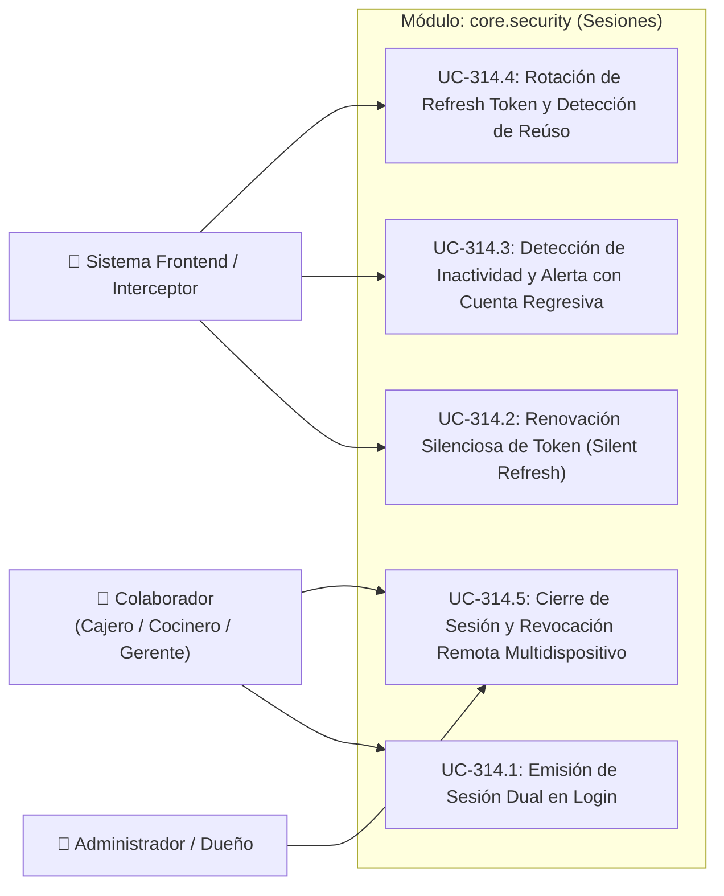

# 🔐 Casos de Uso: Ciclo de Vida de Sesiones, Expiración JWT y Renovación Silenciosa (PB-027 / UC-314)

Este documento especifica los casos de uso para la gestión del ciclo de vida de sesiones, expiración de tokens, renovación silenciosa (*silent refresh*), control de inactividad parametrizable y revocación remota según lo establecido en [ADR-0011](../../../adr/0011_session_lifecycle_and_silent_refresh.md).

---

## 1. Diagrama General de Casos de Uso (Mermaid)

---

## 2. Especificación Detallada de Casos de Uso

### UC-314.1: Emisión de Sesión Dual en Login
- **Actor Principal:** Colaborador del Restaurante (cualquier rol).
- **Precondiciones:** El colaborador ingresa credenciales válidas en `/auth/login`.
- **Flujo Principal:**
  1. El cliente envía credenciales autenticadas (`POST /api/v1/auth/login`).
  2. El backend valida el hash Argon2id de la contraseña y la vigencia temporal del usuario (`role_valid_until`).
  3. El backend genera:
     - **Access Token:** JWT firmado con expiración corta ($15\text{ minutos}$), conteniendo `sub`, `tenant_id`, `role`, `permissions`, `branch_ids` y `default_branch_id`.
     - **Refresh Token:** String criptográfico aleatorio opaco (64 bytes).
  4. El backend calcula `SHA-256(refreshToken)` y crea una fila en `refresh_tokens` con `device_info`, `ip_address` y `expires_at = NOW() + 7 días`.
  5. El backend retorna `LoginResponse` conteniendo `accessToken`, `refreshToken`, `tokenType: "Bearer"`, expiración en segundos y datos del usuario.
  6. El frontend almacena el `accessToken` en memoria/Signals y el `refreshToken` en almacenamiento seguro local.
- **Postcondiciones:** El colaborador inicia sesión y comienza el monitoreo de inactividad.

---

### UC-314.2: Renovación Silenciosa de Token (Silent Refresh)
- **Actor Principal:** Sistema Frontend (Interceptor HTTP / Timer Proactivo).
- **Precondiciones:** El colaborador se encuentra operando en el POS o Backoffice con una sesión activa y un `refreshToken` válido.
- **Flujo Principal (Modo Proactivo / Heartbeat):**
  1. Cuando resta el $20\%$ de la vida útil del Access Token (ej. a los 12 minutos de emisión) y el usuario ha registrado actividad reciente, el frontend invoca en segundo plano `POST /api/v1/auth/refresh`.
  2. El backend aplica la rotación atómica (UC-314.4) y responde con un nuevo Access Token y Refresh Token.
  3. El frontend actualiza los tokens en memoria sin parpadeos ni interrupciones visuales para el usuario.
- **Flujo Alternativo (Modo Reactivo ante HTTP 401):**
  1. El Access Token expira mientras el usuario llenaba una orden. El usuario presiona "Cobrar".
  2. La petición a `/api/v1/pos/orders` falla con `HTTP 401 Unauthorized`.
  3. El `authInterceptor` captura el 401, encola la petición original y activa `isRefreshing = true`.
  4. Envía `POST /api/v1/auth/refresh` con el `refreshToken` guardado.
  5. El backend valida, rota los tokens y responde `HTTP 200 OK`.
  6. El interceptor actualiza el token, desencola la orden original y la reintenta automáticamente con el nuevo token.
  7. El cobro concluye con éxito; el cajero nunca percibe la expiración intermedia.
- **Flujo de Excepción (Refresh Token Inválido o Expirado):**
  - Si el refresh token venció (ej. pasaron más de 7 días sin usar la app), el backend responde `401 Unauthorized`. El interceptor purga la sesión y redirige limpiamente a `/auth/login`.

---

### UC-314.3: Detección de Inactividad y Alerta con Cuenta Regresiva
- **Actor Principal:** Sistema Frontend (`IdleTimerService`) y Colaborador.
- **Precondiciones:** Colaborador autenticado en la plataforma.
- **Flujo Principal:**
  1. El frontend obtiene el parámetro `SESSION_INACTIVITY_TIMEOUT_MINUTES` de la sucursal (ej. 30 minutos para Administración, 120 minutos para Mostrador POS).
  2. El servicio monitorea eventos DOM (`mousemove`, `keydown`, `click`, `touchstart`, `scroll`). Cada evento reinicia el cronómetro de inactividad.
  3. Si transcurre el tiempo configurado menos 2 minutos (ej. minuto 28 en Admin), se despliega un modal visual de advertencia:
     - *"Tu sesión está a punto de cerrarse por inactividad. Se cerrará automáticamente en 120 segundos. ¿Deseas mantenerte conectado?"*.
     - Se muestra un contador regresivo visible segundo a segundo.
  4. Si el colaborador hace clic en **"Mantener Sesión Activa"** o presiona cualquier tecla:
     - El modal se cierra, se reinicia el cronómetro y se envía un ping al backend.
  5. Si el contador llega a $0$ segundos sin interacción:
     - El frontend ejecuta `authService.logout()`, llama a `POST /api/v1/auth/logout` para revocar el refresh token y redirige a la pantalla de login con el mensaje: *"Sesión cerrada por inactividad por tu seguridad"*.

---

### UC-314.4: Rotación de Refresh Token y Detección de Reúso (Compromiso)
- **Actor Principal:** Motor de Seguridad Backend (`AuthService`, `JwtService`).
- **Precondiciones:** Petición entrante a `POST /api/v1/auth/refresh`.
- **Flujo Principal:**
  1. El backend recibe `{ "refreshToken": "..." }`.
  2. Calcula `hash = SHA256(refreshToken)` y consulta `refresh_tokens` por `token_hash`.
  3. Si la fila no existe o `expires_at < NOW()`, responde `HTTP 401 Unauthorized` (`SessionExpiredException`).
  4. Si `revoked_at IS NOT NULL` (Token ya revocado presentado nuevamente):
     - **Detección de Reúso:** Se identifica un posible ataque de replay o compromiso de credenciales.
     - Se marcan como revocados **todos** los tokens activos de ese `user_id`:
       `UPDATE refresh_tokens SET revoked_at = NOW() WHERE user_id = :userId AND revoked_at IS NULL;`
     - Se registra alerta crítica en `audit_logs`: `CRITICAL_TOKEN_REUSE_DETECTED`.
     - Se responde con `HTTP 401 Unauthorized` (`ProblemDetail: Posible brecha de seguridad detectada. Todas las sesiones han sido cerradas.`).
  5. Si la fila está activa (`revoked_at IS NULL`):
     - Se marca la fila como revocada (`revoked_at = NOW()`).
     - Se genera un nuevo par de tokens.
     - Se inserta la nueva fila en `refresh_tokens`, vinculando la anterior mediante `replaced_by_id`.
     - Se responde `HTTP 200 OK` con el nuevo par.

---

### UC-314.5: Cierre de Sesión y Revocación Remota Multidispositivo
- **Actor Principal:** Colaborador o Administrador de Restaurante.
- **Precondiciones:** Usuario autenticado en el sistema.
- **Flujo Principal (Cierre de Sesión Individual):**
  1. El colaborador presiona "Cerrar Sesión" en la barra superior o menú de usuario.
  2. El frontend envía `POST /api/v1/auth/logout` con el `refreshToken` actual.
  3. El backend marca la fila correspondiente con `revoked_at = NOW()`.
  4. El frontend elimina los tokens almacenados y redirige a `/auth/login`.
- **Flujo Principal (Revocación Remota de Todas las Sesiones):**
  1. El administrador ingresa a `/users` y selecciona un colaborador (ej. cajero desvinculado) o el usuario ingresa a "Mi Perfil" y presiona **"Cerrar sesión en todos los demás dispositivos"**.
  2. El frontend envía `POST /api/v1/auth/revoke-all` (o `POST /api/v1/users/{id}/revoke-sessions`).
  3. El backend invalida masivamente todos los refresh tokens activos del usuario:
     `UPDATE refresh_tokens SET revoked_at = NOW() WHERE user_id = :userId AND revoked_at IS NULL;`
  4. En un lapso máximo de 15 minutos (vida del Access Token), cualquier terminal remoto que intente refrescar sesión será rechazado y expulsado al login.
