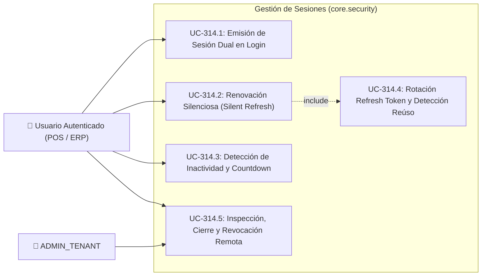

# 🔐 Casos de Uso: Ciclo de Vida de Sesiones, Expiración JWT y Renovación Silenciosa (`UC-314`)

Este documento especifica el ciclo de vida completo de sesiones de usuarios del ERP (`core.security`), verificado contra `AuthController`, `AuthService`, `SessionServiceImpl` e `IdleTimerService` y alineado con [ADR-0011](../../../adr/0011_session_lifecycle_and_silent_refresh.md).

---

## 🗺️ 1. Diagrama General de Casos de Uso (Mermaid)

---

## 📋 2. Especificación Detallada de Casos de Uso

### UC-314.1: Emisión de Sesión Dual en Login

- **Actor Principal:** Cualquier usuario del tenant (`ADMIN_TENANT`, `BRANCH_MANAGER`, `CASHIER`, etc.).
- **Flujo Principal:**
  1. El usuario envía `POST /api/v1/auth/login` con identificador de empresa (`tenantIdentifier`: slug o NIT), `username` y `password`.
  2. El backend verifica credenciales con Argon2id/BCrypt, estado del usuario, vigencia temporal de rol (`role_valid_until`) y permisos de acceso del tenant en `core.entitlements`.
  3. Emite un **Access Token JWT** de corta vida (15 minutos) con claims `tenant_id`, `branch_id`, `branch_ids`, `role`, `permissions` y `mustChangePassword` efectivo (evaluando `security.enforce_password_change_on_reset`).
  4. Genera un **Refresh Token opaco** cuyo hash `SHA-256` se persiste en `refresh_tokens` junto con `device_info` e `ip_address`.
  5. Si `mustChangePassword == true`, `LoginComponent` / `AuthGuard` redirigen obligatoriamente a **`/profile`** antes de habilitar cualquier módulo operativo.

---

### UC-314.2: Renovación Silenciosa de Token (*Silent Refresh*)

- **Actor Principal:** `AuthInterceptor` (Angular HttpClient).
- **Precondiciones:** Access Token expirado (`401 Unauthorized`) mientras exista Refresh Token válido en almacenamiento local.
- **Flujo Principal:**
  1. Ante un `401`, el interceptor encola la petición original y dispara `POST /api/v1/auth/refresh` una sola vez aunque existan múltiples peticiones simultáneas (*lock* reactivo `isRefreshing`).
  2. El backend ejecuta la rotación atómica (`UC-314.4`) y responde con nuevo `accessToken`, nuevo `refreshToken` y snapshot de usuario.
  3. El cliente actualiza tokens y reintenta todas las peticiones encoladas de forma transparente.

---

### UC-314.3: Detección de Inactividad y Alerta con Cuenta Regresiva

- **Actor Principal:** Usuario operando sesión abierta en navegador / POS.
- **Parámetro Backend Asociado:** `security.session_inactivity_timeout_minutes` en `parameters-catalog.json` (**valor por defecto: `15` minutos**, ámbito `TENANT`, criticidad `MEDIUM`).
- **Flujo Principal:**
  1. `IdleTimerService` monitorea eventos de interacción del usuario (`mousemove`, `keydown`, `click`, `scroll`, `touchstart`, entre otros).
  2. Cuando restan `WARNING_COUNTDOWN_SECONDS = 120` segundos para alcanzar el umbral, se abre el componente `InactivityModalComponent` con cuenta regresiva en pantalla.
  3. Si el usuario pulsa **"Continuar"**, se reinicia el temporizador; si el contador llega a `0`, se ejecuta cierre automático de sesión (`logout()`).
- **Brecha Vigente Documentada (`TASK-640`):** Aunque el catálogo backend define `15` minutos como defecto de `security.session_inactivity_timeout_minutes`, `IdleTimerService` utiliza actualmente `DEFAULT_IDLE_TIMEOUT_MINUTES = 30` en memoria mientras se completa el cableado dinámico desde el parámetro de configuración (`TASK-640`).

---

### UC-314.4: Rotación de Refresh Token y Detección de Reúso

- **Actor Principal:** Sistema de Seguridad (`SessionServiceImpl`).
- **Flujo Principal:**
  1. Al recibir `POST /api/v1/auth/refresh`, el backend calcula `SHA-256(refreshToken)` y busca la fila en `refresh_tokens`.
  2. **Caso Válido (`revoked_at IS NULL` y no expirado):** Marca la fila anterior como revocada, emite un nuevo refresh token enlazado (`replaced_by_id`) y retorna el nuevo par de tokens.
  3. **Caso de Reúso Detectado (`revoked_at IS NOT NULL`):** Asume compromiso de token, revoca **todas las sesiones activas** de ese usuario y responde `401 Unauthorized`, forzando reingreso en todos los dispositivos.

---

### UC-314.5: Inspección de Sesiones Activas, Cierre Puntual y Revocación Remota

- **Actor Principal:** Usuario autenticado (sobre sus propias sesiones) o `ADMIN_TENANT` (sobre un colaborador vía `users:write`).
- **Flujo Principal:**
  1. **Consultar sesiones activas propias:** El usuario (desde `/profile`) o cliente consulta `GET /api/v1/auth/sessions`, recibiendo lista de `ActiveSessionDto(id, deviceInfo, ipAddress, createdAt, expiresAt, isCurrent)`.
  2. **Cerrar sesión actual:** El cliente invoca `POST /api/v1/auth/logout` enviando `{ "refreshToken": "..." }`, revocando ese token específico y limpiando memoria local.
  3. **Revocar sesión remota de otro dispositivo propio:** El usuario envía `DELETE /api/v1/auth/sessions/{sessionId}`, invalidando esa sesión sin cerrar la sesión actual (`isCurrent = true`).
  4. **Cerrar todas las sesiones propias:** El usuario invoca `POST /api/v1/auth/revoke-all` para invalidar la familia completa de refresh tokens activos.
  5. **Revocación administrativa sobre colaborador:** Un administrador con `users:write` invoca `POST /api/v1/users/{id}/revoke-sessions` para invalidar de inmediato todas las sesiones activas de un empleado (p. ej. tras baja o cambio de rol).

---

## Documentos Relacionados
- [Mapa Macro de Casos de Uso](./use_cases_overview.md)
- [Casos de Uso de RBAC y Perfil](./use_cases_rbac.md)
- [Casos de Uso de Configuración](./use_cases_configuration.md)
- [Casos de Uso de Onboarding](./use_cases_onboarding.md)
- [Secuencia de Ciclo de Vida de Sesiones y Refresh](../04-behavior-and-flows/sequence_session_lifecycle_and_refresh.md)
- [Secuencia de Resolución RBAC y Enforcement](../04-behavior-and-flows/sequence_rbac_resolution_and_enforcement.md)
- [ADR-0010: Control de Acceso RBAC Dinámico](../../../adr/0010_granular_rbac_roles_and_privileges.md)
- [ADR-0011: Ciclo de Vida de Sesiones y Silent Refresh](../../../adr/0011_session_lifecycle_and_silent_refresh.md)
- [ADR-0024: Perfil de Usuario Autoservicio y PIN](../../../adr/0024_self_service_user_profile_pin_and_humanization.md)
- [Manual de Dueño, Finanzas, Personal y Reglas](../../../manuals/restaurante/06_dueno_finanzas_personal_y_reglas.md)
