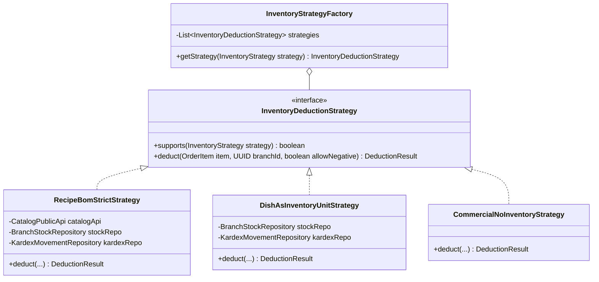

# 📦 Diagrama de Actividad: Estrategias Flexibles de Inventario y Deducción en Kardex (PB-044)

Este documento modela el comportamiento del procesamiento de inventario ante el cobro de pedidos (`OrderPaidEvent`), aplicando el patrón de diseño **Strategy** sobre la tríada de estrategias de inventario configurables a nivel de plato (`dishes.inventory_strategy`): **Receta BOM Estricta**, **Plato como Unidad en Almacén** y **Comercial / Venta Libre**.

---

## 🧭 1. Tríada de Estrategias y Patrón de Diseño



---

## 📊 2. Diagrama de Actividad Mermaid

```mermaid
flowchart TD
    Start(["Inicio: OrderPaidEvent"]) --> ExtractOrder["1. Extraer orden y sucursal<br/>(orderId, branchId, items)"]
    ExtractOrder --> ReadParam["2. Leer Parámetro Multinivel:<br/><b>inventory.allow_negative_stock</b><br/>(Default: false)"]
    
    ReadParam --> LoopItems["3. Para cada ítem en order.items"]
    LoopItems --> FetchDish["Consultar estrategia del plato:<br/><b>dish.inventory_strategy</b>"]
    
    FetchDish --> StrategyFactory{"InventoryStrategyFactory<br/>Resuelve Estrategia"}

    %% =========================================================
    %% RAMA 1: COMMERCIAL_NO_INVENTORY
    %% =========================================================
    StrategyFactory -->|COMMERCIAL_NO_INVENTORY| StratNoInv["<b>CommercialNoInventoryStrategy</b>"]
    StratNoInv --> LogNoInv["Log debug: 'Plato comercial libre.<br/>Sin afectación en Kardex ni almacén'"]
    LogNoInv --> NextItem["¿Más ítems en orden?"]

    %% =========================================================
    %% RAMA 2: DISH_AS_INVENTORY_UNIT
    %% =========================================================
    StrategyFactory -->|DISH_AS_INVENTORY_UNIT| StratUnit["<b>DishAsInventoryUnitStrategy</b>"]
    StratUnit --> QueryDishStock["Consultar branch_stock<br/>WHERE branch_id = :bId AND dish_id = :dId"]
    
    QueryDishStock --> CheckDishAvail{"¿current_quantity >= item.qty?"}
    CheckDishAvail -->|No| CheckAllowNegUnit{"¿allow_negative_stock<br/>== true?"}
    
    CheckAllowNegUnit -->|false (Strict)| ErrUnit["Lanzar InsufficientStockException<br/>(HTTP 409 INSUFFICIENT_STOCK_ERROR)"]
    ErrUnit --> AbortTx(["Rollback / Alerta de Bloqueo"])
    
    CheckAllowNegUnit -->|true (Permissive)| WarnNegUnit["⚠️ Log warn: STOCK_DEFICIT_WARNING<br/>(Saldo de plato quedará negativo)"]
    WarnNegUnit --> DeductDishUnit["Actualizar branch_stock:<br/>current_quantity = current_quantity - item.qty"]
    CheckDishAvail -->|Sí| DeductDishUnit
    
    DeductDishUnit --> InsertKardexUnit["Insertar kardex_movements:<br/>- dish_id = item.dishId<br/>- ingredient_id = NULL<br/>- movement_type = 'SALE_OUT'<br/>- quantity = item.quantity<br/>- reference_id = orderId"]
    InsertKardexUnit --> NextItem

    %% =========================================================
    %% RAMA 3: RECIPE_BOM_STRICT
    %% =========================================================
    StrategyFactory -->|RECIPE_BOM_STRICT| StratBOM["<b>RecipeBomStrictStrategy</b>"]
    StratBOM --> FetchRecipe["Consultar receta del plato<br/>(dish_recipes de CatalogPublicApi)"]
    
    FetchRecipe --> HasIngredients{"¿Tiene insumos<br/>en receta?"}
    HasIngredients -->|No| WarnNoRecipe["⚠️ Log warn: 'Plato marcado como BOM estricto<br/>pero no tiene ingredientes definidos'"]
    WarnNoRecipe --> NextItem
    
    HasIngredients -->|Sí| LoopBOM["Para cada insumo en receta:<br/>neededQty = item.qty × recipe.qty"]
    LoopBOM --> QueryIngStock["Consultar branch_stock<br/>WHERE branch_id = :bId AND ingredient_id = :ingId"]
    
    QueryIngStock --> CheckIngAvail{"¿current_quantity >= neededQty?"}
    CheckIngAvail -->|No| CheckAllowNegBOM{"¿allow_negative_stock<br/>== true?"}
    
    CheckAllowNegBOM -->|false (Strict)| ErrBOM["Lanzar InsufficientStockException<br/>(HTTP 409 INSUFFICIENT_STOCK_ERROR)"]
    ErrBOM --> AbortTx
    
    CheckAllowNegBOM -->|true (Permissive)| WarnNegBOM["⚠️ Log warn: STOCK_DEFICIT_WARNING<br/>(Insumo con déficit post-venta)"]
    WarnNegBOM --> DeductIngBOM["Actualizar branch_stock:<br/>current_quantity = current_quantity - neededQty"]
    CheckIngAvail -->|Sí| DeductIngBOM
    
    DeductIngBOM --> InsertKardexBOM["Insertar kardex_movements:<br/>- ingredient_id = ing.id<br/>- dish_id = NULL<br/>- movement_type = 'SALE_OUT'<br/>- quantity = neededQty<br/>- unit_cost = stock.average_unit_cost<br/>- total_cost = neededQty × unit_cost"]
    
    InsertKardexBOM --> MoreIngredients{"¿Más insumos<br/>en receta?"}
    MoreIngredients -->|Sí| LoopBOM
    MoreIngredients -->|No| NextItem

    %% =========================================================
    %% ITERACIÓN GENERAL
    %% =========================================================
    NextItem -->|Sí| LoopItems
    NextItem -->|No| Finish(["Fin: Deducción Completa & Kardex Asentado"])
```

---

## 🛡️ 3. Reglas de Negocio e Integridad de Base de Datos

1. **Restricción de Integridad Polimórfica en Base de Datos:**
   Para prevenir estados inconsistentes donde un movimiento de Kardex apunte a un insumo y a un plato a la vez:
   ```sql
   ALTER TABLE branch_stock 
     ADD CONSTRAINT chk_branch_stock_target 
     CHECK ((ingredient_id IS NOT NULL AND dish_id IS NULL) OR (ingredient_id IS NULL AND dish_id IS NOT NULL));

   ALTER TABLE kardex_movements 
     ADD CONSTRAINT chk_kardex_target 
     CHECK ((ingredient_id IS NOT NULL AND dish_id IS NULL) OR (ingredient_id IS NULL AND dish_id IS NOT NULL));
   ```
2. **Costo Promedio Ponderado (CPP) en Platos Unidad:**
   Cuando el plato se maneja con `DISH_AS_INVENTORY_UNIT`, las compras o transferencias de cocina valorizan el stock unitario del plato. La deducción en `SALE_OUT` toma el `average_unit_cost` del plato registrado en `branch_stock`.
3. **Comportamiento ante Falta de Stock:**
   - Si `inventory.allow_negative_stock = false`: Ningún ítem se deduce a ciegas; si cualquiera de los ítems de la orden supera el saldo disponible, la venta es rechazada de inmediato.
   - Si `inventory.allow_negative_stock = true`: El sistema prioriza no interrumpir la cola de clientes del mostrador, procesa la venta, asienta el déficit y despacha alertas a los reportes de inventario del administrador.
