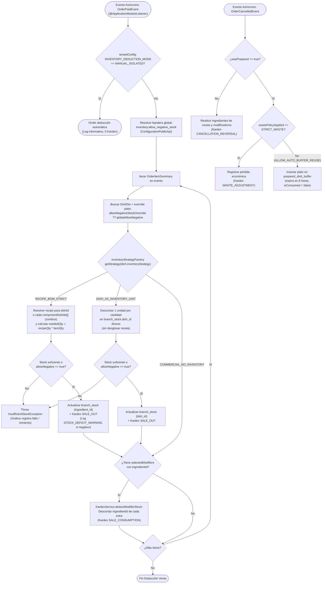

# Actividad de Estrategias de Deducción y Reversión de Inventario Kardex

Flujo de decisión ejecutado por `InventoryEventListener` y `KardexService` al procesar asíncronamente los eventos `OrderPaidEvent` (consumo de venta) y `OrderCancelledEvent` (reversión, vitrina de rescate `PreparedDishBuffer` o merma `WASTE_ADJUSTMENT`).

> [!NOTE]
> Este diagrama unifica la verificación global de aislamiento manual (`MANUAL_ISOLATED`), el patrón Strategy por plato (`InventoryStrategyFactory`) introducido en `V9` (`ADR-0015`), el parámetro `inventory.allow_negative_stock` (con override por plato) y el consumo de modificadores (`SALE_CONSUMPTION`).

## Diagrama de Flujo de Decisión (Mermaid)

## Estrategias Activas en `modules.inventory`

| Estrategia / Modo | Alcance | Comportamiento Real en `KardexService` |
| :--- | :--- | :--- |
| **`MANUAL_ISOLATED`** (`INVENTORY_DEDUCTION_MODE`) | Global por tenant | Detiene por completo cualquier descuento automático ante ventas POS; las existencias solo se ajustan manualmente (`/api/v1/inventory/stock/adjust`). |
| **`RECIPE_BOM_STRICT`** (`InventoryStrategy`) | Por plato / componente | Lee `dish_recipes` vía `CatalogPublicApi.getRecipeForDish` para el `dishId` o cada `componentDishIds` (combos y menús del día) y descuenta insumos de `branch_stock`. |
| **`DISH_AS_INVENTORY_UNIT`** (`InventoryStrategy`) | Por plato | Descuenta unidades terminadas directamente en `branch_stock` usando `dish_id` (`V9` constraint `chk_branch_stock_target`), útil para bebidas embotelladas o postres comprados listos. |
| **`COMMERCIAL_NO_INVENTORY`** (`InventoryStrategy`) | Por plato | Omite validación y deducción de stock para servicios o artículos sin control de inventario (aun manteniendo el descuento si tuviera modificadores con insumo). |
| **Modificadores (`SALE_CONSUMPTION`)** | Por extra en orden | Si el modificador seleccionado define `ingredientId` y `quantityConsumed > 0`, descuenta del almacén con tipo `SALE_CONSUMPTION` (`V11`). |
| **Permisividad de Saldo Negativo** | Parámetro + Override | `dish.allowNegativeStockOverride` tiene precedencia sobre `inventory.allow_negative_stock`; si resulta `false` y el saldo es insuficiente, lanza `InsufficientStockException`, o registra déficit con `STOCK_DEFICIT_WARNING` cuando es `true`. |

*(Nota técnica: El módulo conserva adicionalmente las clases heredadas `DeductionStrategy` [`ManualIsolatedStrategy`, `AutomaticPermissiveStrategy`, `AutomaticStrictStrategy`] para resolución legada por modo global, mientras el flujo principal de eventos utiliza `InventoryStrategyFactory`.)*

## Enlaces Relacionados

- [Flujo de Venta POS y Deducción](./sequence_pos_order_deduction.md)
- [Cancelación de Pedidos y Autorizaciones](./sequence_pos_order_cancellation_and_authorizations.md)
- [C4 Nivel 3: Backend Spring Modulith](../01-c4-system/c4_level3_backend_modulith.md)
- [ADR-0015: Menús Diarios e Inventario Flexible](../../../adr/0015_daily_menus_and_flexible_dish_inventory.md)
- [ADR-0019: Cancelaciones y Política de Merma](../../../adr/0019_order_cancellation_workflow_authorizations_and_waste_treatment.md)
