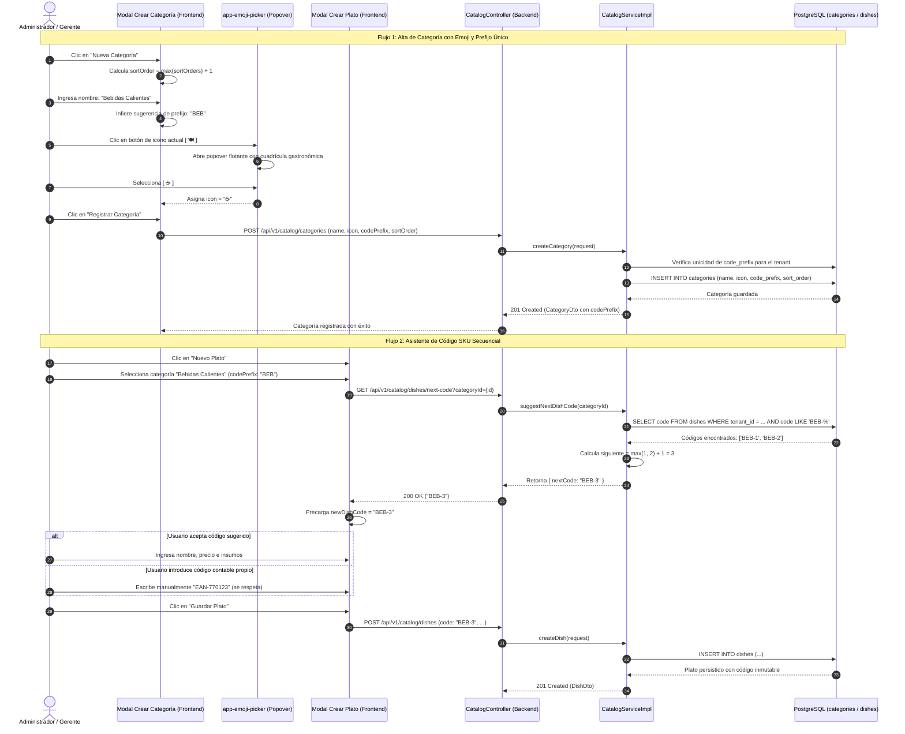

# 🪄 Diagrama de Secuencia: Asistente de SKU Secuencial y Selector de Emojis (PB-048 / TASK-507)

Este documento modela las interacciones para el alta inteligente y asistida en el catálogo de productos: selección interactiva de emojis gastronómicos mediante popover nativo, sugerencia de prefijo único de categoría y generación determinista del correlativo SKU (`BEB-1`, `BEB-2`) con política `MAX + 1` en backend.

---

## 1. Diagrama de Secuencia Mermaid

---

## 2. Invariantes del Flujo

1. **Unicidad de Prefijo:** Ninguna categoría puede registrar un `code_prefix` ya utilizado por otra categoría del mismo tenant.
2. **Consecutivo Auditado (`MAX + 1`):** La secuencia se calcula siempre sumando 1 al número mayor registrado con ese prefijo; nunca se rellenan huecos de platos eliminados o inactivos.
3. **Formato Simple:** Los códigos autogenerados no llevan ceros a la izquierda (`BEB-1`, `BEB-2`, `HAM-15`), garantizando brevedad y legibilidad en tickets térmicos de cocina.
4. **Respeto a la Entrada Manual:** La entrada manual del usuario o lector de código de barras tiene precedencia sobre la sugerencia automática del sistema.
