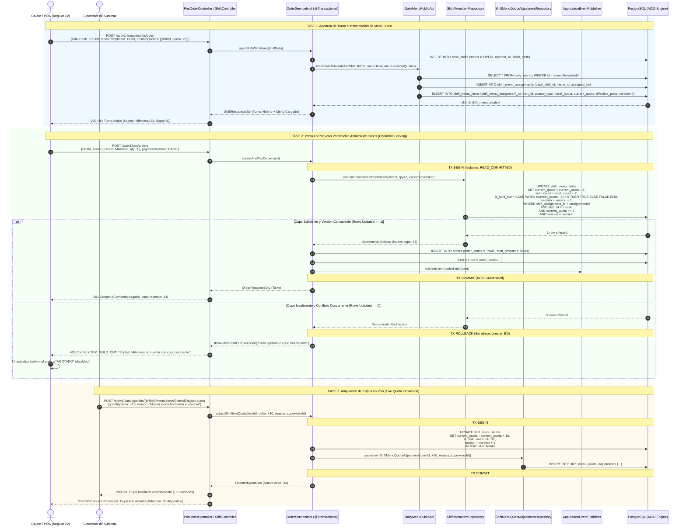

# ⏱️ Diagrama de Secuencia: Asignación de Menú al Turno y Control Atómico de Cupos en POS (PB-034)

Este documento modela las interacciones transaccionales y de concurrencia entre los módulos `pos`, `catalog`, `finance` y la base de datos PostgreSQL, garantizando el cumplimiento de las propiedades **ACID** y el control de concurrencia mediante **Optimistic Locking** (`@Version`) al vender raciones de menús diarios en el punto de venta.

---

## 🧭 1. Resumen de Flujos Cubiertos

1. **Apertura de Turno con Instanciación de Plantilla:**
   - El cajero/supervisor abre el turno de caja (`cash_shifts`).
   - Selecciona una plantilla de menú diario (`daily_menus`).
   - El sistema clona los ítems a `shift_menu_assignments` y `shift_menu_items` con cupos iniciales independientes, sin mutar la plantilla maestra.
2. **Cobro Concurrente con Verificación Atómica de Cupo:**
   - La orden se procesa en una transacción `@Transactional`.
   - Se ejecuta el decremento condicional en SQL: `WHERE current_quota >= :qty AND version = :version`.
   - Si se detecta venta concurrente o agotamiento, se arroja `ItemSoldOutException` (HTTP 409 `ITEM_SOLD_OUT`) con rollback transaccional total.
3. **Ampliación Supervisada de Cupo en Vivo:**
   - Cocina elabora raciones extra durante el turno.
   - Un usuario con privilegio `FINANCE_SHIFTS` o `BRANCH_MANAGER` amplía el cupo (+N raciones).
   - Se audita el cambio en `shift_menu_quota_adjustments` de forma inmutable.

---

## 📊 2. Diagrama de Secuencia Mermaid



---

## 🛡️ 3. Invariantes y Reglas ACID Garantizadas

1. **Invariante de Balance de Raciones:**
   $$\text{current\_quota} + \text{sold\_count} = \text{initial\_quota} + \sum \text{quantity\_delta}$$
2. **Atomicidad estricta:**
   Si la orden incluye múltiples platos del menú (ej. 1 Sopa y 1 Milanesa) y uno de ellos falla por cupo (`0 rows affected`), la transacción completa sufre `ROLLBACK`. Ni la sopa ni la milanesa son descontadas, evitando comandas a medio cobrar.
3. **No-Negatividad Inviolable:**
   Restricción de integridad en base de datos:
   ```sql
   CONSTRAINT chk_shift_menu_current_quota CHECK (current_quota >= 0)
   ```
4. **Trazabilidad Inmutable:**
   Toda variación de cupo posterior a la apertura exige registro obligatorio en `shift_menu_quota_adjustments` con el `user_id` del supervisor y motivo textual.
