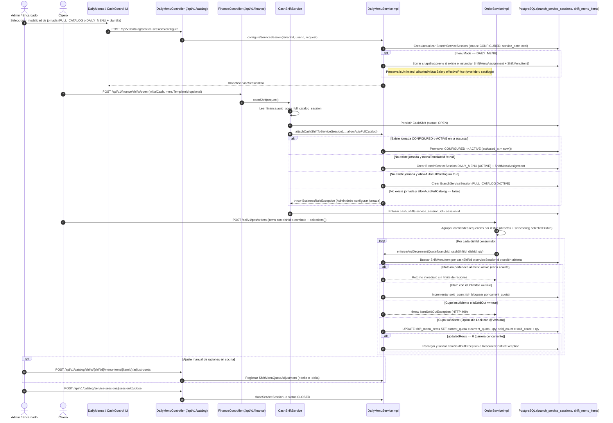

# Flujo de Jornadas de Servicio, Menús del Día, Combos Dinámicos y Cupos

Secuencia operativa introducida en `V9` y consolidada en `V23`/`V24` para desacoplar la oferta gastronómica del turno individual de cajero mediante **`BranchServiceSession`** (`CONFIGURED -> ACTIVE -> CLOSED`), soportar operación en **`FULL_CATALOG`** o **`DAILY_MENU`**, habilitar combos dinámicos (`MENU_COURSE`) e imponer el control atómico de raciones por venta POS sin sockets/SSE ficticios (refresco estándar por consulta HTTP de catálogo/turno activo).

## Diagrama de Secuencia (Mermaid)

## Capacidades Clave del Modelo `V23`/`V24`

1. **Desacoplamiento Multi-Cajero (`branch_service_sessions`):** Varios turnos `cash_shifts` simultáneos (`INDIVIDUAL_PER_CASHIER`) comparten una única `BranchServiceSession` activa en la sucursal y consumen el mismo pool de `shift_menu_items` (`service_session_id`).
2. **Modos `FULL_CATALOG` vs `DAILY_MENU`:** Con el parámetro `finance.auto_open_full_catalog_session` activado (`true`), abrir caja sin jornada previa inicia automáticamente en modo `FULL_CATALOG`; en modo estricto (`false`), exige configuración previa del administrador.
3. **Combos Dinámicos y Restricciones por Plato (`V23`):**
   - `daily_menu_combos` habilita combos completos dentro de una plantilla de Menú del Día.
   - `combo_items.selection_source = 'MENU_COURSE'` vincula un bloque del combo a un tiempo (`course_type`) del menú activo (ej. Sopas o Segundos del día).
   - `allow_individual_sale = false` permite ofrecer un plato solo dentro de combos/paquetes sin habilitar su venta suelta en el catálogo individual POS.
   - `is_unlimited = true` excluye al ítem de bloqueo por agotamiento de cupo (`ItemSoldOutException`), manteniendo conteo de `sold_count`.
4. **Sincronización de Cupos en Cliente:** El frontend consulta el menú y la jornada actual mediante llamadas HTTP estándar (`GET /api/v1/catalog/service-sessions/current`, `GET /api/v1/catalog/shifts/{shiftId}/menu`) y tras cada cobro o error `ItemSoldOutException`; no existe infraestructura WebSocket ni SSE activa.

## Enlaces Relacionados

- [Flujo de Venta POS y Deducción](./sequence_pos_order_deduction.md)
- [Flujo de Turno de Caja y Gastos](./state_shift_and_expense_workflow.md)
- [ERD Catálogo y Jornadas (`branch_service_sessions`, `daily_menu_combos`)](../02-domain-and-data/database_erd.md)
- [Casos de Uso de Catálogo](../03-use-cases/use_cases_catalog.md)
- [ADR-0015: Menús Diarios e Inventario Flexible](../../../adr/0015_daily_menus_and_flexible_dish_inventory.md)
- [ADR-0031: Jornadas de Servicio y Combos Dinámicos](../../../adr/0031_branch_service_sessions_and_dynamic_combos.md)
