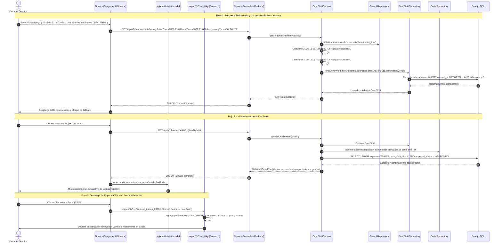

# 📊 Diagrama de Secuencia: Auditoría Multicriterio de Turnos, Drill-Down y Exportación CSV (PB-030 / TASK-508)

Este documento modela las interacciones entre la interfaz de gestión gerencial de Finanzas, el servicio de conversión de zonas horarias de sucursal (ADR-0006), la consulta multicriterio en base de datos y la exportación de reportes compatibles con hojas de cálculo (Excel/CSV).

---

## 1. Diagrama de Secuencia Mermaid

---

## 2. Invariantes del Flujo

1. **Alineación Estricta de Calendario:** La consulta de fechas nunca opera en UTC directo; los instantes de inicio y fin se calculan transformando el día civil local (`00:00:00` a `23:59:59`) según `branches.timezone` (ADR-0006).
2. **Determinismo Contable:** En el detalle de auditoría, la suma de las órdenes cobradas por método de pago debe cuadrar exactamente con los totales registrados en la cabecera del turno:
   $$\text{Ventas Totales} = \text{Ventas Efectivo} + \text{Ventas Tarjeta} + \text{Ventas QR} + \text{Ventas Transferencia}$$
3. **Exportación Ligera y Segura:** Cero librerías externas en el bundle; el archivo generado incluye `\uFEFF` para compatibilidad nativa e inmediata con Microsoft Excel.
