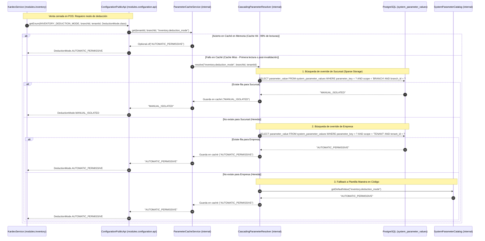
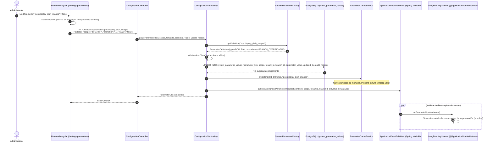
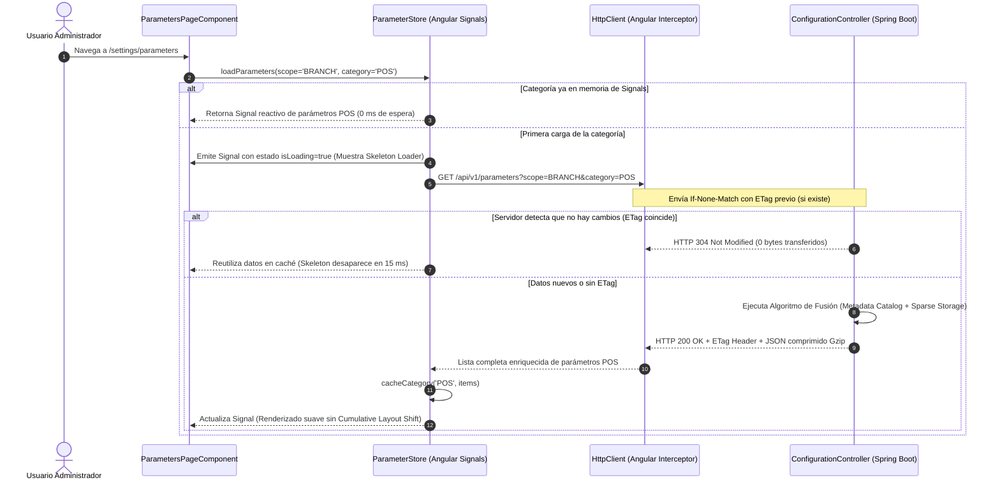

# ⚙️ Diagrama de Secuencia: Resolución en Cascada de Parámetros, Hot-Reload y Mutación Atómica

Este documento modela la dinámica transaccional del **Sistema de Parametrización Multinivel** ([ADR-0008](../../../adr/0008_unified_multilevel_parameter_system.md) / `TASK-311`): el ciclo de vida de resolución en cascada ($O(1)$) mediante almacenamiento disperso (*Sparse Storage*), la invalidación concurrente de caché en memoria (*Hot-Reload*) y el protocolo de comunicación de alto rendimiento entre Angular 22 Zoneless y Spring Boot 4.1.x.

---

## 🧭 1. Resumen Ejecutivo del Flujo

1. **Resolución Jerárquica en Cascada ($O(1)$):** Cuando cualquier módulo (`POS`, `INVENTORY`, `FINANCE`, `CATALOG`) requiere el valor de una configuración para una sucursal, consulta `ConfigurationPublicApi`. El motor evalúa:
   $$\text{Caché en Memoria} \longrightarrow \text{Sucursal (Branch)} \longrightarrow \text{Empresa (Tenant)} \longrightarrow \text{Global} \longrightarrow \text{Default del Código}$$
2. **Mutación Atómica y Desalojo de Caché:** Ante un cambio desde la UI, se envía un micro-payload `PATCH /api/v1/parameters/{key}` (< 150 bytes), se persiste en `system_parameter_values`, se invalida la clave atómicamente en la caché Caffeine/ConcurrentHashMap y se emite `ParameterUpdatedEvent`.
3. **Comunicación Eficiente en Frontend:** Carga diferida por categorías (`category=POS`), almacenamiento en `Signals` reactivos ($0$ ms al conmutar pestañas) y actualización optimista de interfaz.

---

## ⚡ 2. Secuencia 1: Consulta y Resolución Jerárquica en Tiempo de Ejecución (Pull Model)

Muestra cómo un servicio de negocio (ej. `KardexService` ante una venta) obtiene un parámetro tipado sin penalizar a la base de datos con lecturas repetitivas:

---

## 🔄 3. Secuencia 2: Mutación Atómica, Hot-Reload y Notificación Desacoplada

Muestra qué ocurre cuando un Administrador cambia un parámetro desde el navegador:

---

## 🚀 4. Secuencia 3: Estrategia de Comunicación Frontend-Backend de Alto Rendimiento

Demuestra cómo se mitigan los tiempos de espera altos y bloqueos de renderizado mediante *Categorized Lazy Loading* y *ETags*:

---

## 🔗 5. Relación con Otros Componentes de Arquitectura

- **Modelo de Persistencia:** [database_erd.md](../02-domain-and-data/database_erd.md) (Tabla `system_parameter_values`).
- **Límites Modulares:** [c4_level3_backend_modulith.md](../01-c4-system/c4_level3_backend_modulith.md) (Módulo `modules.configuration`).
- **Decisión Estructural:** [ADR-0008](../../../adr/0008_unified_multilevel_parameter_system.md).
- **Proceso Operativo de Negocio:** [01_flujo_parametrizacion_operativa_empresa.md](../../../business-processes/04-administracion-y-personal/01_flujo_parametrizacion_operativa_empresa.md).
