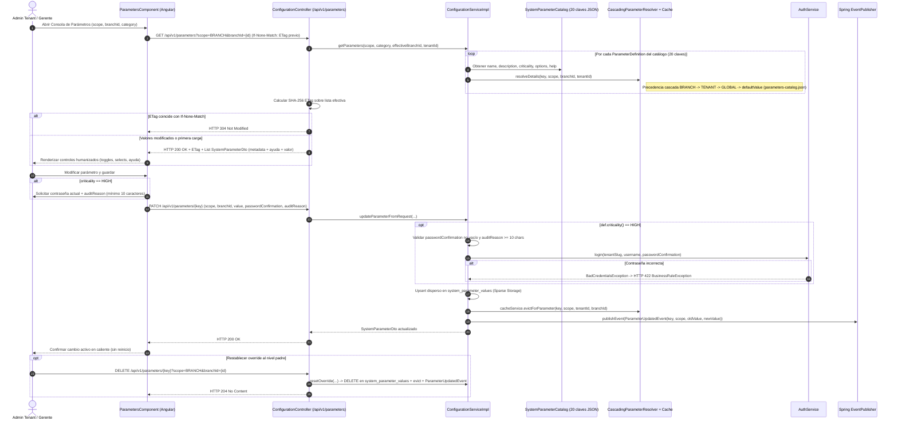

# Secuencia de Resolución Multinivel de Parámetros, Catálogo JSON y Hot-Reload

Flujo completo para consultar parámetros efectivos en cascada (**`BRANCH -> TENANT -> GLOBAL -> parameters-catalog.json`**), servir metadatos humanizados y ayuda contextual de los **20 parámetros** registrados, optimizar lecturas mediante `ETag` HTTP `304 Not Modified`, exigir reautenticación ante cambios de criticidad `HIGH` y propagar invalidación inmediata de caché vía `ParameterUpdatedEvent`.

> [!NOTE]
> Este diagrama consolida el catálogo JSON humanizado (`parameters-catalog.json`, 20 claves activas en Sprint 6) con el ciclo de actualización en caliente y reautenticación forense (`ADR-0008`, `ADR-0025`).

## Diagrama de Secuencia (Mermaid)

## Catálogo Activo Verificado (`parameters-catalog.json`, 20 Parámetros)

| Categoría | Claves Activas | Default Base |
| :--- | :--- | :--- |
| **`INVENTORY`** (`2`) | `inventory.deduction_mode`, `inventory.allow_negative_stock` | `AUTOMATIC_PERMISSIVE`, `false` |
| **`POS`** (`6`) | `pos.display_dish_images`, `pos.default_order_mode`, `pos.allow_scheduled_pickup`, `pos.delivery_fee_enabled`, `pos.delivery_fee_default`, `pos.cancellation_prepared_waste_policy` | `true`, `DINE_IN`, `true`, `false`, `0.00`, `ALLOW_AUTO_BUFFER_REUSE` |
| **`FINANCE`** (`6`) | `finance.max_petty_cash_expense`, `finance.require_supervisor_pin_cancel`, `finance.shift_opening_policy`, `finance.shift_concurrency_mode`, `finance.expense_allow_self_approval`, `finance.auto_open_full_catalog_session` | `100.00`, `true`, `ALL_AUTHORIZED`, `SINGLE_PER_BRANCH`, `false`, `true` |
| **`SECURITY`** (`3`) | `security.require_user_email`, `security.enforce_password_change_on_reset`, `security.session_inactivity_timeout_minutes` | `true`, `true`, `15` |
| **`COMPANY` / `CATALOG`** (`3`) | `company.currency`, `company.timezone`, `catalog.scope_mode` | `BOB`, `America/La_Paz`, `BRANCH_ISOLATED` |

## Enlaces Relacionados

- [Casos de Uso de Configuración](../03-use-cases/use_cases_configuration.md)
- [Resolución RBAC y Políticas de Seguridad](./sequence_rbac_resolution_and_enforcement.md)
- [Ciclo de Vida de Sesión y Refresh](./sequence_session_lifecycle_and_refresh.md)
- [ADR-0008: Sistema Unificado de Parámetros Multinivel](../../../adr/0008_unified_multilevel_parameter_system.md)
- [ADR-0025: Consola Humanizada de Parámetros y Catálogo JSON](../../../adr/0025_parameter_console_humanization_json_catalog_and_contextual_help.md)
- [ADR-0030: Aislamiento por Sucursal del Catálogo (`catalog.scope_mode`)](../../../adr/0030_catalog_branch_isolation_by_default.md)
