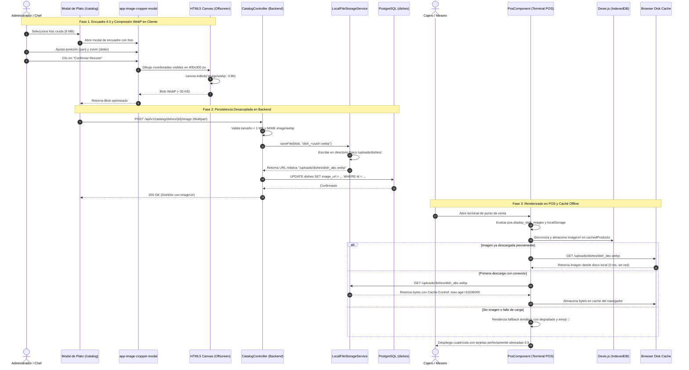

# 📸 Diagrama de Secuencia: Recorte Nativo, Almacenamiento y Despliegue en POS (PB-036 / TASK-506)

Este documento modela el ciclo de vida completo de las imágenes de platos: encuadre y compresión nativa en Angular 22 Zoneless, subida desacoplada al backend, persistencia en base de datos y despliegue reactivo en el terminal POS con soporte de caché de disco y modo offline en Dexie.js.

---

## 1. Diagrama de Secuencia Mermaid

---

## 2. Invariantes del Flujo

1. **Compresión Mandatoria en Cliente:** Ninguna imagen cruda de más de 1 MB viaja por la red; el canvas cliente garantiza que el payload hacia el backend sea siempre un archivo WebP de $\sim 25\text{--}35\text{ KB}$.
2. **Proporción Determinista:** Todas las imágenes generadas por el cropper miden exactamente **$400 \times 300\text{ px}$ (relación 4:3)**, erradicando desalineaciones en la cuadrícula.
3. **Resiliencia Offline:** La presencia de `imageUrl` en Dexie.js permite que el navegador sirva las fotos desde su caché local de disco ante caídas de conexión externa.
