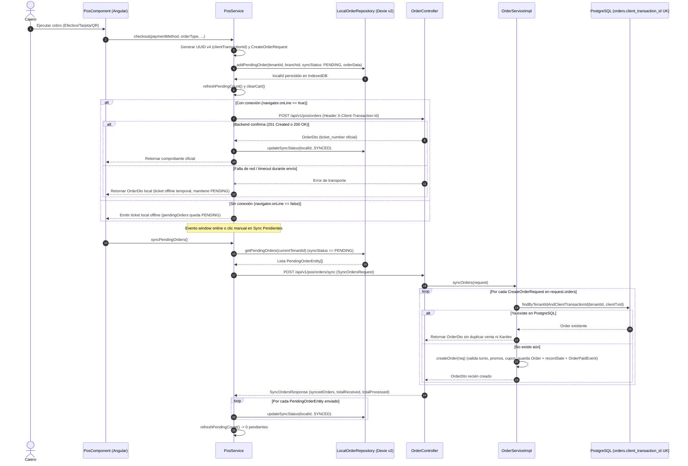

# Secuencia de Sincronización Offline-First POS (Dexie.js)

Protocolo de resiliencia ante desconexión de red en sucursales usando **Dexie.js v4** (`RestaurantPosDb` `version(2)`) encapsulado tras la capa DAL (`LocalOrderRepository`), garantizando idempotencia estricta mediante `clientTransactionId` y el endpoint batch `POST /api/v1/pos/orders/sync`.

> [!NOTE]
> El almacenamiento local `version(2)` gestiona exclusivamente los stores `cachedCategories`, `cachedProducts`, `pendingOrders` (indexado por `tenantId`, `branchId`, `syncStatus`, `clientTransactionId`, `createdAt`) y `activeShift`. No existen stores separados `cachedShiftMenu` ni `cachedShiftMenuItems`.

## Diagrama de Secuencia Offline y Reconexión (Mermaid)

## Garantías de Idempotencia y Multi-Tenancy

1. **Persistencia Local Previa:** `PosService.checkout()` registra el pedido en `appDb.pendingOrders` **antes** de ejecutar cualquier petición HTTP, evitando pérdida de ventas ante cortes de energía o caídas de navegador.
2. **Aislamiento por `tenantId` (`version(2)`):** Durante la migración automática de Dexie a `version(2)`, cualquier registro local huérfano sin `tenantId` se purga para impedir filtraciones al cambiar de empresa en un mismo dispositivo compartido.
3. **Deduplicación en Servidor:** La restricción única `client_transaction_id` en `orders` y la búsqueda previa `findByTenantIdAndClientTransactionId(...)` hacen que reintentos individuales o por lote sean completamente idempotentes.

## Enlaces Relacionados

- [Skill: Estrategia Offline Dexie y Sincronización](../../../../.agents/skills/offline-dexie-sync/SKILL.md)
- [Esquema Local Dexie.js](../02-domain-and-data/dexie_local_schema.md)
- [Flujo Principal de Venta POS](./sequence_pos_order_deduction.md)
- [Ciclo de Vida de la Orden](./state_order_lifecycle.md)
- [ADR-0003: Estrategia Offline-First y Sincronización Dexie](../../../adr/0003_offline_first_dexie_sync.md)
