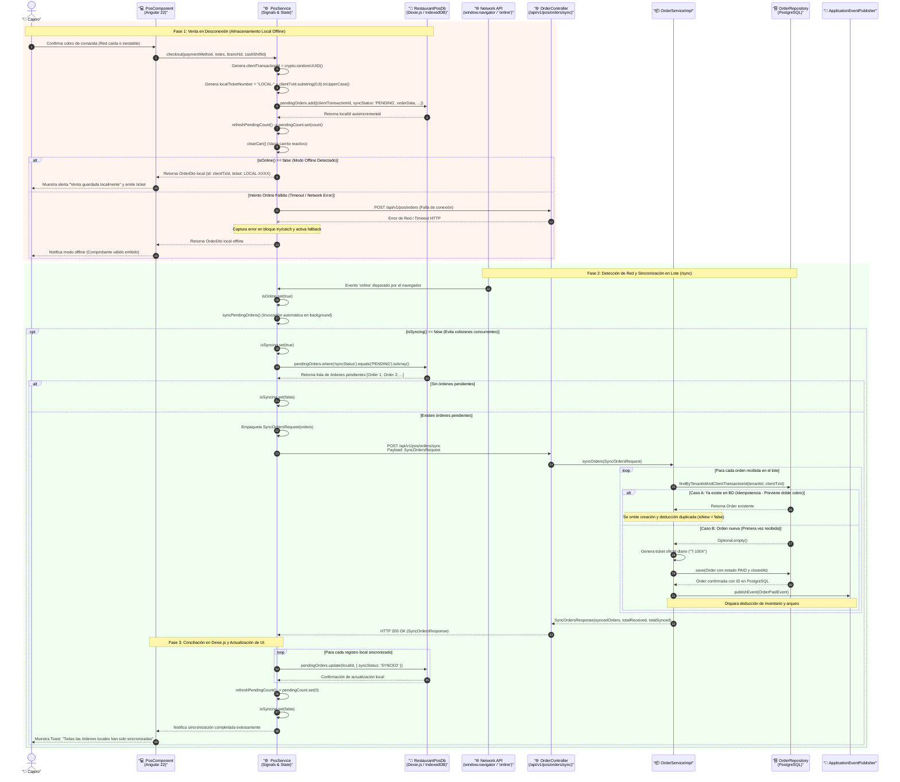

# 📶 Diagrama de Secuencia: Flujo Offline-First y Reconciliación Idempotente

Este documento modela la arquitectura de tolerancia a fallos de conectividad del punto de venta (**POS Offline-First**). Detalla la captura de ventas en condiciones de desconexión total o intermitente, la persistencia local en el almacenamiento del navegador (**IndexedDB** vía **Dexie.js**), y la reconciliación asíncrona por lotes (`/sync`) con garantía estricta de **idempotencia** mediante `client_transaction_id` (UUID v4) en PostgreSQL.

---

## 🧭 1. Resumen Ejecutivo del Flujo

1. **Venta Continua sin Conectividad:** La estación de cobro nunca detiene su operación ante cortes de red o caídas temporales del servidor. El cajero procesa el pedido normalmente en la interfaz Angular 22.
2. **Generación de Identificador Idempotente Local:** Al momento del checkout, el cliente genera un identificador universal único `client_transaction_id` (UUID v4) y un número de comprobante provisional (`LOCAL-XXXXXXXX`).
3. **Escritura Inmediata en Dexie.js:** La comanda se guarda de forma atómica en la tabla local `pendingOrders` de IndexedDB con estado `syncStatus = 'PENDING'`.
4. **Respuesta Inmediata al Cajero:** El carrito se vacía, el contador reactivo `pendingCount` incrementa su valor mediante Angular Signals y se emite el ticket físico o digital para el cliente con su código de rastreo local.
5. **Detección Automática de Reconexión:** El servicio escucha el evento nativo del navegador `window.addEventListener('online')` (o el cajero pulsa manualmente el botón de sincronización).
6. **Llamada de Sincronización en Lote (`POST /api/v1/pos/orders/sync`):** Se empaquetan todas las órdenes con estado `PENDING` en un único payload `SyncOrdersRequest`.
7. **Validación de Idempotencia en Backend:** El backend procesa cada comanda consultando el índice único `findByTenantIdAndClientTransactionId`. Si la comanda ya existía (por ejemplo, ante reintentos de red tras una respuesta HTTP 200 truncada), retorna el registro sin duplicar cobros ni deducciones de inventario. Si es nueva, genera el ticket oficial (`T-100X`), la persiste y dispara el `OrderPaidEvent`.
8. **Actualización de Estado Local:** El cliente marca los registros locales como `SYNCED` en Dexie.js y actualiza reactivamente el signal `pendingCount` a 0.

---

## 📊 2. Diagrama de Secuencia Mermaid



---

## 🧩 3. Anatomía del Mecanismo de Idempotencia

### 3.1. Clave de Idempotencia: `client_transaction_id`
En sistemas distribuidos y aplicaciones web con conectividad intermitente, el problema fundamental es el **reintento de red ciego** (por ejemplo, el servidor procesó el cobro con éxito, pero la respuesta HTTP 200 no llegó al cliente debido a un corte en el enlace de bajada). Si el cliente reintenta enviar la orden sin un identificador idempotente, se generaría un cobro duplicado y una doble deducción en el Kardex.

Para neutralizar este riesgo de forma matemática:
1. **Generación en el Cliente:** `PosService` genera un UUID versión 4 estándar criptográfico (`crypto.randomUUID()`) al inicio del checkout.
2. **Propagación Dual:** Se envía tanto en el cuerpo del JSON (`clientTransactionId`) como en la cabecera HTTP (`X-Client-Transaction-Id`).
3. **Restricción Unívoca en PostgreSQL:**
   ```sql
   ALTER TABLE orders ADD CONSTRAINT uk_orders_tenant_client_tx 
   UNIQUE (tenant_id, client_transaction_id);
   ```
4. **Lógica de Verificación en `OrderServiceImpl`:**
   ```java
   Optional<Order> existingOpt = orderRepository.findByTenantIdAndClientTransactionId(tenantId, clientTxId);
   if (existingOpt.isPresent()) {
       log.warn("Detectada solicitud duplicada para clientTransactionId: {}. Retornando orden existente.", clientTxId);
       return new CreateOrderResult(toOrderDto(existingOpt.get()), false);
   }
   ```

---

## 💾 4. Esquema de Persistencia Local (Dexie.js / IndexedDB)

La tabla local `pendingOrders` en `RestaurantPosDb` almacena la cola transaccional en el navegador:

```typescript
// frontend/src/app/core/models/pos.models.ts
export interface PendingOrderEntity {
  localId?: number;                // Clave primaria autoincremental de IndexedDB (++localId)
  clientTransactionId: string;     // UUID v4 único para idempotencia en backend
  syncStatus: 'PENDING' | 'SYNCED' | 'FAILED'; // Estado de conciliación
  createdAt: string;              // Marca temporal ISO UTC (ej. 2026-10-25T14:30:00Z)
  orderData: CreateOrderRequest;  // Payload completo listo para transmisión a la API
  ticketNumber?: string;          // Identificador provisional de emisión local (LOCAL-XXXXXXXX)
  totalAmount?: number;           // Importe total para visualización rápida en UI
}
```

### Tabla de Índices en Dexie.js
```typescript
this.version(1).stores({
  cachedCategories: 'id, name, sortOrder',
  cachedProducts: 'id, categoryId, code, name, salePrice, isAvailable',
  pendingOrders: '++localId, clientTransactionId, syncStatus, createdAt, orderData',
  activeShift: 'id, branchId, openedAt, status',
});
```

---

## 🛡️ 5. Manejo de Estados Extremos y Casos Borde

| Escenario Borde | Comportamiento del Sistema | Mitigación Técnica |
| :--- | :--- | :--- |
| **Cierre intempestivo del navegador** | Las órdenes siguen vivas en IndexedDB (no se pierden). | IndexedDB es almacenamiento duradero local en disco del cliente. Al volver a abrir el sistema, `initNetworkListeners` consulta `refreshPendingCount` y retoma la sincronización. |
| **Falla de conexión en medio de un lote `/sync`** | El backend procesa las órdenes dentro de transacciones individuales por comanda. | Las órdenes que alcanzaron a guardarse en PostgreSQL quedan con su `clientTransactionId`. Al reconectar, el reintento del lote detectará las ya creadas por idempotencia y creará solo las pendientes faltantes. |
| **Discrepancia de correlativos de tickets** | El cliente emitió `LOCAL-A1B2C3D4` durante el corte. | Al sincronizar, el backend asigna el correlativo fiscal/diario oficial `T-100X`. El registro local asocia ambos códigos para auditoría de tickets. |
| **Venta de insumos sin stock en offline** | En offline el cliente no puede consultar existencias en tiempo real. | La estrategia por defecto de inventario `AUTOMATIC_PERMISSIVE` permite saldos negativos temporales y emite alertas de merma/auditoría sin bloquear la venta. |

---

## 🔗 Enlaces Cruzados a Bóveda y Documentación

- **Diagrama de Secuencia Central POS:** [sequence_pos_order_deduction.md](./sequence_pos_order_deduction.md)
- **Máquina de Estados de la Comanda:** [state_order_lifecycle.md](./state_order_lifecycle.md)
- **Esquema Dexie.js Detallado:** [dexie_local_schema.md](../02-domain-and-data/dexie_local_schema.md)
- **Skill de Arquitectura Offline:** [.agents/skills/offline-dexie-sync/SKILL.md](../../../.agents/skills/offline-dexie-sync/SKILL.md)
- **SDD 03: Especificación Frontend:** [docs/sdd/03_frontend_spec.md](../../../sdd/03_frontend_spec.md)
