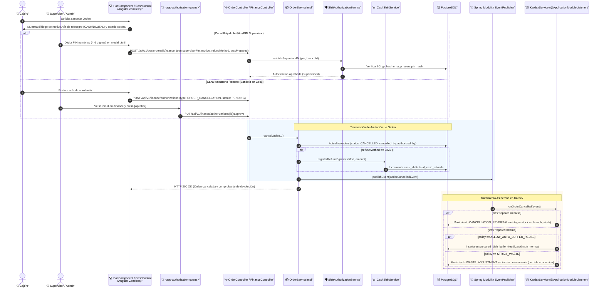

# ⚡ Diagrama de Secuencia: Flujo de Cancelación de Pedidos, Autorización por PIN y Tratamiento de Kardex (PB-031 / TASK-503 / TASK-504)

Este documento modela el flujo integral de anulación de comandas pagadas en el Punto de Venta: captura del motivo y canal de devolución, canal dual de autorización (PIN rápido in-situ vs bandeja asíncrona remota), afectación a gaveta física de caja y resolución desacoplada en Kardex (reintegro, merma o buffer de vitrina).

---

## 🧭 1. Resumen Ejecutivo del Flujo

1. **Iniciación en Terminal:** El cajero solicita la cancelación de una orden pagada desde `/pos` o `/cash-control`.
2. **Diálogo de Cancelación:** El cajero especifica el motivo tipado (`CUSTOMER_RETRACTED`, `TYPING_ERROR`, etc.), el método de devolución (`CASH` o `DIGITAL`) y si el plato ya fue elaborado en cocina (`wasPrepared`).
3. **Autorización (Canal Dual):**
   - **Canal In-Situ:** El supervisor ingresa su PIN numérico de 4 a 6 dígitos directamente en la pantalla del cajero. Se valida la credencial y se ejecuta la anulación en tiempo real.
   - **Canal Remoto:** Se crea una solicitud `ShiftAuthorization` en estado `PENDING_APPROVAL`. El supervisor la aprueba remotamente desde `/finance`.
4. **Persistencia y Finanzas:**
   - La orden pasa a estado `CANCELLED`.
   - Si `refundMethod == 'CASH'`, se registra un egreso `REFUND` en el turno activo (`cash_shifts`), reduciendo el saldo esperado en gaveta para cuadre exacto.
5. **Deducción y Kardex Desacoplado:** Spring Modulith despacha `OrderCancelledEvent`:
   - Si `wasPrepared == false` $\rightarrow$ `CANCELLATION_REVERSAL` devuelve insumos a `branch_stock`.
   - Si `wasPrepared == true` $\rightarrow$ Evalúa `pos.cancellation_prepared_waste_policy`:
     - `ALLOW_AUTO_BUFFER_REUSE`: Transfiere a `prepared_dish_buffer` (sin merma).
     - `STRICT_WASTE`: Registra `WASTE_ADJUSTMENT` en `kardex_movements` (pérdida económica).

---

## 📊 2. Diagrama de Secuencia Mermaid

