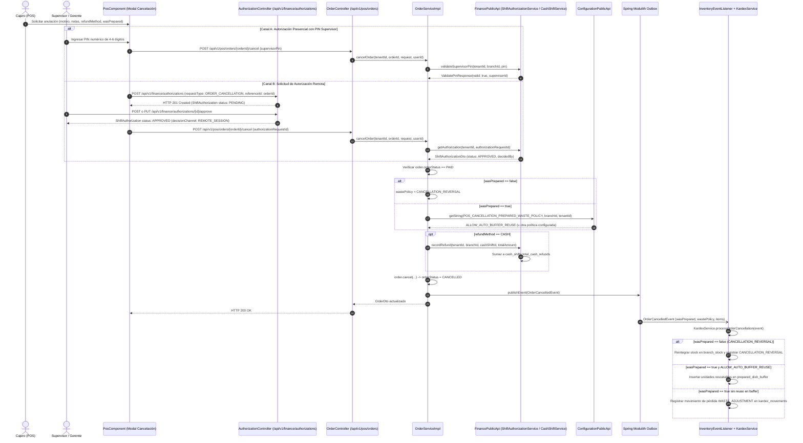

# Flujo de Anulación de Pedidos, Autorizaciones Dual-Control y Rescate/Merma

Secuencia unificada para anular un pedido en estado `PAID` cumpliendo el control dual de supervisión (PIN presencial in-situ o aprobación remota en sesión), registro de devolución de efectivo en caja y resolución de inventario según si el plato fue preparado (`PreparedDishBuffer` / `WASTE_ADJUSTMENT`) o revertido al stock (`CANCELLATION_REVERSAL`).

## Diagrama de Secuencia (Mermaid)

## Validaciones y Reglas de Negocio Verificadas

1. **Precondición de Estado:** Solo órdenes en estado `PAID` admiten cancelación (`OrderServiceImpl.cancelOrder`).
2. **Motivos de Anulación Tipados (`V12`):** `CUSTOMER_RETRACTED`, `TYPING_ERROR`, `KITCHEN_ISSUE`, `QUALITY_COMPLAINT`, `DUPLICATE_ORDER`.
3. **Validación Dual-Control (`AuthorizationController`):**
   - El canal presencial valida el hash BCrypt (`app_users.pin_hash`) de un supervisor autorizado para la sucursal (`POST /api/v1/finance/authorizations/validate-pin` o directamente en `cancelOrder`).
   - El canal remoto registra un `ShiftAuthorization` (`PENDING`) y exige aprobación explícita mediante `POST` o `PUT` sobre `/api/v1/finance/authorizations/{id}/approve` (requiere privilegio `finance:shifts_supervisor`, `finance:expenses_approve` o rol gerencial).
4. **Impacto en Arqueo de Caja (`V12`):** Únicamente los reintegros con `refundMethod == "CASH"` incrementan `cash_shifts.total_cash_refunds`, reduciendo el efectivo esperado (`expected_cash`).

## Enlaces Relacionados

- [Ciclo de Vida de la Orden](./state_order_lifecycle.md)
- [Flujo de Turno de Caja y Gastos](./state_shift_and_expense_workflow.md)
- [Resolución RBAC y Autorizaciones](./sequence_rbac_resolution_and_enforcement.md)
- [Casos de Uso POS](../03-use-cases/use_cases_pos.md)
- [Casos de Uso Finanzas](../03-use-cases/use_cases_finance.md)
- [ADR-0019: Flujo de Cancelación de Pedidos, Autorizaciones y Merma](../../../adr/0019_order_cancellation_workflow_authorizations_and_waste_treatment.md)
