# ⚡ Diagrama de Secuencia: Venta POS y Deducción Asíncrona de Inventario y Finanzas

Este documento modela el flujo troncal de procesamiento transaccional del sistema: el cobro de una comanda en el punto de venta (**POS**), su persistencia idempotente en PostgreSQL, la publicación transaccional del evento de dominio `OrderPaidEvent` y el posterior consumo asíncrono desacoplado mediante los escuchadores de eventos de **Inventario** (Kardex) y **Finanzas** (Turnos de Caja), orquestados bajo **Spring Modulith**.

---

## 🧭 1. Resumen Ejecutivo del Flujo

1. **Captura y Cobro en Terminal:** El cajero confirma la comanda y método de pago en el cliente Angular 22 Zoneless.
2. **Idempotencia y Persistencia en POS:** `OrderController` y `OrderServiceImpl` validan el identificador único `client_transaction_id`, generan el número secuencial diario de ticket (`T-100X`), persisten la orden con estado `PAID` y fijan la marca temporal `closed_at`.
3. **Publicación Transaccional de Evento:** Dentro de la misma transacción física de base de datos, Spring Modulith intercepta la publicación de `OrderPaidEvent` y lo registra de manera duradera en la tabla `event_publication` (Patrón Transaccional Outbox sin intermediarios externos pesados).
4. **Despacho Asíncrono a Módulos Consumidores:** Una vez confirmada la transacción (`AFTER_COMMIT`), los escuchadores anotados con `@ApplicationModuleListener` se ejecutan en transacciones aisladas e independientes (`REQUIRES_NEW`) mediante Virtual Threads de Java 25:
   - **Módulo Inventario:** `InventoryEventListener` invoca a `KardexService`, el cual consulta las recetas (BOM) mediante `CatalogPublicApi`, evalúa la estrategia de deducción configurada (`DeductionStrategy`) y asienta los movimientos de salida (`SALE_OUT`) en `kardex_movements` y `branch_stock`.
   - **Módulo Finanzas:** `FinanceEventListener` invoca a `CashShiftService`, actualizando los acumuladores de ventas del turno de caja activo en `cash_shifts`.
5. **Cierre de Ciclo en Registro de Eventos:** Al concluir exitosamente cada listener, Spring Modulith actualiza la tabla `event_publication`, garantizando semántica *At-Least-Once Delivery* y tolerancia a fallos.

---

## 📊 2. Diagrama de Secuencia Mermaid

```mermaid
sequenceDiagram
    autonumber
    actor Cashier as "👤 Cajero (POS)"
    participant PosComp as "💻 PosComponent<br/>(Angular Zoneless)"
    participant PosServ as "⚙️ PosService"
    participant OrderCtrl as "🌐 OrderController<br/>(/api/v1/pos/orders)"
    participant OrderSvc as "📦 OrderServiceImpl"
    participant OrderRepo as "🗄️ OrderRepository<br/>(PostgreSQL)"
    participant Pub as "📢 ApplicationEventPublisher"
    participant EventReg as "🏛️ EventPublicationRegistry<br/>(event_publication)"
    participant InvListener as "🎧 InventoryEventListener<br/>(@ApplicationModuleListener)"
    participant KardexSvc as "📦 KardexService"
    participant CatalogApi as "🔌 CatalogPublicApi"
    participant Strategy as "🎯 DeductionStrategy<br/>(AutomaticPermissive)"
    participant BranchStockRepo as "🗄️ BranchStockRepository"
    participant KardexRepo as "🗄️ KardexMovementRepository"
    participant FinListener as "🎧 FinanceEventListener<br/>(@ApplicationModuleListener)"
    participant CashShiftSvc as "📦 CashShiftService"
    participant CashShiftRepo as "🗄️ CashShiftRepository"

    %% --- ETAPA 1: SOLICITUD DE COBRO EN POS ---
    rect rgb(240, 248, 255)
        Note over Cashier,PosServ: Fase 1: Creación y Despacho de Comanda en POS
        Cashier->>PosComp: Confirma cobro (Método de Pago: CASH, CARD, QR o TRANSFER)
        PosComp->>PosServ: checkout(paymentMethod, notes, branchId, cashShiftId)
        PosServ->>PosServ: Genera clientTransactionId (UUID v4)
        PosServ->>OrderCtrl: POST /api/v1/pos/orders<br/>Header: X-Client-Transaction-Id
    end

    %% --- ETAPA 2: TRANSACCIÓN DE VENTA EN BACKEND ---
    rect rgb(245, 255, 245)
        Note over OrderCtrl,EventReg: Fase 2: Persistencia Transaccional e Inyección Outbox (Tx 1)
        OrderCtrl->>OrderSvc: createOrder(CreateOrderRequest)
        OrderSvc->>OrderRepo: findByTenantIdAndClientTransactionId(tenantId, clientTxId)
        alt Orden ya existente (Idempotencia)
            OrderRepo-->>OrderSvc: Optional<Order> presente
            OrderSvc-->>OrderCtrl: Retorna OrderDto existente (isNew = false, HTTP 200)
        else Orden nueva (Procesamiento Regular)
            OrderRepo-->>OrderSvc: Optional.empty()
            OrderSvc->>OrderSvc: Valida branchId e ítems (cantidades > 0, precios >= 0)
            OrderSvc->>OrderSvc: Asigna orderStatus = 'PAID' y closedAt = Instant.now()
            OrderSvc->>OrderRepo: countByTenantIdAndBranchIdAndCreatedAtBetween(...)
            OrderRepo-->>OrderSvc: Retorna conteo diario de tickets
            OrderSvc->>OrderSvc: Formatea ticket_number ("T-%04d", 1000 + count + 1)
            OrderSvc->>OrderRepo: save(Order con OrderItems en cascada)
            OrderRepo-->>OrderSvc: Order persistida con id UUID
            OrderSvc->>Pub: publishEvent(OrderPaidEvent)
            Pub->>EventReg: Intercepta y persiste publicación en tabla 'event_publication'
            Note over OrderSvc,EventReg: Commit Transacción 1: Comanda y Registro de Evento quedan blindados
            OrderSvc-->>OrderCtrl: CreateOrderResult(order, isNew = true)
            OrderCtrl-->>PosServ: HTTP 201 Created (OrderDto)
            PosServ-->>PosComp: Emite comanda exitosa y refresca UI
        end
    end

    %% --- ETAPA 3: CONSUMO ASÍNCRONO DESACOPLADO (MODULITH) ---
    par Listener de Inventario (Tx 2 - Asíncrono / Virtual Thread)
        rect rgb(255, 250, 240)
            Note over InvListener,KardexRepo: Fase 3A: Descuento de Recetas y Costeo Kardex
            EventReg->>InvListener: on(OrderPaidEvent) [AFTER_COMMIT, REQUIRES_NEW]
            InvListener->>KardexSvc: processOrderDeduction(event)
            loop Para cada ítem en event.items()
                KardexSvc->>CatalogApi: getRecipeForDish(tenantId, dishId)
                CatalogApi-->>KardexSvc: Optional<DishRecipeDto> (Lista de insumos y gramos)
                KardexSvc->>KardexSvc: Agrega cantidades necesarias: sum(quantity * neededPerDish)
            end
            KardexSvc->>KardexSvc: Obtiene modo INVENTORY_DEDUCTION_MODE (default: AUTOMATIC_PERMISSIVE)
            KardexSvc->>Strategy: executeDeduction(tenantId, branchId, event, deductionItems)
            loop Para cada insumo requerido
                Strategy->>BranchStockRepo: findByTenantIdAndBranchIdAndIngredientId(...)
                BranchStockRepo-->>Strategy: BranchStock actual
                Strategy->>Strategy: newBalance = currentQuantity - neededQuantity
                Strategy->>BranchStockRepo: save(stock con newBalance)
                opt Si newBalance < 0
                    Strategy->>Strategy: Emite alerta log warn STOCK_DEFICIT_WARNING (sin abortar)
                end
                Strategy->>Strategy: Calcula totalCost = neededQuantity * averageUnitCost
                Strategy->>KardexRepo: save(KardexMovement con SALE_OUT, unitCost, totalCost, orderId)
            end
            KardexSvc-->>InvListener: Deducción completada exitosamente
            InvListener->>EventReg: ACK de evento completado para InventoryEventListener
        end
    and Listener de Finanzas (Tx 3 - Asíncrono / Virtual Thread)
        rect rgb(255, 245, 255)
            Note over FinListener,CashShiftRepo: Fase 3B: Acumulación de Ventas en Turno Activo
            EventReg->>FinListener: on(OrderPaidEvent) [AFTER_COMMIT, REQUIRES_NEW]
            FinListener->>CashShiftSvc: updateRunningSales(tenantId, branchId, cashShiftId, paymentMethod, totalAmount)
            alt cashShiftId presente en evento
                CashShiftSvc->>CashShiftRepo: findByIdAndTenantId(cashShiftId, tenantId)
            else Sin cashShiftId
                CashShiftSvc->>CashShiftRepo: findByTenantIdAndBranchIdAndStatus(tenantId, branchId, "OPEN")
            end
            CashShiftRepo-->>CashShiftSvc: Optional<CashShift>
            opt Turno presente y en estado OPEN
                alt paymentMethod == 'CASH'
                    CashShiftSvc->>CashShiftSvc: totalCashSales += totalAmount
                else paymentMethod == 'CARD'
                    CashShiftSvc->>CashShiftSvc: totalCardSales += totalAmount
                else paymentMethod in ('QR', 'TRANSFER')
                    CashShiftSvc->>CashShiftSvc: totalOtherSales += totalAmount
                end
                CashShiftSvc->>CashShiftRepo: save(shift actualizado)
            end
            CashShiftSvc-->>FinListener: Actualización de caja concluida
            FinListener->>EventReg: ACK de evento completado para FinanceEventListener
        end
    end
```

---

## 🧩 3. Detalle de Componentes y Responsabilidades

| Participante / Componente | Módulo | Estereotipo / Capa | Responsabilidad Técnica |
| :--- | :--- | :--- | :--- |
| **`PosComponent`** | `pos` (Frontend) | Angular Standalone Component | Captura la interacción del cajero, valida la selección de productos y gestiona el modal de cobro y vuelto. |
| **`PosService`** | `pos` (Frontend) | Angular Injectable Service | Administra el carrito de compra mediante Signals reactivos, genera `clientTransactionId` (UUID v4) y gestiona la comunicación HTTP con fallback a Dexie.js. |
| **`OrderController`** | `pos` (Backend) | `@RestController` | Expone endpoints REST en `/api/v1/pos/orders`, interpreta la cabecera `X-Client-Transaction-Id` y mapea excepciones a RFC 7807 (`ProblemDetail`). |
| **`OrderServiceImpl`** | `pos` (Backend) | `@Service` / `@Transactional` | Aplica reglas de negocio: validación de idempotencia, cálculo de importes, generación de ticket diario por zona horaria de sucursal (`T-100X`), persistencia de la orden y publicación de eventos. |
| **`OrderRepository`** | `pos` (Backend) | Spring Data JPA Repository | Operaciones CRUD y consultas optimizadas sobre la tabla `orders` particionada lógicamente por `tenant_id`. |
| **`EventPublicationRegistry`** | `core` / Modulith | Tabla `event_publication` | Implementa el patrón Outbox transaccional de Spring Modulith, asegurando persistencia duradera del evento antes del commit de la orden. |
| **`InventoryEventListener`** | `inventory` | `@ApplicationModuleListener` | Escuchador desacoplado que intercepta `OrderPaidEvent` en un hilo virtual independiente con propagación de transacción `REQUIRES_NEW`. |
| **`KardexService`** | `inventory` | `@Service` / `@Transactional` | Orquesta la resolución de recetas de platos mediante la API pública de catálogo y selecciona la estrategia de deducción adecuada según configuración. |
| **`CatalogPublicApi`** | `catalog` | Java Interface (`.api`) | Contrato público expuesto por el módulo de catálogo para consultar fichas técnicas (BOM) sin acoplar repositorios internos. |
| **`DeductionStrategy`** | `inventory` | GoF Strategy Pattern | Interfaz polimórfica que abstrae el algoritmo de deducción (`AUTOMATIC_PERMISSIVE`, `AUTOMATIC_STRICT`, `MANUAL_ISOLATED`). |
| **`BranchStockRepository`** | `inventory` | Spring Data JPA Repository | Gestiona las existencias físicas y costos promedio ponderados en la tabla `branch_stock`. |
| **`KardexMovementRepository`** | `inventory` | Spring Data JPA Repository | Registra el historial inmutable de movimientos de almacén (`kardex_movements`). |
| **`FinanceEventListener`** | `finance` | `@ApplicationModuleListener` | Escuchador desacoplado que actualiza en tiempo real los acumuladores de ventas del turno de caja activo. |
| **`CashShiftService`** | `finance` | `@Service` / `@Transactional` | Gestiona el ciclo de vida del turno de caja y acumulación de ventas desagregadas por medio de pago. |
| **`CashShiftRepository`** | `finance` | Spring Data JPA Repository | Operaciones de persistencia sobre la tabla `cash_shifts`. |

---

## 🛡️ 4. Aislamiento Transaccional y Resiliencia con Spring Modulith

### 4.1. Patrón Outbox Integrado sin Brokers Externos
A diferencia de arquitecturas tradicionales basadas en microservicios que requieren dependencias de infraestructura compleja (ej. Apache Kafka, RabbitMQ) para lograr consistencia eventual:
- Spring Modulith intercepta la llamada `ApplicationEventPublisher.publishEvent(event)` en la misma transacción abierta por `OrderServiceImpl`.
- Modulith inserta una fila en la tabla relacional `event_publication` con el payload JSON del evento, el tipo de evento y la fecha de publicación.
- Si la inserción de la orden en `orders` falla por cualquier error de validación o conflicto de clave única, **el evento se revierte automáticamente con el rollback de la base de datos**.

> [!IMPORTANT]
> Nunca existe riesgo de "orden cobrada sin evento registrado" o "evento publicado sin orden persistida". La atomicidad ACID de PostgreSQL garantiza la integridad de ambos registros.

### 4.2. Comportamiento de `@ApplicationModuleListener`
La anotación `@ApplicationModuleListener` de Spring Modulith es un meta-estereotipo que combina:
1. `@Async`: Se despacha en un hilo de ejecución independiente (aprovechando los Virtual Threads de Java 25 para máximo throughput y bajo overhead de memoria).
2. `@Transactional(propagation = Propagation.REQUIRES_NEW)`: Cada listener abre su propia transacción de base de datos aislada. Un fallo en el descuento de un insumo no revierte la venta ya cobrada en POS.
3. `@TransactionalEventListener(phase = TransactionPhase.AFTER_COMMIT)`: El listener solo se invoca cuando la comanda ya ha sido escrita y confirmada en disco por PostgreSQL.

### 4.3. Tolerancia a Fallos y Reintentos
Si durante la ejecución de `InventoryEventListener` ocurre un error inesperado (ej. bloqueo por concurrencia pesimista en la tabla de stock o indisponibilidad temporal):
- La transacción individual del listener hace rollback.
- El registro en `event_publication` permanece sin marca de finalización (`completion_date = NULL`).
- El mecanismo de reintento en segundo plano de Spring Modulith (`IncompleteEventPublications`) vuelve a despachar el evento periódicamente hasta su procesamiento exitoso, garantizando **consistencia eventual absoluta**.

---

## 🔗 Enlaces Cruzados a Bóveda y Documentación

- **Diagrama de Sincronización Offline:** [sequence_pos_offline_sync.md](./sequence_pos_offline_sync.md)
- **Estrategias de Inventario:** [activity_inventory_deduction_strategy.md](./activity_inventory_deduction_strategy.md)
- **Máquina de Estados de la Comanda:** [state_order_lifecycle.md](./state_order_lifecycle.md)
- **Componentes Backend Spring Modulith:** [c4_level3_backend_modulith.md](../01-c4-system/c4_level3_backend_modulith.md)
- **ERD PostgreSQL:** [database_erd.md](../02-domain-and-data/database_erd.md)
- **ADR-0004: Event-Driven Architecture:** [docs/adr/0004-event-driven-architecture.md](../../../adr/)
- **SDD 02: Especificación Backend:** [docs/sdd/02_backend_spec.md](../../../sdd/02_backend_spec.md)
