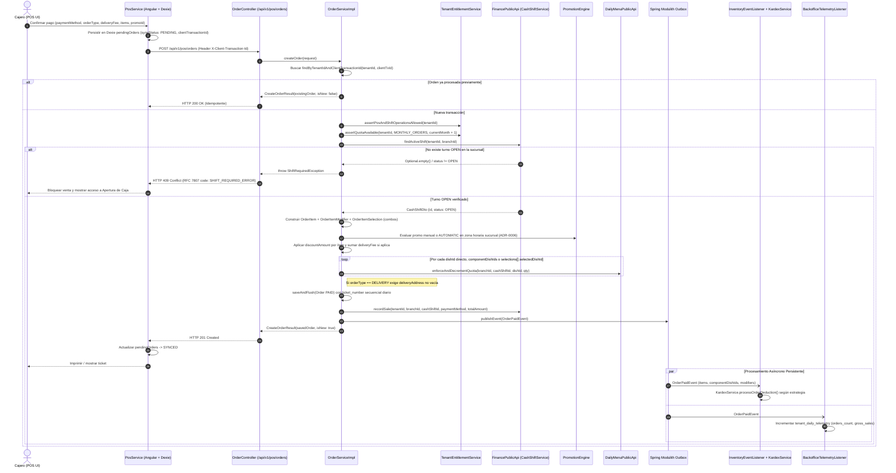

# Flujo de Venta POS: Validación de Turno, Modalidades, Combos y Kardex

Secuencia integral desde el checkout en Angular hasta la persistencia atómica de la orden, verificación de entitlements SaaS, invariante estricto de turno abierto (`409 SHIFT_REQUIRED_ERROR`), descuento de promociones y cupos de menú del día/combos, registro síncrono en caja y deducción asíncrona de inventario en Kardex.

> [!NOTE]
> Este diagrama consolidado unifica la validación de turno abierto (`409`), la gestión de modificadores/selecciones de combos y las modalidades de servicio (`DINE_IN`, `TAKEOUT`, `DELIVERY`, `SCHEDULED_PICKUP`). Asimismo, reemplaza la referencia obsoleta a `FinanceEventListener` (`@Deprecated`): el registro de venta en caja se ejecuta de forma **síncrona** vía `FinancePublicApi.recordSale(...)`.

## Diagrama de Secuencia (Mermaid)

## Detalles Críticos Verificados

1. **Modalidades de Servicio y Flete (`V10`, `V13`, `ADR-0020`):**
   - `orderType` soporta `DINE_IN` (default), `TAKEOUT`, `DELIVERY` y `SCHEDULED_PICKUP`.
   - En modalidad `DELIVERY`, el backend exige `deliveryAddress` obligatorio y suma `deliveryFee` (`>= 0`) al `totalAmount` final después de aplicar descuentos de promociones.
2. **Modificadores y Combos Dinámicos (`V4`, `V23`, `ADR-0018`, `ADR-0031`):**
   - Cada `OrderItem` puede referenciar un plato individual (`dishId`), un combo (`comboId`) y/o un menú diario (`dailyMenuId`), con lista de `selectedModifiers` (`OrderItemModifier`, que opcionalmente descuentan un ingrediente físico) y `selections` (`OrderItemSelection`, persistiendo el plato real elegido por slot `MENU_COURSE` o `SPECIFIC_OPTIONS`).
   - El decremento atómico de cupos (`DailyMenuPublicApi.enforceAndDecrementQuota`) suma cantidades tanto de `dishId` como de cada `selectedDishId` en `selections` (o `componentDishIds`).
3. **Invariante de Turno y Contrato RFC 7807 (`ADR-0013`):**
   - Si la caja de la sucursal no tiene un turno `OPEN`, `ShiftRequiredException` responde `409 Conflict` con `errorCode: "SHIFT_REQUIRED_ERROR"` y `type: "https://api.restaurant.com/errors/shift-required"`.

## Enlaces Relacionados

- [Sincronización Offline Dexie](./sequence_pos_offline_sync.md)
- [Evaluación de Promociones POS](./sequence_pos_promotions_evaluation.md)
- [Cancelación de Pedidos y Autorizaciones](./sequence_pos_order_cancellation_and_authorizations.md)
- [Ciclo de Vida de la Orden](./state_order_lifecycle.md)
- [Estrategia de Deducción Kardex](./activity_inventory_deduction_strategy.md)
- [Cuotas de Menú Diario y Jornadas](./sequence_daily_menu_shift_assignment_and_quota_enforcement.md)
- [ADR-0013: Invariante de Turno POS y Autorizaciones](../../../adr/0013_pos_shift_invariant_and_expense_authorizations.md)
- [ADR-0018: Modificadores, Extras y Notas de Cocina](../../../adr/0018_pos_modifiers_extras_and_kitchen_notes_suite.md)
- [ADR-0020: Modalidades de Servicio y Delivery](../../../adr/0020_service_modalities_takeout_delivery_and_ticket_badges.md)
- [ADR-0031: Jornadas de Servicio y Combos Dinámicos](../../../adr/0031_branch_service_sessions_and_dynamic_combos.md)
