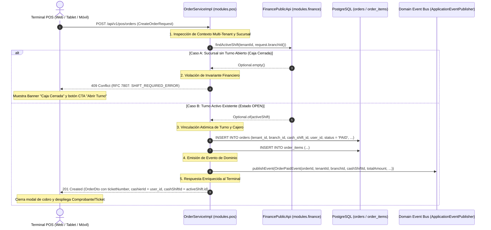
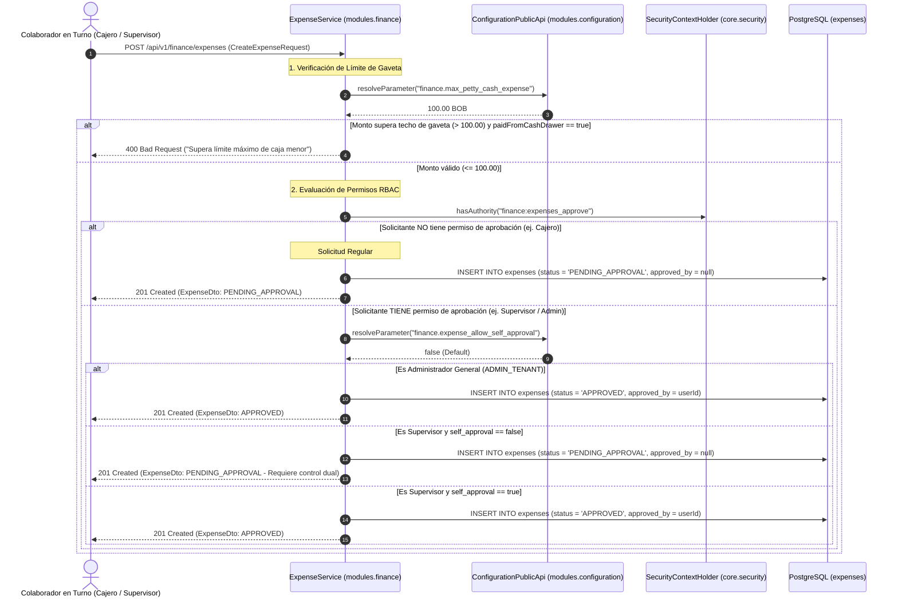

# Diagrama de Secuencia: Invariante de Turno Abierto y Validación de Comandas en POS

Este diagrama describe la interacción modular entre el **Terminal POS**, el módulo **`modules.pos`**, el módulo **`modules.finance`** y la persistencia en base de datos PostgreSQL, implementando el **invariante financiero estricto** definido en el **ADR-0013**.

---

## Flujo de Cobro de Comanda con Verificación de Turno

---

## Flujo de Registro y Autorización de Gastos de Caja Menor (RBAC Puro)

