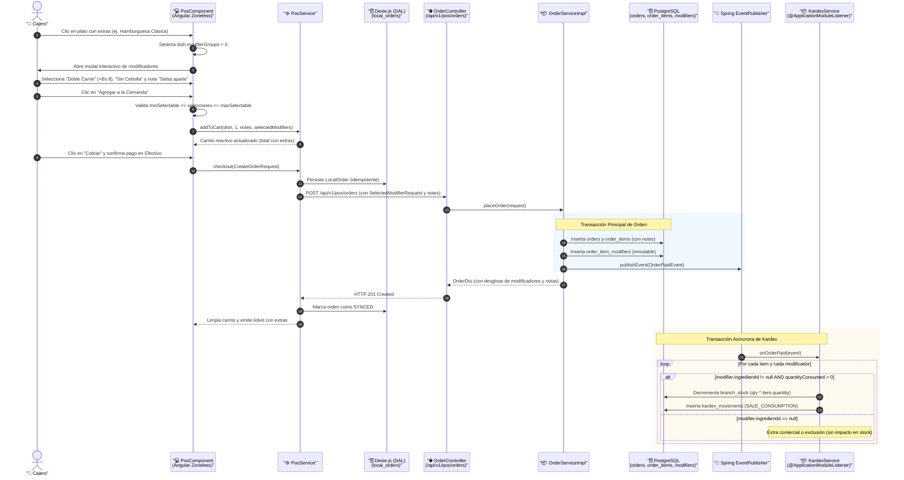

# ⚡ Diagrama de Secuencia: Personalización de Comanda, Modificadores y Deducción Atómica en Kardex (PB-020 / TASK-501 / TASK-502)

Este documento modela el flujo end-to-end de personalización de comandas en el Punto de Venta: selección interactiva de extras/modificadores, notas específicas de cocina por ítem, validación de reglas de selección, persistencia en `order_item_modifiers` y deducción atómica desacoplada en el Kardex.

---

## 🧭 1. Resumen del Flujo

1. **Interacción en POS:** El cajero selecciona un plato que posee grupos de modificadores asociados (`dish.modifierGroups`).
2. **Selector Interactivo (`PosComponent`):** Se despliega el modal interactivo de modificadores (`<app-modal>`), permitiendo elegir opciones y escribir notas abiertas de cocina.
3. **Validación Reactiva:** Se comprueban los límites `minSelectable` y `maxSelectable` de cada grupo de modificadores antes de permitir la confirmación.
4. **Agregado al Carrito:** El plato se añade al carrito con precio unitario incrementado por los extras seleccionados:  
   $$\text{unitPrice} = \text{basePrice} + \sum \text{additionalPrice}$$
5. **Persistencia Transaccional:** `OrderServiceImpl` guarda la cabecera en `orders`, los ítems en `order_items` con sus notas de cocina, y cada extra seleccionado en `order_item_modifiers`.
6. **Publicación y Deducción Desacoplada:** `OrderPaidEvent` viaja vía Spring Modulith a `KardexService`. Por cada modificador con `ingredient_id != null` y `quantity_consumed > 0`, se decrementa `branch_stock` de forma atómica y se registra el movimiento de Kardex.

---

## 📊 2. Diagrama de Secuencia Mermaid



---

## 📋 3. Contratos de Datos Clave

### A. DTO de Modificador Seleccionado en Venta (`SelectedModifierRequest`)
```json
{
  "modifierId": "3fa85f64-5717-4562-b3fc-2c963f66afa6",
  "name": "Doble Carne Smash",
  "additionalPrice": 8.00,
  "ingredientId": "7c9e6679-7425-40de-944b-e07fc1f90ae7",
  "quantityConsumed": 0.1200
}
```

### B. DTO de Ítem de Comanda con Modificadores y Notas (`CreateOrderItemRequest`)
```json
{
  "dishId": "a1b2c3d4-e5f6-7a8b-9c0d-1e2f3a4b5c6d",
  "quantity": 2,
  "unitPrice": 43.00,
  "notes": "Salsa golf aparte, bien crujiente",
  "selectedModifiers": [
    {
      "modifierId": "3fa85f64-5717-4562-b3fc-2c963f66afa6",
      "name": "Doble Carne Smash",
      "additionalPrice": 8.00,
      "ingredientId": "7c9e6679-7425-40de-944b-e07fc1f90ae7",
      "quantityConsumed": 0.1200
    }
  ]
}
```
