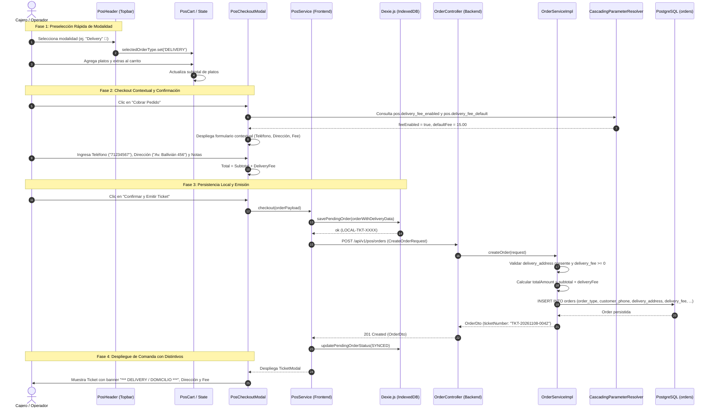

# 🛵 Diagrama de Secuencia: Modalidades de Servicio, Delivery Fee y Distintivos en Tickets (PB-032 / TASK-505)

Este documento modela el ciclo de vida y la interacción entre el terminal de venta (POS), el almacenamiento local (Dexie.js), la configuración de parámetros del sistema y la persistencia transaccional para órdenes en sus diferentes modalidades: **En Salón (`DINE_IN`)**, **Para Llevar (`TAKEOUT`)**, **Encargo para Recoger (`SCHEDULED_PICKUP`)** y **A Domicilio (`DELIVERY`)**.

---

## 1. Diagrama de Secuencia Mermaid

---

## 2. Invariantes y Reglas del Flujo

1. **Selector Dual:** La modalidad puede preseleccionarse en el topbar o modificarse en el modal de checkout antes de emitir el cobro.
2. **Validación de Dirección:** Si la modalidad es `DELIVERY`, el campo `deliveryAddress` no puede ser vacío.
3. **Determinismo Contable:** Si `deliveryFee > 0`, dicho monto incrementa el `totalAmount` transaccional de la comanda y debe cuadrar exactamente con el medio de pago seleccionado (`CASH`, `CARD`, `QR`, `TRANSFER`).
4. **Resiliencia Offline:** En caso de corte de red, Dexie.js almacena los atributos de delivery (`customerName`, `customerPhone`, `deliveryAddress`, `deliveryFee`, `deliveryNotes`) en `pendingOrders`, permitiendo imprimir el ticket local con sus distintivos y sincronizar al restablecerse la conectividad.
