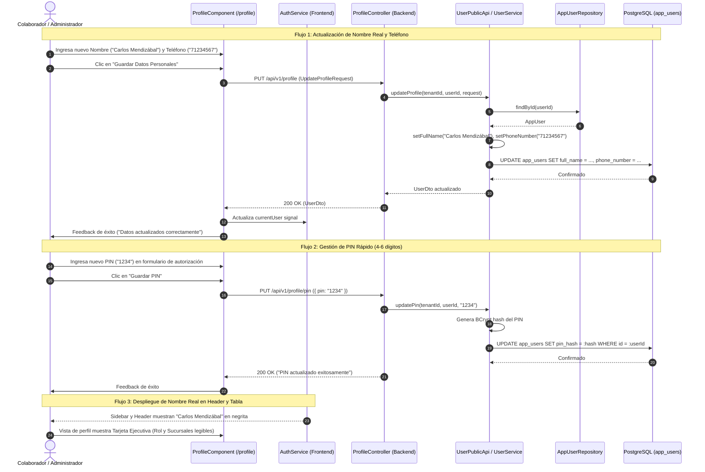

# 👤 Diagrama de Secuencia: Perfil de Usuario Autoservicio, PIN y Humanización (PB-045 / TASK-509)

Este documento modela las interacciones para la actualización autoservicio de datos de contacto (nombre real, teléfono y correo), configuración de contraseña y PIN de supervisor, y la propagación de identidades humanizadas hacia el sidebar, el header y la administración de personal.

---

## 1. Diagrama de Secuencia Mermaid

---

## 2. Invariantes del Flujo

1. **Fricción Cero en Contacto:** La edición de nombre completo y teléfono no exige reautenticación con contraseña para maximizar la usabilidad del colaborador.
2. **Blindaje Criptográfico:** El cambio de contraseña exige validación obligatoria contra Argon2id de la clave actual; el PIN de autorización rápida se almacena estrictamente bajo hash BCrypt en `app_users.pin_hash`.
3. **Ergonomía Visual:** La interfaz erradica listas crudas de recursos técnicos en `/profile`, priorizando roles amigables y nombres reales de sucursales autorizadas.
