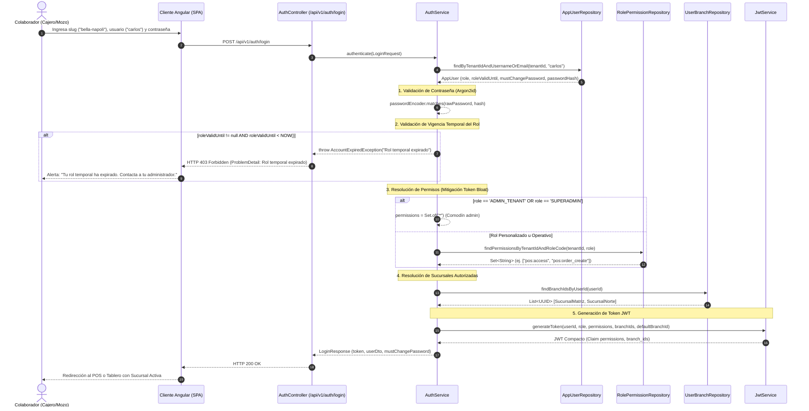
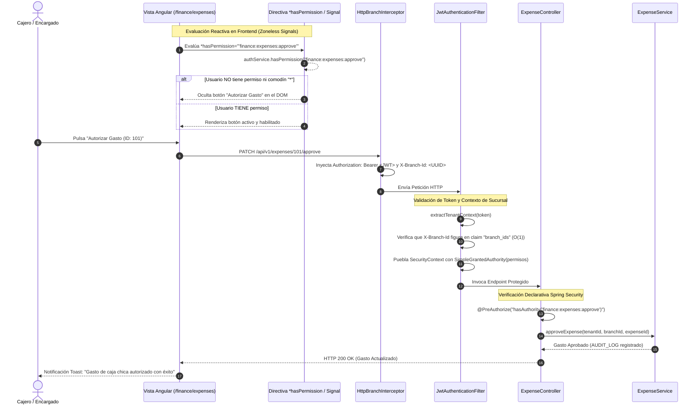
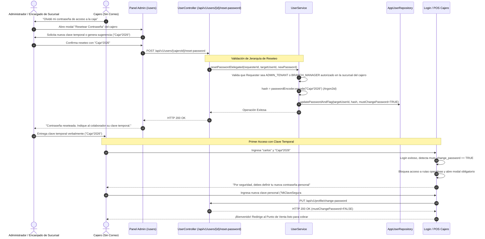

# 🛡️ Diagramas de Secuencia: Resolución RBAC, Multi-Sucursal y Reseteo Delegado

Este documento formaliza las interacciones dinámicas para la resolución de permisos, rotación de sucursales y administración jerárquica de contraseñas bajo el estándar **SDD** ([ADR-0010](../../../adr/0010_granular_rbac_roles_and_privileges.md) / `TASK-336`).

---

## 🔐 Secuencia 1: Login, Validación de Vigencia Temporal y Emisión de JWT

Muestra el flujo de autenticación, validación de expiración de rol temporal (`role_valid_until`), compilación de sucursales autorizadas (`user_branches`) y mitigación de *token bloat*:

---

## ⚡ Secuencia 2: Aplicación de Seguridad en Backend (@PreAuthorize) y Frontend (*hasPermission)

Ilustra la aplicación de permisos en una operación crítica (ej. Autorización de Gasto Menor en Caja Chica):

---

## 🔑 Secuencia 3: Circuito Jerárquico de Reseteo Asistido de Contraseñas

Muestra cómo se resuelve la pérdida de contraseña para un cajero o cocinero sin correo electrónico corporativo:

