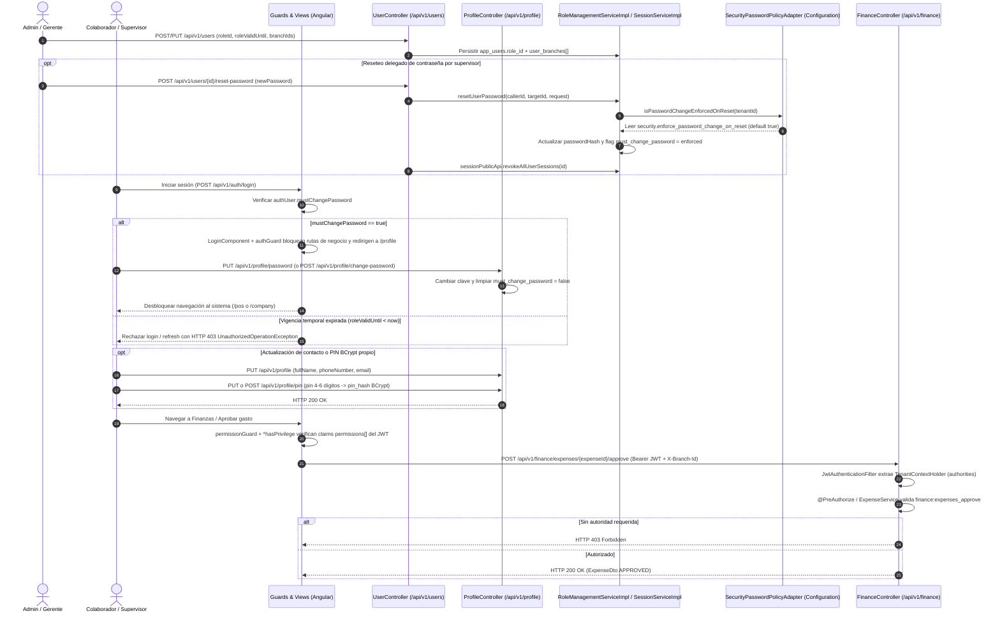

# Flujo de Resolución RBAC, Vigencia Temporal, Perfil y Cumplimiento en Endpoints

Secuencia de resolución de roles y permisos granulares (`recurso:acción`) en tiempo de login/refresh, asignación multi-sucursal (`user_branches`), caducidad temporal (`role_valid_until`), reseteo delegado de contraseña hacia `/profile` y autoservicio de perfil/PIN supervisor (`ProfileController`).

## Diagrama de Secuencia (Mermaid)

## Reglas RBAC y Autoservicio Verificadas

1. **Bloqueo y Redirección por `mustChangePassword` (`auth.guard.ts` & `LoginComponent`):**
   - El backend consulta `security.enforce_password_change_on_reset` mediante el puerto `PasswordChangePolicyPort` (`SecurityPasswordPolicyAdapter`) al ejecutar `POST /api/v1/users/{id}/reset-password` y revoca inmediatamente todas las sesiones previas del colaborador.
   - Si `mustChangePassword == true`, `LoginComponent` redirige directamente a **`/profile`** y todos los guards funcionales (`authGuard`, `guestGuard`, `roleGuard`, `permissionGuard`) impiden acceder a cualquier ruta operativa distinta de `/profile` hasta completar el cambio de contraseña.
2. **Catálogo Real de Permisos (`SystemPermissions` & `RoleController`):**
   - Formato `recurso:acción` verificado en controladores: `pos:access`, `pos:void_item`, `finance:shifts`, `finance:shifts_supervisor`, `finance:expenses_create`, `finance:expenses_approve`, `finance:reports`, `reports:view`, `catalog:read`, `catalog:write`, `inventory:read`, `company:read`, `company:write`, `users:read`, `users:write`, `roles:manage`, `settings:read`, `settings:write`.
   - Roles de sistema (`ADMIN_TENANT`, `SUPERADMIN`) poseen resolución completa de privilegios en su tenant.
3. **Autoservicio de Perfil y PIN (`ProfileController` `/api/v1/profile`):**
   - `GET /api/v1/profile` / `PUT /api/v1/profile`: actualización de `fullName`, `email` y `phoneNumber` (`V16`).
   - `PUT /api/v1/profile/pin` (alias `POST /api/v1/profile/pin`): registra/actualiza el PIN numérico hasheado (`app_users.pin_hash`) usado para autorizaciones presenciales en caja (`V12`).

## Enlaces Relacionados

- [Ciclo de Vida de Sesión y Refresh](./sequence_session_lifecycle_and_refresh.md)
- [Estados de Turnos de Caja y Gastos](./state_shift_and_expense_workflow.md)
- [Anulación de Pedidos y Autorizaciones](./sequence_pos_order_cancellation_and_authorizations.md)
- [Casos de Uso RBAC](../03-use-cases/use_cases_rbac.md)
- [ADR-0010: Control de Acceso RBAC Granular](../../../adr/0010_granular_rbac_roles_and_privileges.md)
- [ADR-0024: Perfil de Usuario Autoservicio y PIN](../../../adr/0024_self_service_user_profile_pin_and_humanization.md)
