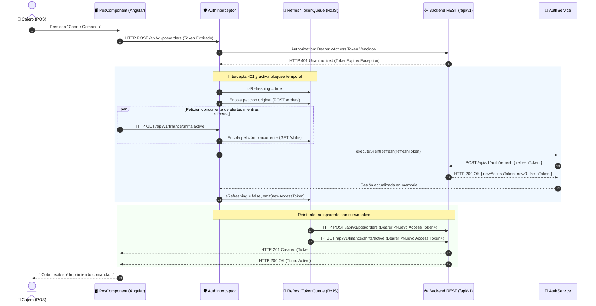
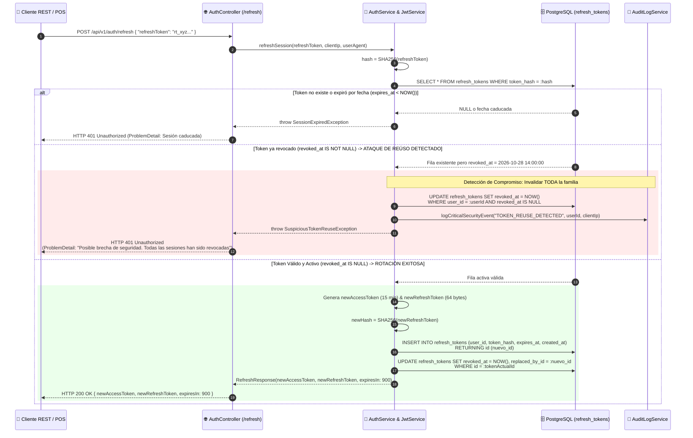
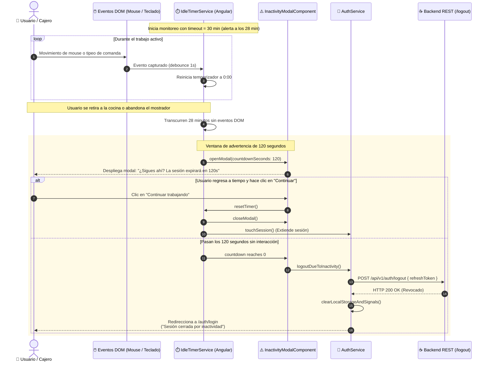

# 🔄 Diagramas de Secuencia: Ciclo de Vida de Sesiones, Silent Refresh y Timeout (PB-027)

Este documento especifica la orquestación temporal de la renovación transparente de tokens (*Silent Refresh*), la rotación criptográfica en base de datos con detección de reúso y el control de inactividad del usuario según lo definido en [ADR-0011](../../../adr/0011_session_lifecycle_and_silent_refresh.md).

---

## 1. Secuencia 1: Silent Refresh Reactivo en Interceptor Angular (Encolamiento ante HTTP 401)

Muestra cómo el `authInterceptor` captura un token expirado, congela las peticiones concurrentes del cajero, renueva el par de tokens y reintenta la operación original sin perder datos:

---

## 2. Secuencia 2: Rotación Atómica de Refresh Token y Detección de Reúso (Compromise Detection)

Detalla la validación del hash SHA-256 en base de datos, la revocación inmediata de la fila previa y la expulsión automática de todas las sesiones en caso de intento de reutilización de token:

---

## 3. Secuencia 3: Control de Inactividad en Frontend, Modal de Advertencia y Cierre Automático

Modela el comportamiento reactivo ante el abandono temporal de una terminal POS o consola administrativa:

