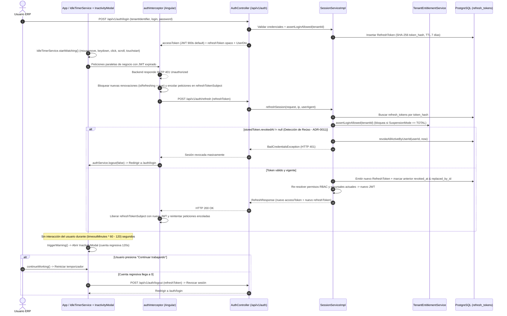

# Ciclo de Vida de Sesión, Silent Refresh con Rotación e Inactividad

Flujo técnico de autenticación JWT + `RefreshToken` opaco con hash SHA-256 (`refresh_tokens`), rotación atómica en cadena (`replaced_by_id`), detección automática de reúso ante robo de tokens, gestión de cola RxJS en `authInterceptor` y monitoreo de inactividad en el navegador (`IdleTimerService`).

## Diagrama de Secuencia (Mermaid)

## Contratos y Comportamiento de Timeout Verificados

1. **Vigencias en Servidor (`SessionServiceImpl`):**
   - `accessToken` JWT: expiración configurable vía `restaurant.security.jwt.expiration-seconds` (default **`900` segundos / 15 minutos**).
   - `refreshToken`: cadena opaca persistida como hash SHA-256 (`refresh_tokens.token_hash`), vigencia de **7 días** (`REFRESH_TOKEN_TTL_DAYS = 7L`).
   - Gestión de sesiones activas del usuario: `GET /api/v1/auth/sessions`, `DELETE /api/v1/auth/sessions/{sessionId}`, `POST /api/v1/auth/logout` y `POST /api/v1/auth/revoke-all`.
2. **Parámetro vs Implementación Actual de Inactividad:**
   - El catálogo de parámetros [`parameters-catalog.json`](../../../../backend/src/main/resources/config/parameters-catalog.json) define **`security.session_inactivity_timeout_minutes`** con valor por defecto **`15`** minutos.
   - En el frontend actual ([`idle-timer.service.ts`](../../../../frontend/src/app/core/services/idle-timer.service.ts)), `IdleTimerService` inicializa por defecto **`DEFAULT_IDLE_TIMEOUT_MINUTES = 30`** minutos (mínimo configurable `3` min en `setTimeoutMinutes`) y **`WARNING_COUNTDOWN_SECONDS = 120`** segundos de aviso previo en `InactivityModal`.
3. **Prioridad ante Bloqueo SaaS:** En `SessionServiceImpl.refreshSession`, `tenantEntitlementService.assertLoginAllowed(tenantId)` se evalúa antes de detectar reúso de token para impedir respuestas `401` ambiguas cuando el tenant se encuentra suspendido en modo `TOTAL`.

## Enlaces Relacionados

- [Resolución RBAC y Autorizaciones](./sequence_rbac_resolution_and_enforcement.md)
- [Ciclo de Vida y Entitlements del Tenant](./state_tenant_lifecycle.md)
- [Casos de Uso de Sesiones](../03-use-cases/use_cases_sessions.md)
- [ADR-0011: Ciclo de Vida de Sesión y Silent Refresh](../../../adr/0011_session_lifecycle_and_silent_refresh.md)
