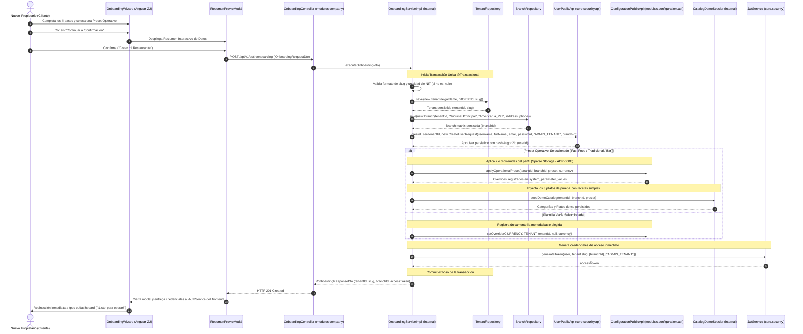
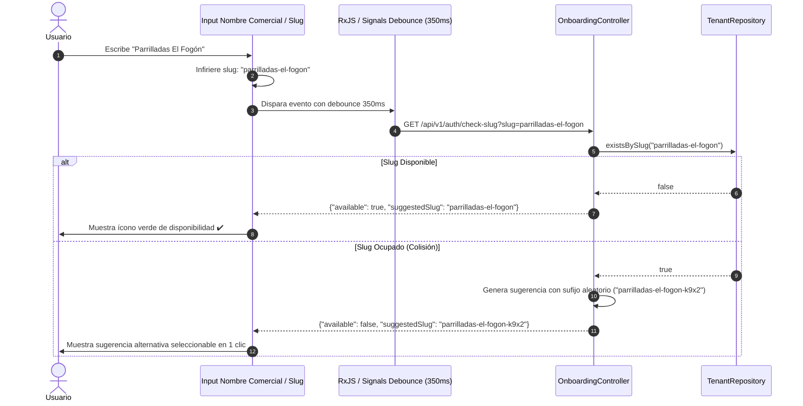

# 🚀 Diagrama de Secuencia: Asistente de Onboarding y Transacción Atómica de Alta

Este documento modela la dinámica transaccional del **Proceso de Onboarding Autónomo (*Self-Service*)** ([ADR-0009](../../../adr/0009_tenant_onboarding_and_operational_presets.md) / `TASK-333`): desde la validación reactiva en el cliente Angular hasta la ejecución coordinada y atómica en Spring Boot 4.1.x y PostgreSQL 16.

---

## 🧭 1. Resumen Ejecutivo del Flujo

1. **Interacción Asíncrona Previa:** Mientras el usuario escribe el nombre de su negocio, el frontend infiere el `slug`, consulta la disponibilidad en tiempo real sin recargar página y valida el NIT (si fue introducido).
2. **Transacción Atómica `@Transactional`:** El backend recibe `OnboardingRequestDto`, valida la unicidad, persiste el `Tenant`, la `Branch` matriz con huso horario boliviano predeterminado, el usuario administrador en `app_users` (Argon2id), aplica 2 a 3 parámetros en `system_parameter_values` (Sparse Storage) e inserta opcionalmente los 3 platos semilla demo.
3. **Emisión de Token JWT "Ready to Sell":** Sin requerir un segundo login manual, se emite el token JWT y el contexto de sucursal (`X-Branch-Id`), redirigiendo al usuario al panel de inicio o terminal POS.

---

## ⚡ 2. Secuencia Principal: Registro Atómico de Alta de Empresa

---

## 🔍 3. Secuencia Secundaria: Validación Reactiva de Disponibilidad de Slug y NIT

Evita que el usuario llegue al final del formulario para descubrir que su identificador comercial ya estaba en uso:

---

## 🔗 4. Relación con Otros Componentes

- **Decisión Arquitectónica:** [ADR-0009](../../../adr/0009_tenant_onboarding_and_operational_presets.md).
- **Esquema de Base de Datos:** [database_erd.md](../02-domain-and-data/database_erd.md).
- **Proceso Operativo de Negocio:** [02_flujo_alta_empresa_y_onboarding.md](../../../business-processes/04-administracion-y-personal/02_flujo_alta_empresa_y_onboarding.md).
- **Casos de Uso:** [use_cases_onboarding.md](../03-use-cases/use_cases_onboarding.md).
