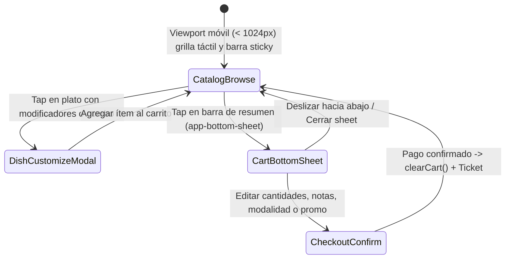
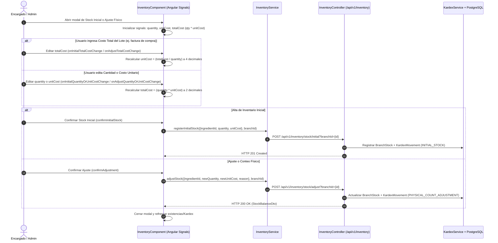

# UX Móvil Táctil en POS y Flujo de Ajuste de Inventario por Lote

Comportamiento de adaptación táctil para dispositivos móviles (`< 1024px`) en el Punto de Venta (`app-bottom-sheet`) y el flujo interactivo de carga inicial y ajuste de stock en [`InventoryComponent`](../../../../frontend/src/app/features/inventory/inventory.component.ts) con calculadora bidireccional costo total de lote $\leftrightarrow$ costo unitario (`POST /api/v1/inventory/stock/initial` y `POST /api/v1/inventory/stock/adjust`).

## 1. Máquina de Estados UX Móvil en POS (`ADR-0012`)

## 2. Flujo Interactivo de Stock Inicial y Ajuste con Calculadora de Lote (`InventoryComponent`)

## Precisiones Verificadas

1. **Rutas Reales de Inventario:** Los endpoints correctos en `InventoryController` son `GET /api/v1/inventory/stock`, `GET /api/v1/inventory/kardex`, `POST /api/v1/inventory/stock/adjust` y `POST /api/v1/inventory/stock/initial` (no existe `/api/v1/inventory/adjustments`).
2. **Precisión Numérica de Costos:** El cálculo bidireccional preserva **4 decimales** en el costo unitario promedio (`toFixed(4)`, alineado a `NUMERIC(12, 4)` en PostgreSQL) y **2 decimales** en el monto total del lote (`toFixed(2)`).

## Enlaces Relacionados

- [ADR-0012: Responsividad Móvil y UX Táctil](../../../adr/0012_mobile_responsiveness_and_touch_ux.md)
- [C4 Nivel 3: Frontend Angular](../01-c4-system/c4_level3_frontend_angular.md)
- [Actividad de Deducción Kardex](./activity_inventory_deduction_strategy.md)
- [Casos de Uso de Inventario](../03-use-cases/use_cases_inventory.md)
