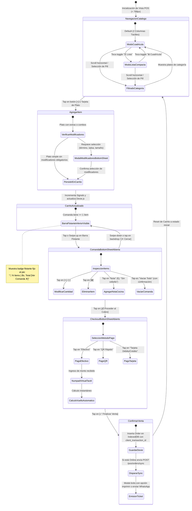
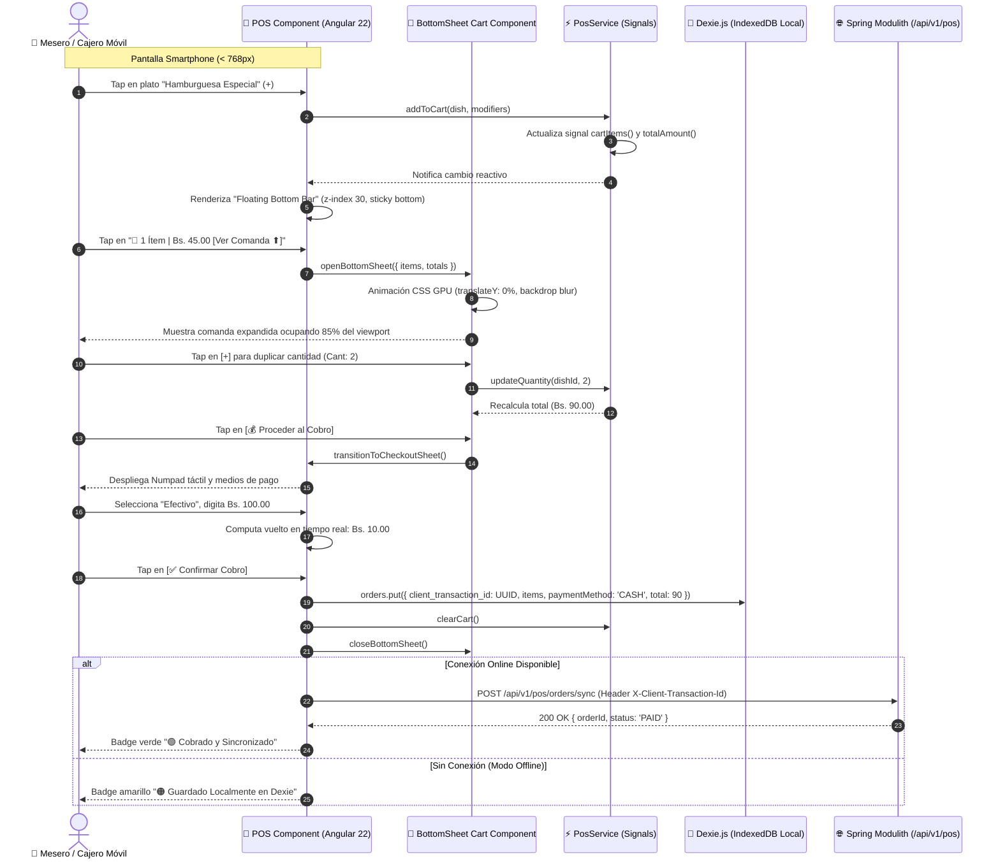
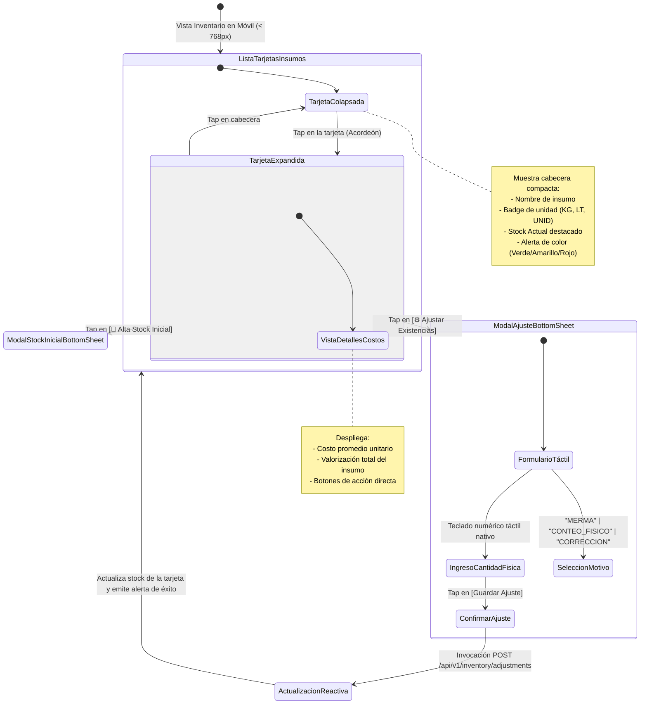

# 📱 Flujo de Interacción y Estados de UX Móvil: POS Táctil e Inventario

Este documento modela las máquinas de estado y diagramas de interacción táctil para dispositivos móviles (`< 768px`) en el Punto de Venta (POS) y el Levantamiento Físico de Inventario, formalizando las decisiones de diseño de **ADR-0012** y **PB-028**.

---

## 1. Máquina de Estados del Punto de Venta Móvil (POS Touch Lifecycle)

---

## 2. Diagrama de Secuencia: Despliegue de Comanda y Cobro Móvil Táctil

---

## 3. Máquina de Estados del Inventario Táctil (Mobile Physical Stock Count)

---

## 4. Matriz de Componentes y Pautas de Accesibilidad Táctil (WCAG 2.2)

| Componente | Rol en Interfaz | Dimensiones Táctiles Mínimas | Comportamiento Móvil (`< 768px`) |
| :--- | :--- | :--- | :--- |
| **`FloatingCartBar`** | Resumen y disparador del carrito | Altura `60px`, `w-full`, `fixed bottom-0` | Persistente cuando `cartItems().length > 0`. Safe-area padding para iOS. |
| **`BottomSheetContainer`** | Contenedor modal deslizable | Drag handle superior `40x4px`, altura dinámica `50vh` a `90vh` | Arrastre vertical (*touch drag*), scroll interno independiente, backdrop oscuro. |
| **`CatalogItemCard` (Grid)** | Tarjeta visual de producto | Min height `120px`, botón `+` de $48 \times 48\text{px}$ | Cuadrícula de 2 columnas con tipografía de precio grande. |
| **`CatalogItemListRow` (Compact)** | Fila rápida de un toque | Altura `56px`, fila completa interactiva | Nombre a la izquierda, precio al centro, botón `+` de $44 \times 44\text{px}$ a la derecha. |
| **`StockCardAccordion`** | Tarjeta de insumo en almacén | Altura colapsada `64px`, padding `p-3.5` | Borde izquierdo con indicador de color (4px), área de toque completa para expandir. |
| **`VirtualNumpad`** | Teclado táctil para cobro en POS | Botones de dígitos de $52 \times 52\text{px}$ | Teclado de 12 teclas (0-9, punto decimal, borrar) para cobro veloz con una mano. |
