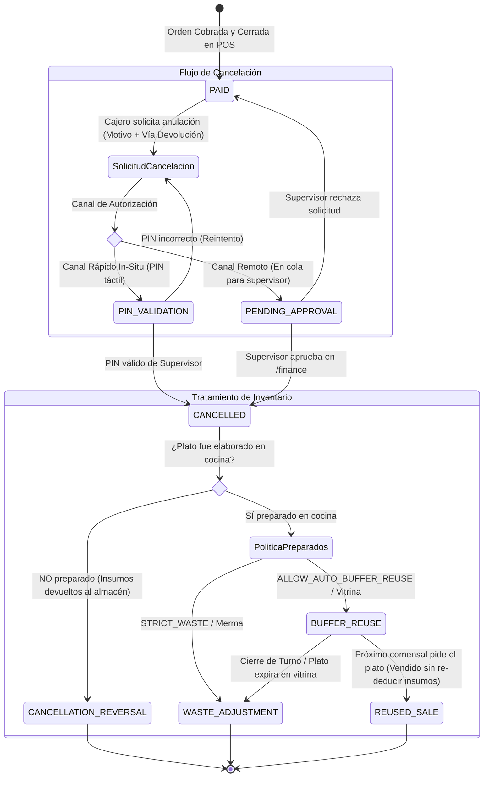

# 🔄 Diagrama de Estados: Ciclo de Vida de Cancelaciones, Autorizaciones y Destino de Insumos (PB-031)

Este diagrama documenta las transiciones de estado de una orden cancelada, las bifurcaciones de autorización y el ciclo de vida del inventario (reverso a Kardex vs buffer de vitrina vs merma física).

---

