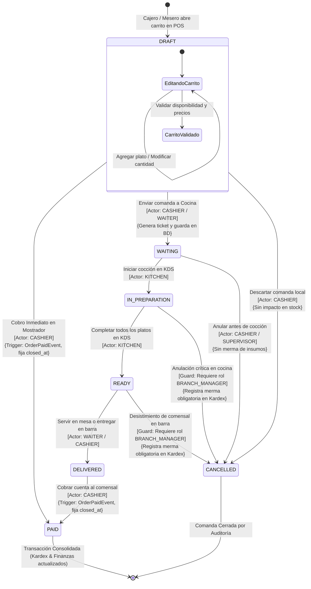

# 🔄 Diagrama de Estados: Ciclo de Vida de la Comanda (Order Lifecycle)

Este documento modela formalmente la máquina de estados (**Finite State Machine - FSM**) que gobierna una comanda (`Order`) dentro del sistema integral de gestión para restaurantes. Describe los estados válidos, las transiciones permitidas, los actores autorizados para ejecutar cada cambio, las invariantes de datos y los eventos de dominio derivados bajo **Specification-Driven Development (SDD)**.

---

## 🧭 1. Resumen de Estados del Dominio

| Estado | Descripción Funcional | Persistencia / Capa | Mutabilidad de Ítems |
| :--- | :--- | :--- | :--- |
| **`DRAFT`** | Comanda en armado preliminar dentro de la terminal de venta. Ítems seleccionados en el carrito de compras. | Local (Signals en memoria y tabla `pendingOrders` en Dexie.js). | Totalmente mutable (+, -, notas, eliminar). |
| **`WAITING`** | Comanda confirmada y guardada en el backend. En cola para preparación en cocina (KDS) o pendiente de cobro en mesa. | PostgreSQL (`orders.order_status = 'WAITING'`). | Restringida (adición de nuevos ítems; eliminación bajo permiso). |
| **`IN_PREPARATION`** | El personal de cocina ha tomado la orden y los platos están en proceso de cocción o ensamble en los fogones. | PostgreSQL (`orders.order_status = 'IN_PREPARATION'`). | Inmutable para el mesero/cajero (insumos en transformación). |
| **`READY`** | Todos los platos han sido finalizados en cocina y reposan en la barra de despacho esperando ser servidos o recogidos. | PostgreSQL (`orders.order_status = 'READY'`). | Inmutable. |
| **`DELIVERED`** | Comanda entregada en mesa o retirada por el cliente en mostrador. | PostgreSQL (`orders.order_status = 'DELIVERED'`). | Inmutable en composición; pendiente de liquidación financiera si no se cobró previamente. |
| **`PAID`** | Comanda cobrada financieramente. Fija `closed_at`, bloquea cualquier edición posterior y desata `OrderPaidEvent`. | PostgreSQL (`orders.order_status = 'PAID'`). | **Estado Terminal Inmutable**. No admite alteraciones ni cancelaciones directas. |
| **`CANCELLED`** | Comanda anulada con motivo explícito registrado en notas de auditoría. | PostgreSQL (`orders.order_status = 'CANCELLED'`). | **Estado Terminal Inmutable**. |

---

## 📊 2. Diagrama de Máquina de Estados Mermaid



---

## 🚦 3. Matriz de Transiciones, Actores y Guardas

```text
+------------------+------------------+---------------------+-----------------------+------------------------------------------+
| Estado Origen    | Estado Destino   | Actor Autorizado    | Método / Evento       | Guardas e Invariantes                    |
+------------------+------------------+---------------------+-----------------------+------------------------------------------+
| [*]              | DRAFT            | CASHIER, WAITER     | PosService.addToCart  | Requiere turno de caja activo o abierto. |
| DRAFT            | PAID             | CASHIER             | PosService.checkout   | Cobro inmediato (CASH, CARD, QR).        |
| DRAFT            | WAITING          | CASHIER, WAITER     | OrderCtrl.createOrder | Comanda con al menos 1 ítem válido.      |
| WAITING          | IN_PREPARATION   | KITCHEN             | KdsService.startOrder | Orden visible en pantalla de cocina.     |
| IN_PREPARATION   | READY            | KITCHEN             | KdsService.markReady  | Todos los platos del pedido listos.      |
| READY            | DELIVERED        | WAITER, CASHIER     | OrderCtrl.deliver     | Despacho físico confirmado.              |
| DELIVERED        | PAID             | CASHIER             | OrderCtrl.payOrder    | Salda el total; registra medio de pago.  |
| WAITING          | CANCELLED        | CASHIER, MANAGER    | OrderCtrl.cancelOrder | Solo permitido si no entró a fogones.    |
| IN_PREPARATION   | CANCELLED        | BRANCH_MANAGER      | OrderCtrl.cancelOrder | Requiere autorización de encargado.      |
| READY            | CANCELLED        | BRANCH_MANAGER      | OrderCtrl.cancelOrder | Genera reporte de comida no servida.     |
+------------------+------------------+---------------------+-----------------------+------------------------------------------+
```

---

## 🔒 4. Invariantes de Negocio y Reglas Críticas

### 4.1. Invariante de la Transición a `PAID`
La transición hacia el estado `PAID` es el hito financiero y logístico neurálgico del sistema:
1. **Fijación de Timestamp:** Se asigna de forma definitiva la marca temporal `closed_at = Instant.now()`.
2. **Cierre de Concurrencia:** La columna `@Version private Long version` previene condiciones de carrera o sobreescrituras concurrentes.
3. **Disparo de Evento de Dominio:** `OrderServiceImpl` invoca:
   ```java
   eventPublisher.publishEvent(new OrderPaidEvent(...));
   ```
   Esto garantiza que los módulos de **Inventario** (Kardex) y **Finanzas** (Turno de Caja) reciban la notificación atómica de cobro sin acoplamiento de código.
4. **Prohibición de Edición:** Una orden en estado `PAID` **no puede ser modificada, eliminada ni re-transicionada a `CANCELLED`**. Cualquier reversión posterior exige un procedimiento explícito de reembolso o nota de crédito auditada.

### 4.2. Invariante de Cancelación y Prevención de Mermas No Declaradas
- Si la comanda es cancelada en `WAITING`, ningún insumo fue comprometido en los fogones, por lo que no existe impacto en el inventario.
- Si la comanda es cancelada en `IN_PREPARATION` o `READY`, los insumos físicos ya fueron transformados y desechados. Por tanto:
  - Se exige que la cancelación sea aprobada únicamente por un usuario con rol `BRANCH_MANAGER` o `ADMIN_TENANT`.
  - El sistema exige registrar en el campo `notes` el motivo detallado de la cancelación.
  - El encargado debe asentar un movimiento de ajuste de merma (`WASTE_OUT`) en el Kardex para mantener la concordancia física.

### 4.3. Flujo Dual: Venta Rápida (Quick-Service) vs. Servicio a la Mesa (Dine-In)
El diseño del ciclo de vida soporta nativamente ambos modelos operacionales:
- **Modelo Quick-Service (Comida rápida, cafeterías, mostrador):** La comanda se arma en caja y se cobra en el acto. La transición ocurre de forma directa:
  $$\text{DRAFT} \longrightarrow \text{PAID}$$
  El ticket emitido al comensal pasa a preparación con el comprobante ya saldado.
- **Modelo Dine-In (Servicio de mesa tradicional):** La comanda se envía primero a cocina para su preparación y servicio, y el cobro se realiza al final de la experiencia gastronómica:
  $$\text{DRAFT} \longrightarrow \text{WAITING} \longrightarrow \text{IN\_PREPARATION} \longrightarrow \text{READY} \longrightarrow \text{DELIVERED} \longrightarrow \text{PAID}$$

---

## 🔗 Enlaces Cruzados a Bóveda y Documentación

- **Diagrama de Secuencia POS a Kardex:** [sequence_pos_order_deduction.md](./sequence_pos_order_deduction.md)
- **Diagrama de Sincronización Offline:** [sequence_pos_offline_sync.md](./sequence_pos_offline_sync.md)
- **Workflow de Turno y Arqueo de Caja:** [state_shift_and_expense_workflow.md](./state_shift_and_expense_workflow.md)
- **Modelo de Dominio Conceptual:** [domain_model.md](../02-domain-and-data/domain_model.md)
- **Casos de Uso de POS:** [use_cases_pos.md](../03-use-cases/use_cases_pos.md)
