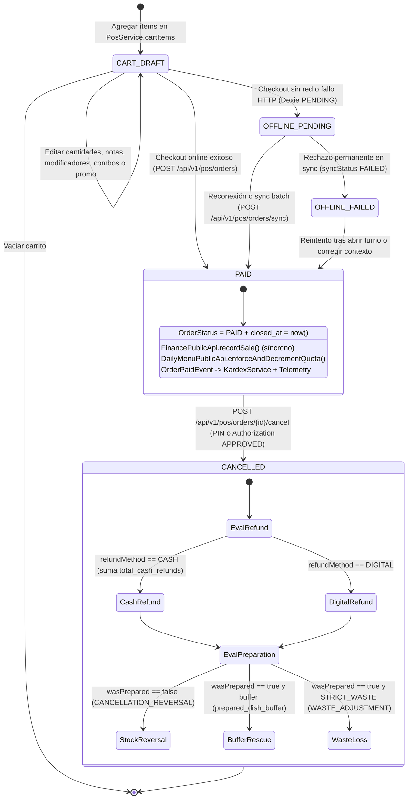

# Máquina de Estados del Ciclo de Vida de la Orden POS

Ciclo de vida real de una orden desde su conformación en memoria en Angular (`PosService`) y cola local Dexie hasta su persistencia definitiva en PostgreSQL (`orders.order_status`) y posible anulación con tratamiento de merma o rescate.

> [!IMPORTANT]
> **Alineación real con el sistema (Sprint 6):** Aunque la migración inicial `V1__init_schema.sql` define un `CHECK` amplio heredado, el sistema actual **no implementa módulo KDS ni estados intermedios operativos** (`WAITING`, `IN_PREPARATION`, `READY`, `DELIVERED`). Toda orden cobrada en POS entra directamente en estado **`PAID`** (o en cola local `PENDING` offline antes de sincronizar a `PAID`), pudiendo transicionar únicamente a **`CANCELLED`**.

## Diagrama de Estados (Mermaid)

## Resumen de Transiciones Verificadas

| Estado Origen | Estado Destino | Disparador / Endpoint | Precondiciones e Invariantes |
| :--- | :--- | :--- | :--- |
| `[*] / CART_DRAFT` | `OFFLINE_PENDING` | `PosService.checkout()` | Se guarda primero en Dexie `pendingOrders` (`tenantId`, `branchId`, `clientTransactionId`, `syncStatus: 'PENDING'`). Si falla el POST online, retorna ticket local provisional. |
| `CART_DRAFT` / `OFFLINE_PENDING` | `PAID` | `POST /api/v1/pos/orders` o `POST /api/v1/pos/orders/sync` | Exige tenant habilitado (`core.entitlements`), cuota mensual disponible (`MONTHLY_ORDERS`), turno abierto `OPEN` (`409 SHIFT_REQUIRED_ERROR`) y cupo suficiente en menú diario. Publica `OrderPaidEvent`. |
| `PAID` | `CANCELLED` | `POST /api/v1/pos/orders/{orderId}/cancel` | Exige PIN de supervisor válido (`pin_hash`) o solicitud `ShiftAuthorization` `APPROVED`. Publica `OrderCancelledEvent` con `wasPrepared` y `wastePolicyApplied`. |

## Enlaces Relacionados

- [Flujo de Venta POS y Deducción](./sequence_pos_order_deduction.md)
- [Secuencia de Sincronización Offline](./sequence_pos_offline_sync.md)
- [Cancelación de Pedidos y Autorizaciones](./sequence_pos_order_cancellation_and_authorizations.md)
- [Esquema Local Dexie.js](../02-domain-and-data/dexie_local_schema.md)
- [ADR-0019: Flujo de Cancelación de Pedidos y Merma](../../../adr/0019_order_cancellation_workflow_authorizations_and_waste_treatment.md)
