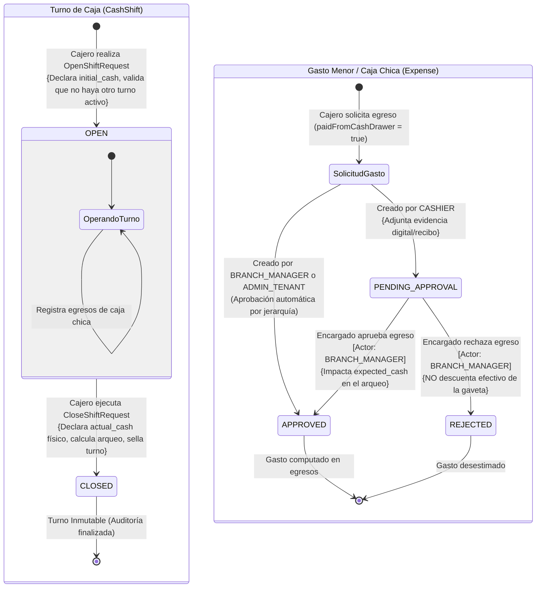
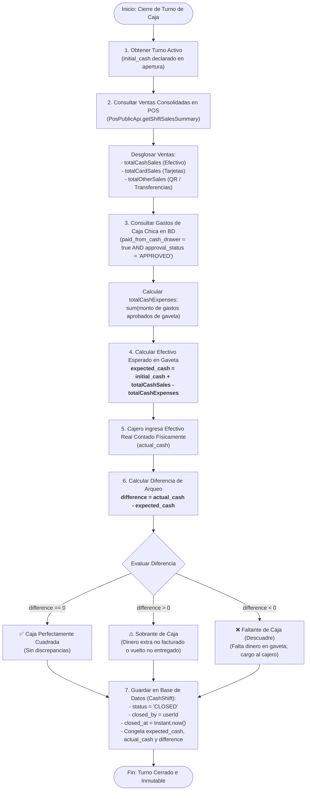

# 💰 Diagrama de Estados y Flujo Operativo: Ciclo de Turno de Caja y Gestión de Gastos

Este documento modela la arquitectura operativa y matemática del módulo de **Finanzas**: el ciclo de vida del **Turno de Caja** (`CashShift`), el flujo de aprobación de **Gastos Menores / Caja Chica** (`Expense`) y la fórmula del **Arqueo de Caja** para el balance y control de descuadres en las sucursales.

---

## 🧭 1. Resumen Ejecutivo del Módulo Financiero

El sistema implementa un modelo estricto de control de efectivo diseñado para evitar pérdidas, robos hormiga y discrepancias operativas:
1. **Unicidad de Turno Abierto:** En una sucursal dada (`branch_id`), únicamente puede existir **un solo turno de caja abierto a la vez** (`status = 'OPEN'`).
2. **Fondo de Inicio de Gaveta (`initial_cash`):** El cajero declara el efectivo base con el que arranca operaciones para dar cambio.
3. **Acumulación Asíncrona en Vivo:** A través de `OrderPaidEvent` y `FinanceEventListener`, las ventas cobradas se suman automáticamente en tiempo real en los acumuladores del turno: `total_cash_sales`, `total_card_sales` y `total_other_sales`.
4. **Gobierno de Gastos de Caja Chica (`expenses`):** Cualquier salida imprevista de dinero de la gaveta física (compra de hielo, propinas a proveedores, artículos de limpieza) requiere aprobación jerárquica del encargado antes de computarse en el arqueo.
5. **Cierre de Turno y Arqueo Ciego:** Al culminar la jornada, el cajero realiza el conteo físico de los billetes y monedas (`actual_cash`). El sistema contrasta este valor contra el cálculo matemático estricto del sistema (`expected_cash`), determinando la diferencia exacta (`difference`: faltante o sobrante).

---

## 📊 2. Diagramas Mermaid

### 2.1. Máquina de Estados: Turno de Caja y Gastos Menores



---

### 2.2. Flujograma del Arqueo y Conciliación Matemática



---

## 🧮 3. Fundamento Matemático del Arqueo de Caja

La conciliación del arqueo de caja se rige por la fórmula canónica del sistema:

### 3.1. Fórmula del Efectivo Esperado (`expected_cash`)
$$\text{expected\_cash} = \text{initial\_cash} + \text{total\_cash\_sales} - \text{total\_cash\_expenses}$$

Donde:
- $\text{initial\_cash}$: Monto base entregado al cajero al abrir el turno (`cash_shifts.initial_cash`).
- $\text{total\_cash\_sales}$: Sumatoria de todas las órdenes en estado `PAID` con método de pago `CASH` procesadas durante el turno.
- $\text{total\_cash\_expenses}$: Sumatoria de egresos que cumplen estrictamente:
  $$\text{total\_cash\_expenses} = \sum_{e \in E} e.\text{amount} \quad \text{donde} \quad E = \{ e \mid e.\text{paid\_from\_cash\_drawer} = \text{true} \land e.\text{approval\_status} = \text{'APPROVED'} \}$$

> [!IMPORTANT]
> Los gastos con estado `PENDING_APPROVAL` o `REJECTED` **no se restan del efectivo esperado**. Si un cajero saca dinero de la gaveta para un gasto pero este no fue aprobado por el encargado, el arqueo detectará un faltante.
> De igual forma, los gastos donde `paid_from_cash_drawer = false` (pagados por transferencia corporativa o cuenta corriente de la empresa) **no afectan la gaveta física**.

### 3.2. Fórmula de la Diferencia (`difference`)
$$\text{difference} = \text{actual\_cash} - \text{expected\_cash}$$

- **Caso 1: $\text{difference} = 0.00$:** El conteo físico coincide al céntimo con las operaciones registradas.
- **Caso 2: $\text{difference} > 0.00$ (Sobrante):** Existe más dinero físico en la gaveta del que el sistema calculó. Común en propinas retenidas por error o cambio no entregado a clientes.
- **Caso 3: $\text{difference} < 0.00$ (Faltante / Descuadre):** Hay menos dinero físico en la gaveta del que debería haber según las ventas y gastos aprobados. El cajero es financieramente responsable por el importe faltante.

---

## 🛡️ 4. Política de Aprobación de Gastos Menores

Para salvaguardar la caja chica y evitar extracciones no autorizadas, el sistema aplica la siguiente matriz de gobierno en `ExpenseService`:

```text
+-----------------------+------------------------+-------------------+--------------------+------------------------+
| Rol del Solicitante   | paid_from_cash_drawer  | Estado Inicial    | Requiere Revisión? | Afecta Arqueo?         |
+-----------------------+------------------------+-------------------+--------------------+------------------------+
| CASHIER               | true (Caja Chica)      | PENDING_APPROVAL  | SÍ (BRANCH_MANAGER)| Solo tras ser APPROVED |
| CASHIER               | false (Cuenta Empresa) | APPROVED          | NO                 | NO (No toca gaveta)    |
| BRANCH_MANAGER        | true (Caja Chica)      | APPROVED          | NO (Auto-aprobado) | SÍ (Inmediato)         |
| ADMIN_TENANT          | true o false           | APPROVED          | NO (Auto-aprobado) | SÍ (Si es gaveta)      |
+-----------------------+------------------------+-------------------+--------------------+------------------------+
```

### Reglas de Auditoría en la Aprobación:
- El encargado (`BRANCH_MANAGER`) revisa la descripción, el importe y el enlace a la foto/recibo digital (`evidence_url`).
- Al resolver el gasto mediante `approveExpense`, se guardan de forma permanente:
  - `approval_status`: `'APPROVED'` o `'REJECTED'`.
  - `approved_by`: UUID del encargado que tomó la decisión.
  - `approval_notes`: Justificación de la aprobación o motivo del rechazo.
- Un gasto en estado `APPROVED` o `REJECTED` se vuelve **inmutable**. No puede volver a procesarse ni modificarse.

---

## 🔗 Enlaces Cruzados a Bóveda y Documentación

- **Diagrama de Secuencia POS a Finanzas:** [sequence_pos_order_deduction.md](./sequence_pos_order_deduction.md)
- **Ciclo de Vida de Comandas:** [state_order_lifecycle.md](./state_order_lifecycle.md)
- **Casos de Uso de Finanzas:** [use_cases_finance.md](../03-use-cases/use_cases_finance.md)
- **ERD PostgreSQL (Tablas `cash_shifts` y `expenses`):** [database_erd.md](../02-domain-and-data/database_erd.md)
- **ADR-0006: Zonas Horarias y Manejo de Fechas:** [docs/adr/0006-strict-datetime-and-timezone-handling.md](../../../adr/)
