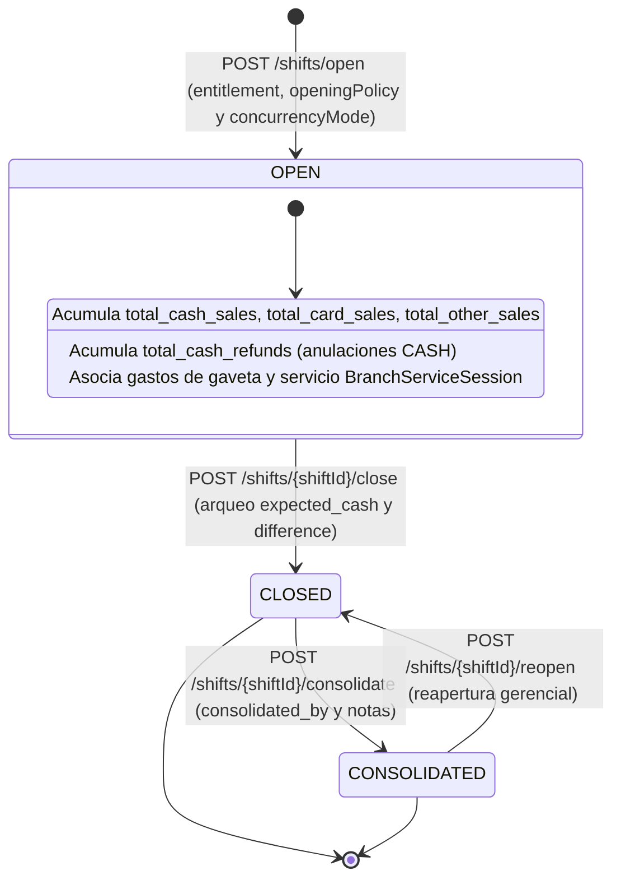
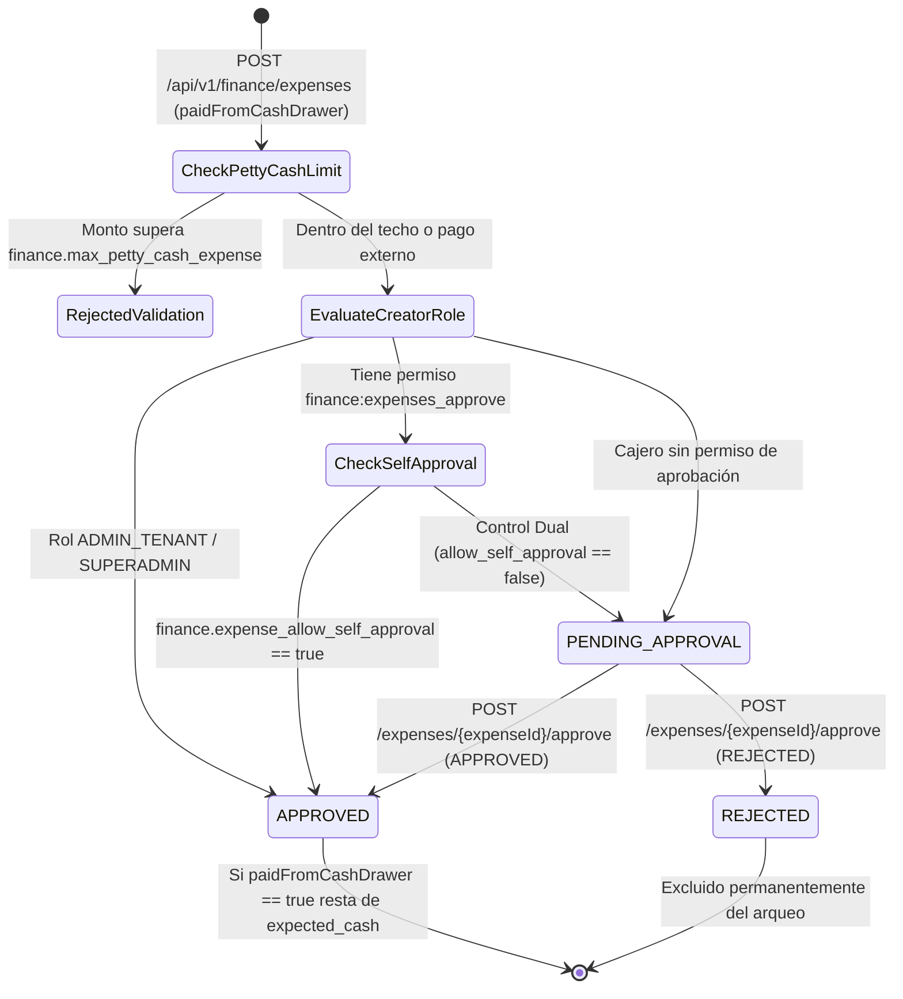

# Estados de Turnos de Caja, Multi-Cajero, Arqueo y Gastos

Máquinas de estados de `CashShift` (`OPEN -> CLOSED -> CONSOLIDATED` + reapertura gerencial `CONSOLIDATED -> CLOSED`) y de aprobación de `Expense` (`PENDING_APPROVAL -> APPROVED | REJECTED`), reflejando concurrencia multi-cajero, deducción por devoluciones en efectivo y control dual RBAC (`finance:expenses_approve` + `finance.expense_allow_self_approval`).

## 1. Ciclo de Vida del Turno de Caja (`CashShiftService`)

### Reglas de Concurrencia y Fórmula de Arqueo Verificadas

1. **Modos de Concurrencia (`finance.shift_concurrency_mode`, `ADR-0016`):**
   - `SINGLE_PER_BRANCH` (default): Solo puede existir **un** turno `OPEN` simultáneo por sucursal (`409 ResourceConflictException` al intentar abrir un segundo).
   - `INDIVIDUAL_PER_CASHIER`: Cada cajero puede abrir y operar simultáneamente **su propio** turno `OPEN` dentro de la misma sucursal compartiendo la misma `BranchServiceSession`.
2. **Política de Apertura (`finance.shift_opening_policy`, `ADR-0013`):**
   - `ALL_AUTHORIZED`: Cualquier usuario autorizado en caja puede abrir turno.
   - `SUPERVISOR_ONLY`: Solo `ADMIN_TENANT`, `SUPERADMIN` o usuarios con privilegio `finance:shifts_supervisor`.
3. **Fórmula Canónica de Arqueo (`CashShiftService.closeShift`, `V12`, `ADR-0019`):**
   $$\text{expected\_cash} = \text{initial\_cash} + \text{total\_cash\_sales} - \text{total\_cash\_expenses\_approved} - \text{total\_cash\_refunds}$$
   $$\text{difference} = \text{actual\_cash} - \text{expected\_cash}$$
4. **Reapertura Gerencial (`reopenShift`):** Permite devolver un turno `CONSOLIDATED` al estado `CLOSED` tras validar entitlements del tenant (`assertPosAndShiftOperationsAllowed`), manteniendo intacta la traza histórica de ventas.
5. **Fechas y Cortes Operativos:** Todos los timestamps (`opened_at`, `closed_at`, `consolidated_at`) se almacenan en `TIMESTAMPTZ` UTC y se consultan/muestran en la zona horaria local de la sucursal (`ADR-0006`).

---

## 2. Flujo de Gastos de Caja Chica y Control Dual RBAC (`ExpenseService`)

### Reglas de Gobernanza en Gastos (`ExpenseService`)

- **Techo de Gaveta (`finance.max_petty_cash_expense`):** Si `paidFromCashDrawer == true` y el monto excede el límite parametrizado (default `100.00`), se rechaza con `ValidationException` (`400 Bad Request`).
- **Aprobación (`POST /api/v1/finance/expenses/{expenseId}/approve`):** Requiere autoridad `finance:expenses_approve` (o rol `ADMIN_TENANT`/`SUPERADMIN`) y transiciona únicamente gastos en estado `PENDING_APPROVAL` hacia `APPROVED` o `REJECTED`.
- **Fecha de Gasto:** Usa `DATE` ISO sin hora ni zona (`ADR-0006`, `expense_date`).

## Enlaces Relacionados

- [Anulación de Pedidos y Autorizaciones](./sequence_pos_order_cancellation_and_authorizations.md)
- [Resolución RBAC y Autorizaciones](./sequence_rbac_resolution_and_enforcement.md)
- [Jornadas de Servicio y Menús del Día](./sequence_daily_menu_shift_assignment_and_quota_enforcement.md)
- [Casos de Uso de Finanzas](../03-use-cases/use_cases_finance.md)
- [ADR-0005: Flujo de Turnos de Caja y Gastos](../../../adr/0005_cash_shift_expense_workflow.md)
- [ADR-0006: Estándar de Fechas y Zonas Horarias](../../../adr/0006_datetime_and_timezone_handling.md)
- [ADR-0013: Invariante de Turno POS y Autorizaciones](../../../adr/0013_pos_shift_invariant_and_expense_authorizations.md)
- [ADR-0016: Separación de Control de Caja y Turnos Multi-Cajero](../../../adr/0016_cash_control_separation_and_multi_cashier_shifts.md)
- [ADR-0019: Cancelaciones y Devoluciones en Efectivo](../../../adr/0019_order_cancellation_workflow_authorizations_and_waste_treatment.md)
