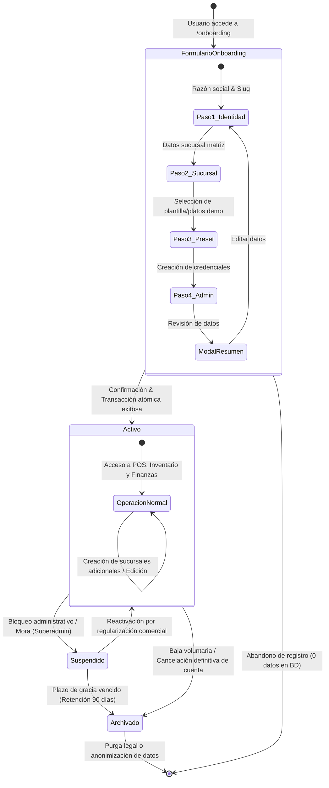

# 🏢 Máquina de Estados: Ciclo de Vida de la Empresa (Tenant Lifecycle)

Este documento modela las fases, estados operacionales y transiciones del ciclo de vida de una empresa inquilina (**Tenant**) en la plataforma, desde su creación en el asistente de onboarding ([ADR-0009](../../../adr/0009_tenant_onboarding_and_operational_presets.md)) hasta su eventual suspensión o archivado definitivo.

---

## 🗺️ 1. Diagrama de Transición de Estados (Mermaid)

---

## 📋 2. Descripción de Estados e Invariantes de Negocio

| Estado | Significado Operativo | Acceso Permitido para Colaboradores | Mutabilidad de Datos |
| :--- | :--- | :--- | :--- |
| **`FormularioOnboarding`** | El usuario se encuentra completando los pasos del asistente visual en el navegador. | No existe sesión ni token JWT emitido. | Solo vive en memoria del cliente. Cero registros en PostgreSQL. |
| **`Activo`** (`is_active = true`) | La empresa está plenamente habilitada en la plataforma con al menos su sucursal matriz y su administrador. | Acceso completo según rol asignado (POS, comandas, arqueos, inventario). | Lectura y escritura transaccional ilimitada. |
| **`Suspendido`** (`is_active = false`) | Bloqueo administrativo preventivo impuesto por el operador SaaS (Superadmin). | Login bloqueado con mensaje explicativo: *"Cuenta temporalmente suspendida. Contacte a soporte"*. | Base de datos en solo lectura técnica; operaciones comerciales bloqueadas. |
| **`Archivado`** | La empresa solicitó la baja del servicio o finalizó su contrato. | Acceso revocado permanentemente para todos los usuarios del tenant. | Datos congelados para cumplimiento fiscal/auditoría histórica. |

---

## 🔗 3. Referencias Relacionadas

- **Transacción Atómica de Alta:** [sequence_tenant_onboarding.md](./sequence_tenant_onboarding.md).
- **Modelo Relacional Físico:** [database_erd.md](../02-domain-and-data/database_erd.md).
- **Decisión Arquitectónica:** [ADR-0009](../../../adr/0009_tenant_onboarding_and_operational_presets.md).
