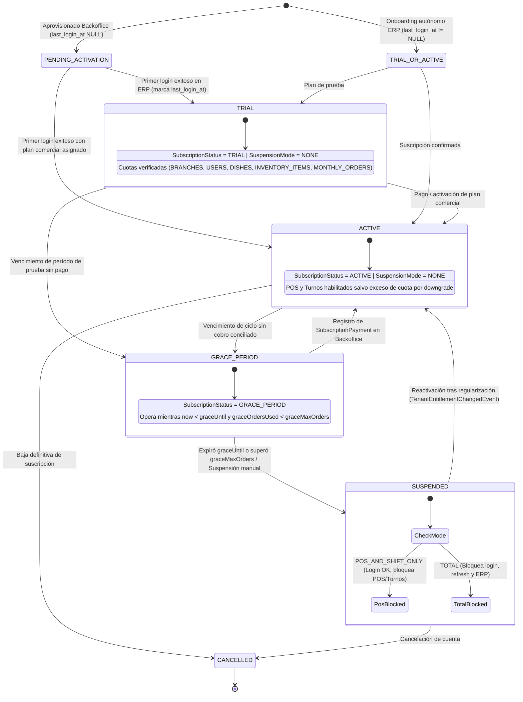

# Máquina de Estados del Ciclo de Vida, Suscripción y Entitlements del Tenant

Estados comerciales y operativos de un inquilino (**`Tenant`**) gobernados por `modules.backoffice` y evaluados en tiempo real en memoria por `core.entitlements` (`TenantEntitlementServiceImpl`), integrando las reglas de **`ADR-0029`**, período de gracia, modos de suspensión (`NONE | POS_AND_SHIFT_ONLY | TOTAL`), cuotas por plan y el rastreo de primer acceso en el ERP (`V20` / `TASK-618`).

## Diagrama de Estados (Mermaid)

## Matriz de Aplicación de `core.entitlements` en Tiempo de Ejecución

1. **Invalidación por Eventos (`TenantEntitlementChangedEvent`):** `TenantEntitlementServiceImpl` mantiene un caché `ConcurrentHashMap<UUID, TenantEntitlementSnapshot>` sincronizado automáticamente cuando Backoffice modifica suscripciones, pagos o estados de suspensión.
2. **Modos de Suspensión (`SuspensionMode`):**
   - `NONE`: Operación normal si las cuotas estructurales están dentro del límite del plan.
   - `POS_AND_SHIFT_ONLY`: Permite login al ERP (lectura administrativa, consulta de reportes y descarga de datos), pero **`assertPosAndShiftOperationsAllowed`** bloquea nuevas ventas POS (`OrderServiceImpl`), apertura de caja y reapertura gerencial de turnos (`CashShiftService`).
   - `TOTAL`: **`assertLoginAllowed`** impide tanto el `login` como el `refreshSession` (incluso evitando revocación equivocada por falso reúso de token).
3. **Bloqueo por Exceso tras Downgrade (`QuotaResource`):** Si un tenant excede `BRANCHES` o `USERS` respecto a su plan vigente (`overQuotaResources`), `getEntitlementView` marca `posAllowed = false` y bloquea ventas/turnos hasta ajustar su dotación o escalar plan; `MONTHLY_ORDERS`, `DISHES` e `INVENTORY_ITEMS` validan disponibilidad antes de crear nuevos recursos (`assertQuotaAvailable`).
4. **Distinción de Activación Inicial (`TASK-618` / `V20`):** Todo tenant creado vía Backoffice conserva `app_users.last_login_at = NULL` hasta el primer inicio de sesión real del propietario en el ERP, permitiendo al Backoffice distinguir cuentas pendientes de activación de cuentas operativas.

## Enlaces Relacionados

- [Secuencia y Estados de Suscripciones en Backoffice](../../../backoffice/architecture/sequence_and_state_subscriptions.md)
- [Casos de Uso del Backoffice](../../../backoffice/architecture/use_cases_backoffice.md)
- [Secuencia de Onboarding de Nuevo Tenant](./sequence_tenant_onboarding.md)
- [Ciclo de Vida de Sesión y Refresh](./sequence_session_lifecycle_and_refresh.md)
- [ADR-0029: Backoffice, Suscripciones, Cuotas y Telemetría](../../../adr/0029_backoffice_subscriptions_quotas_and_telemetry.md)
