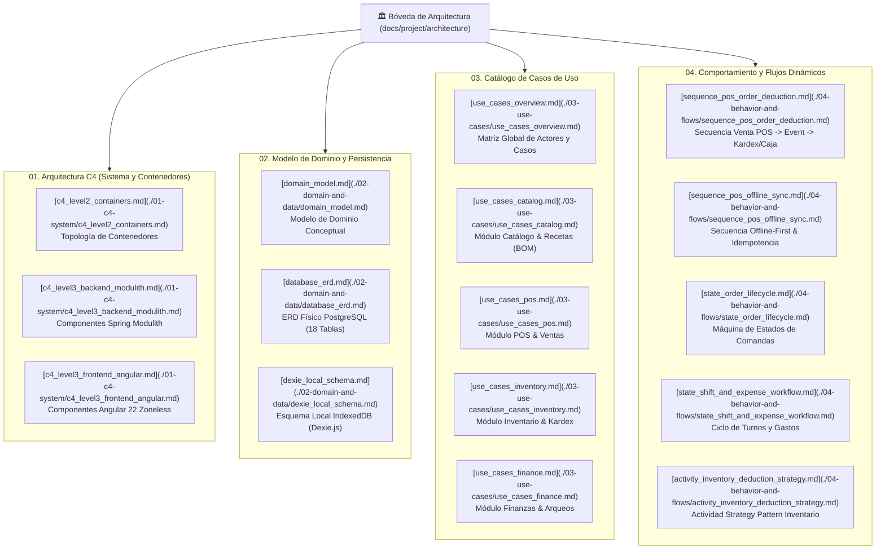

# 🏛️ Bóveda de Arquitectura Viva - Sistema Integral de Gestión para Restaurante

Bienvenido al centro de conocimiento y especificación viva del proyecto. Esta bóveda está diseñada bajo el estándar de **Specification-Driven Development (SDD)** y es 100% compatible con **Obsidian**, **Git** y plataformas como **GitHub/GitLab**.

Aquí residen los modelos estructurales, conceptuales, físicos y dinámicos del sistema construido durante el **Hito 1 (Iteración 1)**.

---

## 🗺️ Mapa de Navegación de la Bóveda

---

## 📂 Estructura Detallada de la Bóveda

### [01. Arquitectura C4 (Sistema y Componentes)](./01-c4-system/)
- **[c4_level2_containers.md](./01-c4-system/c4_level2_containers.md):** Vista de alto nivel de los contenedores de software: SPA Frontend (Angular), Persistencia Local (Dexie.js), Backend API (Spring Boot con Virtual Threads) y Motor de Base de Datos (PostgreSQL 16).
- **[c4_level3_backend_modulith.md](./01-c4-system/c4_level3_backend_modulith.md):** Arquitectura modular de Spring Modulith con límites de paquetes, exposición de contratos públicos `.api`, aislamiento de repositorios en `.internal` y publicación asíncrona de eventos con `event_publication`.
- **[c4_level3_frontend_angular.md](./01-c4-system/c4_level3_frontend_angular.md):** Arquitectura del cliente Angular 22: Zoneless Change Detection, Signals reactivos, servicios singleton, interceptores HTTP y Data Access Layer (DAL) para IndexedDB.

### [02. Modelo de Dominio y Persistencia](./02-domain-and-data/)
- **[domain_model.md](./02-domain-and-data/domain_model.md):** Diagrama de clases del dominio puro con entidades, agregados (`Tenant`, `Branch`, `Dish`, `Recipe`, `Order`, `KardexMovement`, `CashShift`, `Expense`) e invariantes de negocio.
- **[database_erd.md](./02-domain-and-data/database_erd.md):** Diagrama Entidad-Relación PostgreSQL completo con las 18 tablas del sistema, claves primarias UUID, claves foráneas, tipos numéricos de precisión (`NUMERIC(12, 2)`, `NUMERIC(12, 4)`) e índices denormalizados multi-tenant.
- **[dexie_local_schema.md](./02-domain-and-data/dexie_local_schema.md):** Esquema y tipado de las tablas locales de IndexedDB en Dexie.js (`cachedCategories`, `cachedProducts`, `pendingOrders`, `activeShift`).

### [03. Catálogo de Casos de Uso](./03-use-cases/)
- **[use_cases_overview.md](./03-use-cases/use_cases_overview.md):** Matriz integral de actores (`SUPERADMIN`, `ADMIN_TENANT`, `BRANCH_MANAGER`, `CASHIER`, `KITCHEN`) y mapa general de casos de uso del sistema.
- **[use_cases_catalog.md](./03-use-cases/use_cases_catalog.md):** Casos de uso de gestión de categorías, insumos con stock mínimo, ficha técnica de platos (BOM), sobreescrituras por sucursal y clonación de recetas.
- **[use_cases_pos.md](./03-use-cases/use_cases_pos.md):** Casos de uso de venta rápida: carga local de catálogo, cálculo reactivo de carrito, checkout multiformato, despacho y sincronización offline.
- **[use_cases_inventory.md](./03-use-cases/use_cases_inventory.md):** Casos de uso de inventario: existencias físicas por sucursal, inventario inicial, ajuste de mermas/conteos físicos y consulta de trazabilidad de Kardex.
- **[use_cases_finance.md](./03-use-cases/use_cases_finance.md):** Casos de uso de finanzas: apertura y cierre de turno, arqueo ciego/en vivo, solicitud de gastos con evidencia digital y aprobación por supervisor.

### [04. Comportamiento y Flujos Dinámicos](./04-behavior-and-flows/)
- **[sequence_pos_order_deduction.md](./04-behavior-and-flows/sequence_pos_order_deduction.md):** Secuencia del evento central `OrderPaidEvent`: publicación transaccional desde POS, procesamiento asíncrono en `InventoryEventListener` y acumulación de ventas en `FinanceEventListener`.
- **[sequence_pos_offline_sync.md](./04-behavior-and-flows/sequence_pos_offline_sync.md):** Secuencia de venta en modo offline, almacenamiento en Dexie.js y reconciliación idempotente por lotes `/sync` mediante cabecera `X-Client-Transaction-Id`.
- **[state_order_lifecycle.md](./04-behavior-and-flows/state_order_lifecycle.md):** Ciclo de vida y transiciones de estado de una comanda (`DRAFT` $\rightarrow$ `WAITING` $\rightarrow$ `IN_PREPARATION` $\rightarrow$ `READY` $\rightarrow$ `DELIVERED` $\rightarrow$ `PAID` / `CANCELLED`).
- **[state_shift_and_expense_workflow.md](./04-behavior-and-flows/state_shift_and_expense_workflow.md):** Ciclo del turno de caja (`OPEN` $\rightarrow$ `CLOSED`) y flujo de estados de los gastos menores (`PENDING_APPROVAL` $\rightarrow$ `APPROVED` / `REJECTED`).
- **[activity_inventory_deduction_strategy.md](./04-behavior-and-flows/activity_inventory_deduction_strategy.md):** Diagrama de actividad que modela el Strategy Pattern (`MANUAL_ISOLATED`, `AUTOMATIC_PERMISSIVE`, `AUTOMATIC_STRICT`) para el descuento de ingredientes y costeo promedio ponderado.

---

## 🔗 Relación con otros Artefactos del Proyecto

- **Decisiones Arquitectónicas:** Ver [docs/adr/](../../adr/) (ADR-0001 a ADR-0006).
- **Especificaciones Técnicas:** Ver [docs/sdd/](../../sdd/) (01 a 05).
- **Product Backlog:** Ver [docs/project/product_backlog.md](../product_backlog.md) (PB-023).
- **Guía de Gobernanza SDD:** Ver [.agents/skills/sdd-architecture-diagramming/SKILL.md](../../../.agents/skills/sdd-architecture-diagramming/SKILL.md).
