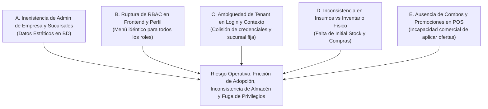
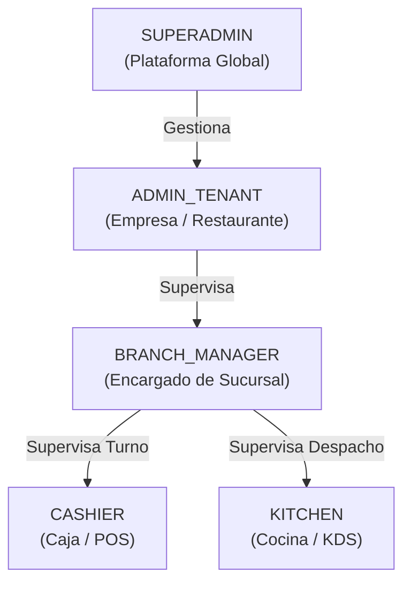
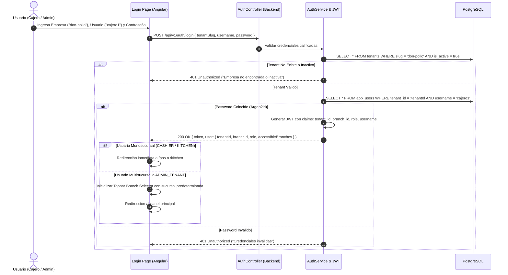
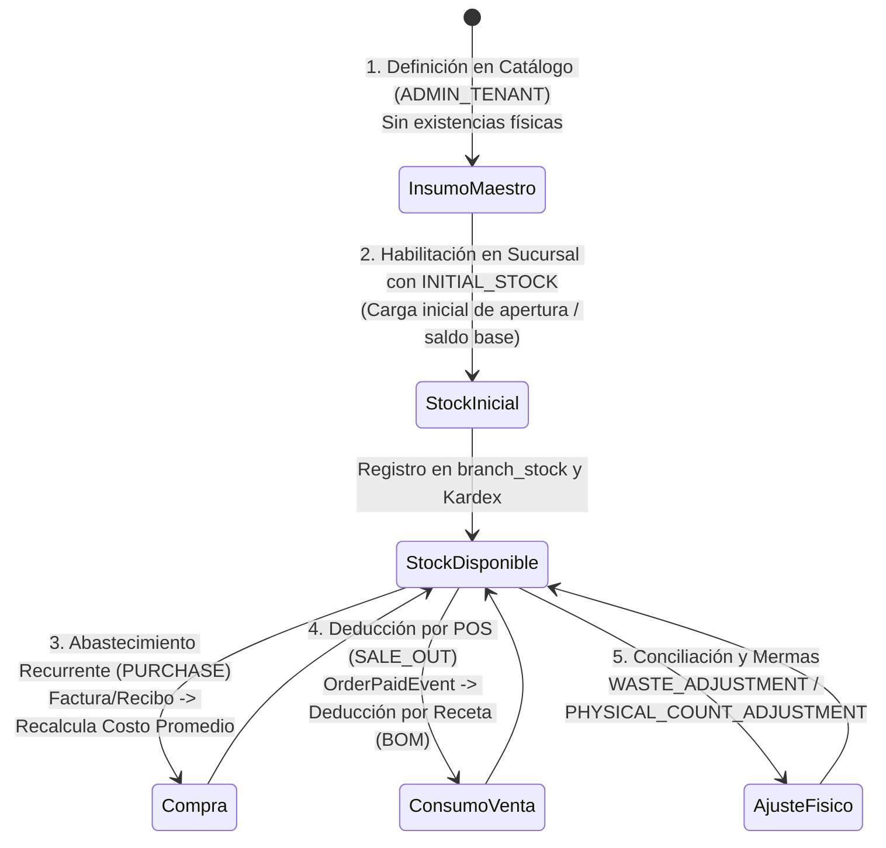
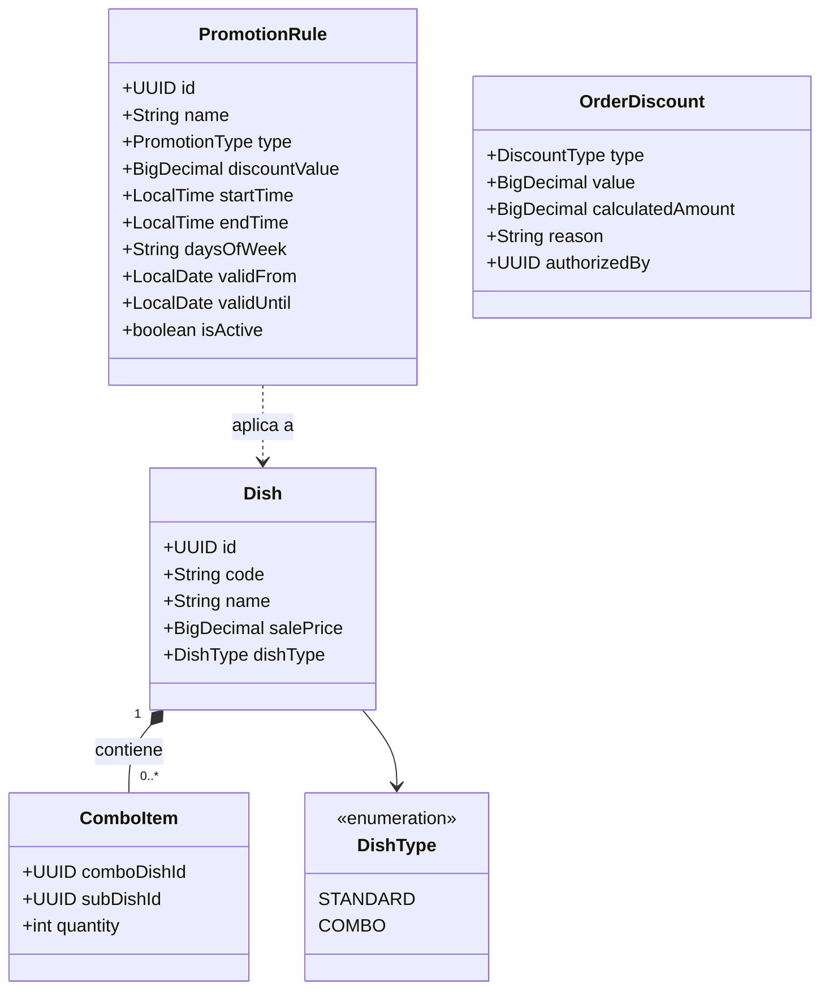
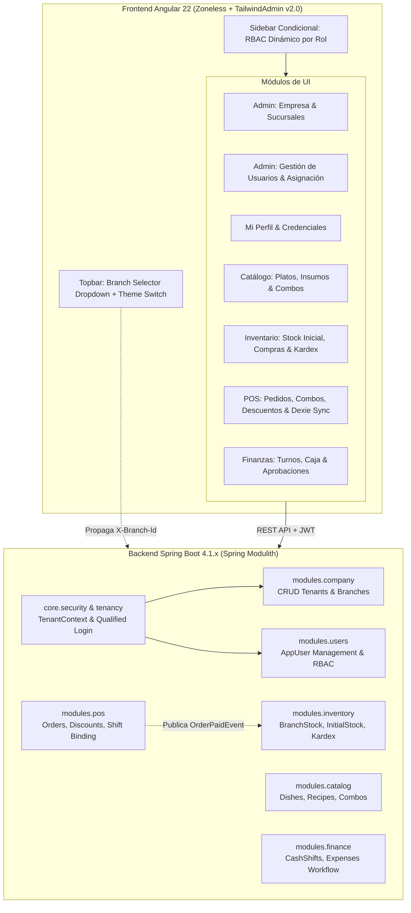

# Retrospectiva Funcional de la Iteración 1 y Análisis de Negocio para Sprint 2
**Proyecto:** Sistema Integral de Gestión para Restaurante (POS + ERP)  
**Documento:** Informe de Retrospectiva Funcional y Propuesta de Arquitectura de Negocio  
**Autor:** Agente Analista de Negocio y Retrospectiva Funcional  
**Destinatario:** Product Owner, Arquitecto de Software y Equipo de Ingeniería  
**Fecha:** Octubre 2026 | **Versión:** 1.0.0  

---

## 1. Resumen Ejecutivo de la Iteración 1

### 1.1 Contraste: Perfil de Proyecto Original vs. Sistema Real Implementado
En el documento fundacional [`docs/project/project_profile.md`](file:///home/jvaca/proyectos/gestion-restaurante/docs/project/project_profile.md), el proyecto se concibió como un monolito web modular orientado a digitalizar la operativa diaria de un restaurante, atacando la pérdida de visibilidad en costos de insumos, la desorganización de tickets y el desconocimiento del stock real.

Durante la **Iteración 1**, el equipo no solo cumplió con los fundamentos técnicos de esta visión, sino que elevó los estándares arquitectónicos para garantizar **resiliencia de grado industrial, alta disponibilidad offline y consistencia contable**. 

| Dimensión | Alcance Declarado en `project_profile.md` | Implementación Real Entregada en Sprint 1 | Nivel de Superación / Brecha |
| :--- | :--- | :--- | :--- |
| **Arquitectura Base** | Monolito Web modular tradicional, PostgreSQL relacional estricto. | Spring Boot 4.1.x con Java 25 LTS, Spring Modulith verificado (`ApplicationModules.verify()`), Virtual Threads de Project Loom habilitados y Flyway. | **Superado:** Cumple aislamiento modular estricto guiado por eventos del dominio sin acoplamiento cruzado de bases de datos. |
| **Punto de Venta (POS)** | Apertura, seguimiento de estados (`WAITING`, `IN_PREPARATION`, `READY`) y cobro de tickets. | POS reactivo en Angular 22 Zoneless con soporte **Offline-First real** respaldado por Dexie.js (IndexedDB), caching de catálogo y turnos, sincronización en segundo plano e idempotencia transaccional mediante `X-Client-Transaction-Id`. | **Superado:** Capacidad de cobrar sin conexión a Internet y reconciliar asíncronamente sin duplicar cobros. |
| **Control de Inventario (Kardex)** | Deducción automática simple de recetas al vender un plato; registro manual de compras y mermas. | Event-Driven Architecture: `OrderPaidEvent` consumido mediante `@ApplicationModuleListener`. Patrón Strategy con 3 modos configurables (`MANUAL_ISOLATED`, `AUTOMATIC_PERMISSIVE`, `AUTOMATIC_STRICT`), costeo promedio ponderado móvil y libro mayor inmutable de movimientos. | **Superado:** Aislamiento transaccional entre POS e Inventario; tolerancia a fallos en caja si el almacén no cuenta con stock según la estrategia del restaurante. |
| **Catálogo y Recetas (BOM)** | Gestión de platos, categorías, precios y recetas con cantidades fijas de ingredientes. | Catálogo maestro desacoplado con soporte de activación y sobreescritura de precios por sucursal (`branch_dishes`) y clonación de platos con receta diferenciada (`cloned_from_id`). | **Superado:** Soporte multi-sucursal nativo desde el catálogo. |
| **Finanzas y Egresos** | Registro de gastos fijos prorrateados y gastos diarios para estimar punto de equilibrio. | Módulo de Turnos de Caja Chica (`cash_shifts`), arqueo en tiempo real (efectivo esperado vs real vs diferencia), workflow de aprobación de gastos (`PENDING_APPROVAL`, `APPROVED`, `REJECTED`) con soporte de comprobante digital (`evidence_url`). | **Alineado:** Cobertura exhaustiva del flujo de efectivo en caja. |
| **Analítica y Dashboard** | Panel de utilidad neta diaria, platos más vendidos y punto de equilibrio. | No implementado en Sprint 1. Pospuesto formalmente para Sprint 3. | **Pospuesto con justificación:** Se priorizó la robustez transaccional y la gobernanza operativa. |

---

### 1.2 Justificación Formal del Descarte de Analítica / Dashboard para el Sprint 2
Originalmente se proyectaba abordar el Módulo 5 (Analítica y Dashboard) inmediatamente tras las funciones base. No obstante, en alineación con el usuario y la dirección técnica, **se descarta formalmente el desarrollo de dashboards analíticos para el Sprint 2**.

Las razones de negocio y arquitectura que sustentan esta decisión son contundentes:

1. **Principio de Calidad de Datos (*Garbage In, Garbage Out*):**  
   Un dashboard de rentabilidad calcula la ecuación:  
   $$\text{Utilidad Neta Real} = \text{Ventas} - \text{Costo Real de Insumos (Kardex)} - \text{Gastos Operativos}$$  
   Si las sucursales aún no cuentan con un ciclo formal de registro de inventario inicial (`INITIAL_STOCK`), módulo de compras a proveedores (`purchases`) y conciliación física de mermas, el costo de recetas y la valorización de stock serán ficticios. Presentar métricas financieras sobre datos operativamente incompletos induce a errores graves en la toma de decisiones del dueño del restaurante.
2. **Confidencialidad y Fuga de Información por Falta de RBAC:**  
   En la versión actual del frontend, todos los usuarios comparten la misma navegación. Un panel de analítica expondría la utilidad neta de la empresa, los márgenes de ganancia y el rendimiento financiero a cajeros y cocineros, violando principios elementales de control interno y privacidad corporativa.
3. **Omisión de Descuentos y Promociones en los Ingresos Reales:**  
   En el negocio gastronómico, un alto porcentaje del volumen de ventas depende de promociones ("2x1", "Happy Hour"), combos y descuentos de cortesía o fidelización. Sin un motor de promociones en POS, los reportes de ventas no reflejarían la realidad comercial de las cajas.
4. **Priorización de la Gobernanza Operativa:**  
   Para que un restaurante opere en el mundo real, es un requisito bloqueante poder crear sucursales, dar de alta usuarios con sus respectivos roles, calificar el login por empresa y permitir la alternancia fluida de sucursales en pantalla.

> [!IMPORTANT]
> **Decisión Estratégica:** El Sprint 2 debe consolidar la **Gobernanza Administrativa, Control de Acceso (RBAC), Autenticación Calificada, Ciclo de Abastecimiento de Insumos y Motor de Promociones en POS**. El Dashboard de Analítica se implementará en el Sprint 3 sobre cimientos de datos 100% fidedignos y seguros.

---

## 2. Diagnóstico Crítico de Brechas Operativas y de Negocio

A partir de las pruebas funcionales de la Iteración 1 y el análisis de la interacción real del usuario, se identificaron **cinco brechas críticas** que comprometen la viabilidad de puesta en producción del sistema:



---

### 2.1 Eje A: Falta de Administración de Empresa y Sucursales

#### Diagnóstico del Estado Actual
Actualmente, las entidades `tenants` y `branches` existen únicamente porque se precargan mediante semillas SQL o migraciones de base de datos (`V1__init_schema.sql`). No existe interfaz de usuario ni endpoints REST para que un cliente configure su restaurante o expanda sus operaciones creando nuevos locales comerciales.

```
Base de Datos Actual:
[tenants] <--- [branches] (Creados manualmente por script SQL)
Sin formularios, sin gestión de zonas horarias, sin activación/desactivación dinámica.
```

#### Requerimientos Funcionales y Perfiles Administrativos
Para habilitar una solución SaaS y auto-administrable, se deben estructurar dos niveles jerárquicos de gestión:

1. **Nivel SUPERADMIN (Operador SaaS de la Plataforma):**
   - **Gestión Global de Tenants:** Alta de nuevas empresas cliente, asignación de identificador único (`slug` alfanumérico, ej: `don-pollo`, `pastas-luigi`), razón social, NIT/RUT, correo de contacto y cupo máximo de sucursales contratadas.
   - **Gobernanza de Suscripciones:** Activación, suspensión o desactivación de tenants por morosidad o fin de contrato.
   - **Alta del Primer Administrador:** Creación del usuario con rol `ADMIN_TENANT` para la empresa.

2. **Nivel ADMIN_TENANT (Dueño / Gerente General de la Empresa):**
   - **Perfil de Empresa ("Mi Restaurante"):** Edición de razón social, nombre comercial, NIT, logo institucional para impresión de comandas y moneda de curso legal (símbolo, decimales).
   - **Administración de Sucursales (CRUD Completo):**
     - Creación de nuevas sucursales: Nombre (ej: "Sucursal Miraflores", "Express Mall"), dirección fiscal y física, teléfono de contacto.
     - **Configuración de Huso Horario IANA Obligatorio:** Asignación del huso horario (`America/La_Paz`, `America/Lima`, etc.) conforme a [`ADR-0006`](file:///home/jvaca/proyectos/gestion-restaurante/docs/adr/0006_datetime_and_timezone_handling.md) para el cómputo exacto de cierres de turno y ventas del día.
     - **Estado Operativo:** Interruptor de activación/desactivación de la sucursal (cierre temporal por refacción o clausura) que impide inicios de turno o cobros mientras esté inactiva.
     - **Inicialización Automática:** Al crear una sucursal, el sistema debe registrar en segundo plano sus `branch_settings` por defecto (ej: modo de inventario heredado del tenant).

---

### 2.2 Eje B: Control de Acceso y RBAC por Rol

#### Evaluación Exhaustiva de los 5 Roles del Sistema



| Rol | Alcance de Negocio | Permisos Permitidos | Restricciones Inviolables |
| :--- | :--- | :--- | :--- |
| **`SUPERADMIN`** | Plataforma Multi-Tenant Global. No opera restaurantes. | CRUD de tenants, asignación de licencias, auditoría global del sistema. | Prohibido registrar ventas, abrir turnos de caja chica o alterar recetas. |
| **`ADMIN_TENANT`** | Empresa completa (Todas las sucursales). | CRUD de sucursales, administración de usuarios y asignación de sedes, catálogo maestro (platos e insumos), parametrización global de deducción Kardex, consulta de reportes consolidados. | Prohibido operar en nombre de otra empresa cliente. |
| **`BRANCH_MANAGER`** | Sucursal asignada exclusivamente. | Carga de stock inicial, recepción de compras locales a proveedores, ajustes de merma y conteo físico, sobreescritura de precios locales en platos maestros (`branch_dishes`), aprobación de gastos de caja chica (`expenses`), supervisión de turnos locales. | Prohibido crear nuevos platos en el catálogo maestro corporativo o ver datos de otras sucursales sin autorización. |
| **`CASHIER`** | Puesto de venta en sucursal y turno activo. | Apertura y cierre de su turno de caja (`cash_shifts`), registro y cobro de tickets en POS, solicitud de egresos menores de caja chica (`expenses`), anulación de tickets propios previa validación. | **Prohibido ver costos de insumos, fórmulas de recetas (BOM), catlogos de proveedores o utilidades del restaurante.** |
| **`KITCHEN`** | Pantalla de comandas en cocina (KDS). | Visualización de tickets en cola (`WAITING`, `IN_PREPARATION`), cambio de estado de preparación y despacho de platos (`READY`, `DELIVERED`). | **Prohibido acceso a montos de dinero, cobros, cierres de caja, costos o gestión de usuarios.** |

#### Falla Crítica en el Frontend Actual
Al revisar [`frontend/src/app/app.component.html`](file:///home/jvaca/proyectos/gestion-restaurante/frontend/src/app/app.component.html#L16-L55) y [`frontend/src/app/app.routes.ts`](file:///home/jvaca/proyectos/gestion-restaurante/frontend/src/app/app.routes.ts#L22-L45), se constata que:
- El menú lateral muestra idénticas opciones (`/pos`, `/catalog`, `/inventory`, `/finance`) para cualquier usuario que inicie sesión, sea un cajero, un cocinero o el dueño.
- El archivo de rutas únicamente aplica `canActivate: [authGuard]`, sin verificar roles (`roleGuard`). Un cajero puede escribir `/finance` en la barra del navegador e ingresar a la pantalla de finanzas de la empresa.

#### Solución de Arquitectura Frontend para RBAC
1. **Navegación Condicional en Sidebar:**
   - Crear una estructura de ítems de menú tipada con matriz de roles permitidos:
     ```typescript
     export interface NavItem {
       label: string;
       icon: string;
       route: string;
       allowedRoles: Role[];
     }
     ```
   - Filtrar reactivamente el menú mediante `computed()` conectado a `authService.currentUser()`.
2. **Guards de Ruta Estrictos (`roleGuard`):**
   - Configurar cada ruta con metadata:  
     `canActivate: [authGuard, roleGuard], data: { roles: ['ADMIN_TENANT', 'BRANCH_MANAGER'] }`.
   - Si el usuario carece del rol, se le redirige automáticamente a su zona de trabajo autorizada (ej. `/pos`) con una alerta visual de acceso denegado.
3. **Gestión de Usuarios por el `ADMIN_TENANT`:**
   - Pantalla administrativa con tabla de usuarios de la empresa:
     - Formulario de creación: Nombres, Apellidos, `username`, `email` (opcional), contraseña temporal, Rol asignable (`BRANCH_MANAGER`, `CASHIER`, `KITCHEN`) y **Sucursal de Adscripción** (con selector desplegable de las sucursales del tenant).
     - Desactivación de cuentas (baja de personal sin borrado físico para preservar la integridad de claves foráneas en auditorías y pedidos).
4. **Vista "Mi Perfil" y Humanización de Identidad:**
   - **Eliminación de Códigos Crudos:** En lugar de mostrar `ADMIN_TENANT` o `CASHIER` en el footer del Sidebar, se debe utilizar un diccionario de presentación:
     - `SUPERADMIN` $\rightarrow$ *"Administrador Global"*
     - `ADMIN_TENANT` $\rightarrow$ *"Administrador de Empresa"*
     - `BRANCH_MANAGER` $\rightarrow$ *"Gerente de Sucursal"*
     - `CASHIER` $\rightarrow$ *"Cajero / Atención"*
     - `KITCHEN` $\rightarrow$ *"Personal de Cocina"*
   - **Datos Personales:** Mostrar Nombre y Apellido real del colaborador junto a su nombre de usuario.
   - **Autogestión de Credenciales:** Permitir al usuario cambiar su propia contraseña (ingresando la contraseña actual y la nueva contraseña con confirmación) y alternar sus preferencias visuales de tema (Claro / Oscuro).

---

### 2.3 Eje C: Flujo de Autenticación y Contexto de Sucursal

#### La Trampa de la No-Calificación de Tenant en el Login
En el esquema de base de datos [`V1__init_schema.sql`](file:///home/jvaca/proyectos/gestion-restaurante/backend/src/main/resources/db/migration/V1__init_schema.sql#L72), la unicidad del nombre de usuario está delimitada por empresa:
```sql
CONSTRAINT uq_user_tenant_username UNIQUE (tenant_id, username)
```
Esto significa que dos restaurantes distintos (ej: "Pizzería Nápoles" y "Hamburguesas BurgerKing") pueden tener legítimamente un empleado con el nombre de usuario `cajero1` o `admin`.

Sin embargo, al examinar la implementación actual de autenticación en [`AuthService.java`](file:///home/jvaca/proyectos/gestion-restaurante/backend/src/main/java/com/restaurant/app/core/security/AuthService.java#L29-L30):
```java
AppUser user = appUserRepository.findByUsernameOrEmail(login)
    .orElseThrow(() -> new BadCredentialsException("Credenciales inválidas"));
```
El backend busca al usuario por nombre sin conocer a qué empresa pertenece. Esto desencadena un **fallo sistémico crítico**:
- Si dos empresas tienen un usuario `cajero1`, la consulta `findByUsernameOrEmail` falla con `NonUniqueResultException` de JPA (HTTP 500) o autentica al usuario equivocado en el restaurante de la competencia.

#### Solución: Autenticación Calificada con Identificador de Tenant
El formulario de login debe incorporar de forma obligatoria el identificador del restaurante:
- **Opción Primaria (Campo de Entrada en UI):** El usuario ingresa tres datos:
  1. **Empresa / Código:** Slug corporativo o NIT (ej: `don-pollo` o `1020304050`).
  2. **Usuario:** `cajero1` o correo electrónico.
  3. **Contraseña:** Clave secreta.
- **Opción Alternativa (Multi-Tenant por Subdominio):** Si se accede desde `donpollo.restaurante.com`, el frontend extrae automáticamente el slug `donpollo` y no solicita el campo.



#### Experiencia Post-Login y Selector Contextual de Sucursal en Topbar
Actualmente, el Topbar en [`app.component.html`](file:///home/jvaca/proyectos/gestion-restaurante/frontend/src/app/app.component.html#L90) contiene un texto estático quemado:
```html
<span class="font-semibold text-link dark:text-white">Central La Paz</span>
```
Esto impide cualquier operación multi-sucursal en el frontend. El comportamiento debe rediseñarse de la siguiente manera:

1. **Usuarios Monosucursal (`CASHIER`, `KITCHEN`, `BRANCH_MANAGER` local):**
   - El Topbar muestra la insignia de su sucursal fija asignada como etiqueta informativa (sin menú desplegable).
   - El usuario no puede cambiarse de sucursal porque sus transacciones pertenecen estrictamente a su espacio de trabajo asignado.
2. **Usuarios Multisucursal y `ADMIN_TENANT`:**
   - El Topbar renderiza un **Selector Desplegable de Sucursal (Dropdown)** estilizado en TailwindAdmin v2.0.
   - Muestra la lista de sucursales activas de la empresa.
   - Al seleccionar otra sucursal:
     - Se actualiza la `Signal` de `activeBranch` en el `BranchContextService`.
     - Se propaga la cabecera `X-Branch-Id` en las peticiones HTTP del interceptor.
     - Se recargan automáticamente las listas de catálogo, stock de inventario, comandas y turnos de caja sin forzar al usuario a cerrar e iniciar sesión.

---

### 2.4 Eje D: Ciclo de Vida Coherente de Insumos e Inventario

#### Inconsistencia Detectada en Sprint 1
En la arquitectura actual del módulo de Catálogo ([`modules.catalog`](file:///home/jvaca/proyectos/gestion-restaurante/backend/src/main/java/com/restaurant/app/modules/catalog)), el insumo se registra en la tabla `ingredients` con atributos maestros: nombre, unidad de medida (`KG`, `GRAM`, `LITER`, `ML`, `UNIT`) y umbral de alerta de stock mínimo.

Este insumo es **abstracto y corporativo**: representa el concepto de "Carne de Res" o "Aceite Vegetal" para toda la empresa, por lo que **no posee existencias físicas en sí mismo**. Las existencias físicas residen únicamente en los almacenes de cada sucursal (`branch_stock`).

Sin embargo, en el sistema actual:
- Al crear un insumo en el catálogo maestro, ninguna sucursal lo tiene formalmente habilitado en su almacén físico.
- Cuando una sucursal consulta su inventario, la tabla `branch_stock` no tiene fila creada o aparece vacía, obligando a realizar ajustes de saldo mediante operaciones confusas.
- En la interfaz no está diferenciado el acto de **dar de alta el stock inicial** de una **compra recurrente** a un distribuidor o de una **merma operativa**.

#### Ciclo de Vida Estandarizado de Insumos
El flujo de inventario se debe estructurar en cinco etapas bien delimitadas:



#### Reglas de Negocio para el Ciclo de Vida:
1. **Paso 1: Catálogo Maestro (Central):**  
   El `ADMIN_TENANT` define `Pechuga de Pollo`, Unidad: `KG`, Alerta Mínima: `5.0`. No afecta ningún Kardex.
2. **Paso 2: Asignación e Inicialización (`INITIAL_STOCK`):**  
   Al abrir una nueva sucursal o comenzar a utilizar un insumo en ella, el encargado registra el **Stock Inicial**.  
   - Requiere: Cantidad inicial física y Costo unitario de apertura.  
   - Genera movimiento Kardex inmutable: `INITIAL_INVENTORY`.  
   - Crea el registro en `branch_stock` con `current_quantity = Q` y `average_unit_cost = C`.  
   - **Regla de integridad:** Solo se permite registrar `INITIAL_STOCK` una única vez por insumo y sucursal. Los movimientos posteriores deben ser compras o ajustes.
3. **Paso 3: Abastecimiento por Compras (`PURCHASE`):**  
   - Módulo formal de Compras donde se registran facturas/recibos de proveedores (`purchases` y `purchase_items`).  
   - Incrementa el stock disponible y actualiza el costo unitario promedio ponderado mediante la fórmula:  
     $$\bar{C}_{\text{nuevo}} = \frac{(Q_{\text{actual}} \times \bar{C}_{\text{actual}}) + (Q_{\text{comprada}} \times C_{\text{compra}})}{Q_{\text{actual}} + Q_{\text{comprada}}}$$  
   - Genera movimiento Kardex: `PURCHASE_IN`.
4. **Paso 4: Consumo por Venta (`SALE_OUT`):**  
   - Al cobrar un ticket en POS, el evento `OrderPaidEvent` desencadena la deducción automática por receta según la estrategia (`AUTOMATIC_PERMISSIVE` o `AUTOMATIC_STRICT`).  
   - Genera movimientos Kardex: `SALE_OUT`.
5. **Paso 5: Conciliación y Mermas:**  
   - **Merma (`WASTE_ADJUSTMENT`):** Salida justificada por descomposición, rotura, vencimiento o mala manipulación de insumos. Disminuye el stock y computa el costo total de la pérdida.  
   - **Conteo Físico (`PHYSICAL_COUNT_ADJUSTMENT`):** Ajuste de auditoría periódica donde el conteo real reemplaza al teórico, registrando la diferencia (positiva o negativa) con nota del auditor.

---

### 2.5 Eje E: Motor de Promociones, Combos y Descuentos en POS

#### Necesidad de Negocio
Un restaurante no vende únicamente platos individuales a precio de lista. Estrategias comerciales esenciales como combos familiares, descuentos para empleados, cupones publicitarios y promociones por horario ("Happy Hour") son los principales motores de facturación. En Sprint 1, el POS solo permite agregar platos simples a su precio base.

#### Requerimientos del Motor Comercial para Sprint 2



1. **Gestión de Combos y Menús Compuestos (Packs):**
   - **Entidad Combo:** Un combo es un plato con `dish_type = 'COMBO'`.
   - **Composición del Combo (`combo_items`):** Se compone de múltiples platos o sub-recetas (ejemplo: "Combo Almuerzo" = 1 "Sopa del Día" + 1 "Plato Fuerte" + 1 "Refresco 500ml").
   - **Deducción Transparente en Kardex:**  
     Cuando POS vende un combo, el listener de inventario resuelve recursivamente los ingredientes de cada sub-plato contenido en el combo y deduce las cantidades exactas de todos los ingredientes en una única transacción atómica.
2. **Descuentos Directos en Ticket:**
   - **Tipos de Descuento:**
     - **Porcentual (%):** Reducción de un porcentaje sobre el subtotal de la comanda (ej: 10% de descuento por convenio).
     - **Monto Fijo ($ / Bs.):** Rebaja de un monto monetario específico sobre el total (ej: Bs. 15 de descuento).
   - **Gobernanza y Autorizaciones:**
     - Los cajeros tienen un límite máximo de descuento autónomo configurable (ej: hasta 5%).
     - Descuentos superiores o cortesías al 100% exigen ingreso de credencial o PIN de autorización del `BRANCH_MANAGER`.
     - Registro obligatorio del motivo del descuento (`reason`: Cortesía, Empleado, Convenio, Queja de Calidad).
3. **Promociones Temporales Automatizadas (Happy Hour / Fechas Especiales):**
   - Parametrización de reglas:
     - Vigencia por calendario: Fecha inicio y fin (ej: campaña navideña).
     - Vigencia semanal y horaria: Días específicos (ej: Martes y Jueves) y ventana horaria (ej: 17:00 a 20:00).
   - **Cálculo Local de Hora Sucursal (ADR-0006):** La comprobación horaria se evalúa contra la zona horaria local de la sucursal (`branches.timezone`), evitando discrepancias por servidores alojados en UTC.
   - Si la orden se abre dentro de la ventana de la promoción, el POS aplica automáticamente el precio de oferta o el descuento promocional en la comanda.
4. **Cupones de Descuento:**
   - Creación de códigos alfanuméricos promocionales (ej: `BIENVENIDO2026`).
   - Restricciones: Límite máximo de usos globales, consumo mínimo en ticket, vigencia y exclusión de platos en oferta.

---

## 3. Propuesta de Arquitectura Funcional y Roadmap para Sprint 2

### 3.1 Arquitectura de Módulos Objetivo (Spring Modulith + Angular 22)



---

### 3.2 Matriz Comparativa de Casos de Uso Propuestos para Sprint 2

| ID | Épica | Caso de Uso | Complejidad | Dependencias | Impacto de Negocio | Prioridad Sugerida |
| :---: | :--- | :--- | :---: | :--- | :--- | :---: |
| **UC-201** | **Seguridad & Tenancy** | **Login Calificado por Tenant:** Formulario de login solicitando identificador de empresa (`slug`/NIT), usuario y contraseña con resolución inequívoca de `tenant_id`. | Media | `core.security` | **Crítico:** Evita colisiones de usuarios entre restaurantes distintos y bloquea accesos no autorizados. | **P0 (Bloqueante)** |
| **UC-202** | **Seguridad & RBAC** | **Navegación Condicional y Route Guards:** Sidebar reactivo según rol del usuario y `roleGuard` protegiendo rutas sensibles (`/finance`, `/inventory`, `/company`). | Baja | UC-201 | **Alto:** Asegura confidencialidad operativa y previene acceso indebido a información financiera. | **P0 (Bloqueante)** |
| **UC-203** | **Empresa & Sedes** | **CRUD de Empresa y Sucursales:** Gestión de razón social, NIT, huso horario local de sucursal, teléfonos y estado operativo de locales. | Media | UC-201 | **Alto:** Permite a la empresa autogestionar su red de locales comerciales sin soporte técnico de BD. | **P0 (Bloqueante)** |
| **UC-204** | **Seguridad & Perfil** | **Gestión de Personal y 'Mi Perfil':** Alta de usuarios con asignación de rol y sucursal; pantalla "Mi Perfil" con nombres humanizados y cambio de contraseña. | Media | UC-202, UC-203 | **Alto:** Facilita la administración de empleados y otorga autonomía para gestionar credenciales. | **P1 (Alta)** |
| **UC-205** | **Contexto Operativo** | **Selector Contextual de Sucursal en Topbar:** Dropdown interactivo para usuarios multisucursal/admin que conmuta el contexto de trabajo en vivo. | Media | UC-203 | **Alto:** Permite a gerentes y dueños supervisar y operar múltiples sucursales con fluidez. | **P1 (Alta)** |
| **UC-206** | **Inventario & Stock** | **Alta de Stock Inicial de Sucursal (`INITIAL_STOCK`):** Habilitación explícita de insumos en la sucursal con saldo base y costo unitario de apertura en Kardex. | Media | UC-203, Catálogo | **Alto:** Garantiza coherencia entre catálogo maestro y existencias reales en cada almacén. | **P1 (Alta)** |
| **UC-207** | **POS & Promociones** | **Descuentos Directos y Cupones en POS:** Aplicación de rebajas porcentuales o de monto fijo en ticket, validando límite autónomo o PIN supervisor. | Media | `modules.pos` | **Medio-Alto:** Otorga flexibilidad comercial en el cobro y fidelización de clientes. | **P1 (Alta)** |
| **UC-208** | **Catálogo & POS** | **Gestión y Venta de Combos (Packs):** Definición de platos compuestos en catálogo y deducción recursiva de ingredientes en Kardex tras cobro en POS. | Alta | UC-206, `modules.pos` | **Alto:** Habilita el formato de venta de combos, esencial en cadenas gastronómicas. | **P2 (Deseable)** |
| **UC-209** | **POS & Precios** | **Reglas de Promociones Temporales (Happy Hour):** Activación de precios de oferta por día de la semana y ventana horaria local de la sucursal. | Alta | UC-205, UC-207 | **Medio:** Automatiza campañas comerciales sin intervención manual del cajero. | **P2 (Deseable)** |

---

### 3.3 Recomendaciones de UX/UI en TailwindAdmin v2.0 para los Nuevos Módulos

El sistema visual del frontend fue refactorizado exitosamente a **TailwindAdmin v2.0** en la Tarea TASK-010. Para preservar la consistencia y profesionalismo visual en los nuevos módulos del Sprint 2, se establecen las siguientes pautas de diseño:

```
+----------------------------------------------------------------------------------------------------+
|  [R] Restaurante Don Pollo       | Sucursal: [ Central La Paz  ▼ ] | [Zoneless v22] [🌙 Modo Oscuro] |
+----------------------------------+---------------------------------+--------------------------------+
| OPERACIONES                      |                                                                  |
| [💳] Punto de Venta (POS)        |  📦 Inventario de Sucursal                                       |
|                                  |  +------------------------------------------------------------+  |
| GESTIÓN SUCURSAL                 |  | [🏷️ Insumos: 24]    [💰 Valuación: Bs. 4,520]  [⚠️ Alertas: 2] |  |
| [📦] Inventario y Stock          |  +------------------------------------------------------------+  |
| [💰] Caja y Finanzas             |                                                                  |
|                                  |  [ + Habilitar Stock Inicial ]   [ + Registrar Compra ]          |
| ADMINISTRACIÓN (Sólo Admins)     |  +------------------------------------------------------------+  |
| [🏢] Empresa & Sucursales        |  | Insumo        | UoM | Stock Actual | Costo Prom. | Estado   |  |
| [👥] Usuarios & Personal         |  | Pechuga Pollo | KG  | 25.40        | Bs. 18.50   | [Normal] |  |
|                                  |  +------------------------------------------------------------+  |
| 👤 Carlos Mendoza (Gerente) [Salir]                                                                 |
+----------------------------------------------------------------------------------------------------+
```

#### 1. Topbar: Selector Contextual de Sucursal
- **Ubicación:** Extremo izquierdo del Topbar, junto al indicador de marca.
- **Componente:** Menú desplegable (`dropdown`) con avatar con iniciales de la sucursal, badge indicador de estado operativo (verde para *"Abierta"*, rojo para *"Cerrada/Inactiva"*) y flecha chevron animada.
- **Feedback:** Al seleccionar una nueva sucursal, una microanimación de carga (*skeleton loading* o *spinner* sutil en la esquina superior) informa la sincronización del nuevo contexto.

#### 2. Sidebar: Agrupación de Navegación por Perfil
Organizar las opciones del menú lateral en tres bloques con encabezados de categoría (`.caption`):
1. **Operaciones Diarias:** `Punto de Venta (POS)` *(Visible para Cajeros, Gerentes y Administradores)*.
2. **Gestión de Sucursal:** `Inventario y Kardex`, `Caja y Finanzas` *(Visible para Encargados y Administradores)*.
3. **Administración Corporativa:** `Catálogo y Recetas`, `Empresa y Sucursales`, `Usuarios y Personal` *(Visible exclusivamente para Administradores de Empresa)*.

#### 3. Ventana Modal de "Stock Inicial"
- Para resolver la confusión operativa de insumos, crear un modal guiado con estilo TailwindAdmin:
  - Selector del insumo maestro abstracto del catálogo.
  - Campos claros: *Cantidad de Apertura* y *Costo Unitario de Adquisición*.
  - Alerta informativa en tono `lightprimary`: *"Esta acción registra la existencia inicial para esta sucursal y apertura su libro mayor en Kardex."*

#### 4. Carrito de POS: Descuentos y Promociones Visibles
- Incorporar una sección colapsable al pie del carrito de compras:
  - Botón interactivo: `[ % Aplicar Descuento / Cupón ]`.
  - Desglose transparente en el resumen de cobro:
    - `Subtotal: Bs. 120.00`
    - `Descuento (Cupón 10%): - Bs. 12.00` *(En color `.text-error` o `.text-primary`)*
    - **`Total a Pagar: Bs. 108.00`** *(En `.text-link` destacado)*
  - Si el descuento supera el umbral permitido para cajeros, se despliega automáticamente un modal seguro de validación: *"Se requiere autorización de supervisor"* solicitando el PIN del `BRANCH_MANAGER`.

#### 5. Vista "Mi Perfil" y Badges de Rol Humanizados
- Diseñar una tarjeta de perfil dentro de una vista accesible desde el avatar del usuario:
  - Presentación de credenciales con badges temáticos de TailwindAdmin:
    - Administrador de Empresa $\rightarrow$ `<span class="bg-lightprimary text-primary font-semibold">`
    - Gerente de Sucursal $\rightarrow$ `<span class="bg-lightsecondary text-secondary font-semibold">`
    - Cajero $\rightarrow$ `<span class="bg-lightsuccess text-success font-semibold">`
    - Cocina $\rightarrow$ `<span class="bg-lightwarning text-warning font-semibold">`
  - Formulario de actualización de contraseña con validación reactiva de fortaleza y confirmación visual instantánea.

---

## 4. Conclusiones y Próximos Pasos

### Conclusiones Principales
1. **Éxito Técnico en la Base:** La Iteración 1 dotó al sistema de una arquitectura sumamente sólida: monolito modular verificado, concurrencia con Virtual Threads, operación offline-first con Dexie.js y deducción desacoplada por eventos.
2. **Brecha de Usabilidad y Gobernanza:** El sistema actual opera como si existiera un único restaurante estático y un único tipo de usuario. No es posible salir a producción sin resolver la calificación de empresas en el login, el control de acceso en la interfaz y la administración dinámica de sucursales.
3. **Validación de la Decisión de Analítica:** Posponer el Dashboard para el Sprint 3 es la decisión técnica y comercialmente correcta. Permitirá construir visualizaciones ejecutivas sobre datos contables y comerciales íntegros.

### Hoja de Ruta Inmediata para el Inicio del Sprint 2
1. **Aprobación de la Propuesta de Negocio:** Acordar con el Product Owner y el equipo las prioridades definidas en la Matriz de Casos de Uso (foco en P0 y P1).
2. **Definición de Especificaciones Técnicas (SDDs):** Elaborar el diseño de base de datos para la ampliación del login calificado (`tenant_slug`), la tabla de relaciones de usuario-sucursal y las tablas de combos y promociones.
3. **Inicio de Implementación por Ramas:** Comenzar la ejecución atómica de tareas en Git (`feat/security-qualified-login`, `feat/rbac-frontend-guards`, `feat/company-branches-crud`), manteniendo la regla de 100% de tests pasando y verificación de módulos con Spring Modulith.
